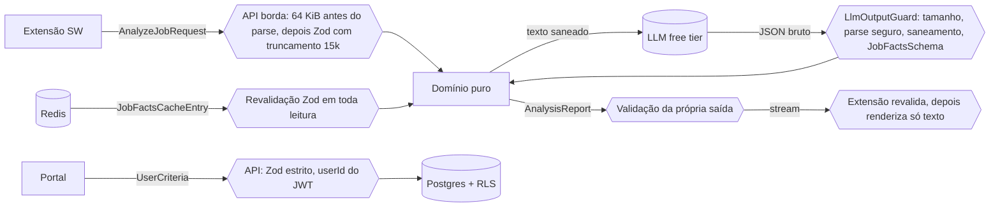

# Contratos Zod: `@trampo/contracts` (v1)

> [!info] Status: **Aceito** em 2026-10-18 (*HITL-QUEUE §HITL-001*).
> **Verificado de forma empírica em 2026-10-17:** o código abaixo compila em **TypeScript 5.9.3** com `strict`, `noUncheckedIndexedAccess`, `exactOptionalPropertyTypes` e `verbatimModuleSyntax`, contra **zod 4.6.7**. Passa em **21/21 testes adversariais** (seção 6). O texto deste documento foi gerado a partir dos mesmos arquivos testados, então o código daqui é o código que passou nos testes.
> **M3 concluída (2026-10-18):** a seção 4 foi extraída deste documento por script e gravada em `packages/contracts/src/`. Ela é **idêntica, byte a byte**, ao código verificado em 2026-10-17, incluindo os 22 code points invisíveis literais das regexes. O pacote roda no Vitest 5.0.5 com zod 4.6.7 (38 testes, cobertura de 100%). **Daqui em diante, a fonte da verdade do código é o pacote.** Este documento explica as decisões, e qualquer mudança de contrato atualiza os dois.
> **DOC-01 (2026-10-27):** a seção 4 ficou parada na M3 enquanto 4 commits mudavam o pacote (seção 9). Ela foi **regerada por script a partir de `packages/contracts/src/`** no HEAD `bdcbd68` (último commit de contrato: `1cbf825`). A comparação depois da gravação deu os 8 arquivos idênticos byte a byte, ignorando só o CRLF do checkout no Windows. Hoje o pacote tem 7 arquivos de teste, **91 testes** e cobertura de 100%, ainda com TypeScript 5.9.3, zod 4.6.7 e Vitest 5.0.5. Daqui em diante, o commit que muda o contrato atualiza a seção 4 e a seção 9 na mesma tarefa.
> **F1-AUTH-00 (2026-11-06):** o commit `47abd8c` acrescentou o `auth.ts` (contratos do BFF de autenticação da extensão, [ADR-004-extension-auth](ADRs/ADR-004-extension-auth.md) D7) e o `ACCESS_TOKEN_MAX_CHARS` no fim do `limits.ts` ([ADR-013-jwt-verification](ADRs/ADR-013-jwt-verification.md) D3). A seção 4 foi **regerada por script a partir de `packages/contracts/src/`**: o `auth.ts` entrou como 4.8, e o `index.ts` virou 4.9. A comparação depois da gravação deu os 9 arquivos idênticos byte a byte, ignorando só o CRLF do checkout. Hoje o pacote tem 8 arquivos de teste, **656 testes** e cobertura de 100%, sem dependência nova.

---

## 1. Princípios do contrato

| # | Princípio | Por quê |
|---|---|---|
| P1 | **Fonte única:** todo tipo é `z.infer`/`z.input`/`z.output` de um schema. Não existe `interface` paralela. | Tipo sem schema só existe em compilação, e a API valida em runtime de qualquer forma (Blueprint §4.5, D7). |
| P2 | **Contrato é forma, não regra.** Pesos, penalidades, teto de deal-breaker e faixas de veredito **não** aparecem aqui. | O pacote é importado pela extensão, e regra de avaliação no cliente viola AGENTS.md §1.2 e a Regra 2 de engajamento. |
| P3 | **Estrito por padrão:** `z.strictObject` em tudo que cruza fronteira de confiança. | Chave desconhecida significa tentativa de injeção ou de *mass assignment* (OWASP API3:2023 BOPLA) e é rejeitada. |
| P4 | **Fechado por padrão:** enum em vez de texto livre sempre que o domínio permitir. | Limita o que uma prompt injection consegue distorcer (Blueprint §2). |
| P5 | **Todo texto que a API emite é `safeText`:** sem caracteres invisíveis/controle, sem `<`/`>`, sem nada parecido com link. | Defesa em profundidade contra XSS e phishing pelo relatório (D8, Ameaça 1). |
| P6 | **Ausência explícita:** `null` ou `[]` significam "não informado", que é diferente de "não atende". | Blueprint §2: salário omitido gera alerta, não zera a nota. |
| P7 | **Regex linear e sem estado:** sem quantificadores aninhados e sem flags `g`/`y`. | Anti-ReDoS (entrada de até 64 KiB controlada pelo atacante) e sem bug de `lastIndex`. |
| P8 | **Versionado:** todo documento de topo tem `schemaVersion: z.literal(n)`. | Evolução sem quebra silenciosa (seção 8). |
| P9 | **"Caractere" significa code point.** Desde o zod 4.5, `.min()/.max()` de string contam code points (um emoji conta 1). O truncamento (`truncateCodePoints`) usa a mesma unidade e troca surrogates órfãos por U+FFFD. | Extensão, portal e API contam igual. Metades de surrogate não se recombinam em Tag characters depois de uma remoção. |
| P10 | **zod fixado em versão exata** (hoje 4.6.7) no `catalog:` do pnpm, nunca com `^`. | A 4.5 mudou semântica (contagem de string, `z.iso.datetime` exige segundos, `__proto__`). A 4.6.6 valida o tamanho de array antes dos elementos (anti-DoS). Houve commits maliciosos revertidos no repositório do zod em 2026-09-21 (nunca publicados). |
| P11 | **Proibido `z.url()` puro e `z.object` frouxo na fronteira.** | `z.url()` aceita `javascript:`/`data:`, e `z.object` descarta chaves extras em silêncio em vez de rejeitar. Nenhum schema v1 precisa de URL. |

**Convenção de nomes:** chaves em inglês `camelCase`. Valores de enum de domínio em pt-BR `snake_case` sem acento, como no Blueprint (`remoto`, `nao_informado`). Códigos ISO (`BRL`, `SP`) e ids de provedor seguem o padrão externo. Códigos de erro usam `UPPER_SNAKE` em pt-BR. O sufixo `Schema` vai no schema e o nome sem sufixo no tipo.

---

## 2. Layout do pacote e quem consome o quê

```text
packages/contracts/
├── package.json          -> "name": "@trampo/contracts", "type": "module", dependência única: zod
├── src/
│   ├── limits.ts         -> limites de transporte/forma (sem regra de negócio), inclusive o teto de bytes dos critérios e o teto do access token
│   ├── primitives.ts     -> safeText, TechTag, URL_LIKE_PATTERNS, helpers
│   ├── enums.ts          -> enums de domínio fechados
│   ├── job-facts.ts      -> JobFacts (saída do LLM), ResolvedJobFacts, JobFactsCacheEntry
│   ├── user-criteria.ts  -> UserCriteria e userCriteriaJsonBytes
│   ├── analysis-report.ts-> AnalysisReport
│   ├── api.ts            -> AnalyzeJobRequest, ApiError, stream, feedback
│   ├── auth.ts           -> contratos do BFF de autenticação da extensão (ADR-004 D7)
│   └── index.ts
├── test/
│   ├── contracts.test.ts          -> os testes da seção 6 (port do node:test)
│   ├── properties.test.ts         -> propriedades (fast-check) de truncateCodePoints e safeText
│   ├── json-schema.test.ts        -> snapshot do JSON Schema de JobFacts (__snapshots__/job-facts.schema.json)
│   ├── invariants-m3.test.ts      -> invariantes sem teste na suíte original
│   ├── adr-002-contracts.test.ts  -> ARS, pressao_excessiva e veredito de 5 faixas (ADR-002 §8.1)
│   ├── model-id.test.ts           -> id de modelo com o prefixo estrito @cf/ (F1-LLM-02)
│   ├── user-criteria-size.test.ts -> teto de 12.288 bytes dos critérios (ADR-021 D3)
│   └── auth.test.ts               -> contratos de auth e teto do access token, com bordas exatas (ADR-004 D7; ADR-013 D3)
├── tsconfig.json, tsconfig.build.json  -> perfil strict; build com skipLibCheck: false
└── vitest.config.ts       -> cobertura v8 com limite de 100%
```

| Schema | `apps/extension` | `apps/web-portal` | `apps/api` | `evals` |
|---|:-:|:-:|:-:|:-:|
| `AnalyzeJobRequest` | produz | | **valida na borda** | |
| `AnalysisStreamEvent` / `AnalysisReport` | **revalida antes de renderizar** | (Fase 3: histórico) | produz e valida a própria saída | |
| `ApiError` | consome | consome | produz | |
| `UserCriteria` | **proibido** (lint) | produz | valida e persiste | fixtures |
| `JobFacts` | | | valida a saída do LLM | gabarito do golden dataset |
| `JobFactsCacheEntry` | | | revalida em toda leitura do Redis | |
| `AuthExchangeRequest` / `AuthRefreshRequest` / `AuthLogoutRequest` | produz no SW (a partir da F1-EXT-05a) | | **valida na borda** (a partir da F1-API-07) | |
| `AuthSessionResponse` | **revalida no SW** | | produz e valida a própria saída | |
| `AccessToken` / `SealedRefresh` | o SW guarda opacos no `storage.session` | | verifica o token e abre o envelope | |

O portal não usa o BFF de auth ([ADR-004-extension-auth](ADRs/ADR-004-extension-auth.md) D8 item 2).

> [!warning] Fronteira
> `apps/extension` só pode importar `@trampo/contracts` pelos subpaths `limits`, `primitives`, `api` e `analysis-report`. A regra `no-restricted-imports` bloqueia `user-criteria` **e a raiz `@trampo/contracts`**, que reexporta `user-criteria` e contornaria o bloqueio (o cliente não guarda perfil, Blueprint §1). `limits` e `primitives` ficam liberados para o Service Worker truncar com o **mesmo** `truncateCodePoints` e o **mesmo** `JOB_TEXT_MAX_CHARS` da API, sem duplicar a constante (revisão M1.6, F-02). A regra é aplicada na tarefa M2.2 via `packages/config` e hoje mora em `apps/extension/eslint.config.js` (`CONTRACTS_ALLOWED = "limits|primitives|api|analysis-report"`, conferido no DOC-01). O subpath `auth` existe desde a F1-AUTH-00, mas só entra no `CONTRACTS_ALLOWED` na F1-EXT-05a, junto com a regra que proíbe o painel de importá-lo ([ADR-004-extension-auth](ADRs/ADR-004-extension-auth.md) D10 B3).

> [!note] Persistência do `UserCriteria` ([ADR-018-postgres-schema-rls-and-criteria](ADRs/ADR-018-postgres-schema-rls-and-criteria.md), [ADR-021-criteria-routes](ADRs/ADR-021-criteria-routes.md))
> A coluna `criteria` guarda o `UserCriteria` **sem** `salary` e **sem** `schemaVersion`. A pretensão salarial vai cifrada numa coluna própria, com o dono no AAD, e a versão vai em `schema_version`. O schema valida o objeto inteiro na escrita (`PUT /v1/criteria`, `bodyLimit` de `CRITERIA_BODY_MAX_BYTES`) e de novo na leitura, com o teto de `USER_CRITERIA_MAX_JSON_BYTES`. Uma linha acima do teto é recusada na leitura e a API falha fechado (503).

---

## 3. Divergências intencionais em relação ao esboço do Blueprint §2

O Blueprint chama o seu schema de **esboço**. Abaixo, cada ajuste e o motivo. Nenhum deles muda as decisões D1–D11.

| Campo no Blueprint | Na v1 | Motivo |
|---|---|---|
| `seniority: enum` com `nao_informado` | `seniorityLevels: SeniorityLevel[]` (vazio = não informado) | No Brasil é comum anunciar "Pleno/Sênior". Com valor único, a ambiguidade seria escondida. |
| `workModel: enum` | `workModels: WorkModel[]` | "Remoto ou híbrido" acontece. O domínio verifica a interseção com o que o usuário aceita. |
| `contractType: enum` | `contractTypes: ContractType[]` | "CLT ou PJ" é muito comum no mercado brasileiro. |
| `location: string` | `{ city, stateUf, countryIso2 }` | Permite casamento determinístico com o critério do usuário (UF/cidade) e reduz texto livre. |
| `benefits: string[]` | `BenefitCategory[]` (enum fechado) | Menos superfície de injection, casável com o critério do usuário e menos tokens de saída. |
| `languageRequirements: string[]` | `{ language, level, required }[]` | Comparável com a proficiência declarada pelo usuário. |
| (não existia) | `yearsExperienceMin: int \| null` | §13 pede interpretar a senioridade real por trás de descrições vagas. |
| `title: string` | `safeText(200) \| null` | Título é exibido no Side Panel e passa pela política sem URL/HTML. |
| `stackRequired/NiceToHave: string[]` | `TechTag[]` com padrão, sem duplicata (sem diferenciar maiúsculas), listas disjuntas | Normalização e coerência. "Node.js", "C#", ".NET" e "CI/CD" continuam válidos. |
| `salary` | + `min ≤ max`, objeto não pode vir todo `null`, teto de 10 mi | JSON não transporta `Infinity`, mas transporta `1e308`. |
| `extractionConfidence` | Mantido, mas tratado só como **indício** | O LLM pode ser induzido a declarar confiança 1. A API calcula `effectiveConfidence` por corroboração com a Camada 1 ([ADR-001-hybrid-engine-and-monorepo §5.6](ADRs/ADR-001-hybrid-engine-and-monorepo.md#56-e6-fusão-factresolver-domínio-puro)). |
| (dentro do objeto) | Versões e hash ficam num **envelope de cache** separado | O LLM não precisa gerar metadados, o que economiza tokens no free tier (§13, Camada 3). |

---

## 4. Código-fonte

### 4.1 `limits.ts`

```ts
/**
 * Limites de TRANSPORTE e de FORMA compartilhados entre extensão, portal e API.
 * Nada aqui é regra de avaliação de vaga (pesos, tetos, faixas de veredito vivem
 * exclusivamente no domínio da API — AGENTS.md §1.2).
 */

/**
 * Teto do texto da vaga após o truncamento na borda (AGENTS.md §1.3, Blueprint §4.2).
 * Unidade: CODE POINTS — a mesma de `z.string().max()` no zod >= 4.5 (emoji = 1).
 * O zod é fixado em versão exata no catálogo do pnpm para extensão, portal e API contarem igual.
 */
export const JOB_TEXT_MAX_CHARS = 15_000;

/** Abaixo disso não há vaga para analisar. Hipótese — calibrar no Spike S-2. */
export const JOB_TEXT_MIN_CHARS = 200;

/**
 * Limite do corpo HTTP aplicado pelo servidor ANTES do parse do JSON (Blueprint §4.2).
 * Pior caso legítimo: 15.000 code points x 4 bytes UTF-8 = 60.000 B + envelope < 65.536 B.
 * Pressuposto: o cliente remove caracteres de controle e surrogates órfãos antes de enviar
 * (viram escapes `\uXXXX` de 6 bytes no JSON). Fora disso, 413 é a resposta correta.
 */
export const HTTP_BODY_MAX_BYTES = 65_536;

export const JOB_TITLE_MAX_CHARS = 200;

/** Teto numérico para salários (anti-absurdo; JSON não carrega Infinity, mas carrega 1e308). */
export const SALARY_MAX = 10_000_000;

/**
 * Teto dos critérios do usuário em bytes UTF-8 do `JSON.stringify` do valor já parseado (ADR-021 D3).
 * O pior caso latino tem ~7,2 KB; o pior caso com caracteres de 4 bytes passaria de 16 KiB e seria
 * recusado pelo `check (pg_column_size(criteria) <= 16384)` do banco (ADR-018 D2). Com 12 KiB, o
 * contrato recusa antes o que o banco recusaria, e o `jsonb` cabe com folga (prova no `test:db`).
 */
export const USER_CRITERIA_MAX_JSON_BYTES = 12_288;

/**
 * `bodyLimit` da rota `PUT /v1/criteria` (ADR-021 D3): os 12 KiB do contrato mais espaços e quebras
 * de linha de um JSON formatado. Um cliente que escape todo caractere não ASCII em `\uXXXX` pode
 * receber 413 com um perfil válido; o portal usa `JSON.stringify`, que não escapa.
 */
export const CRITERIA_BODY_MAX_BYTES = 16_384;

/**
 * Teto do access token do Supabase (JWS compacto, só ASCII), conferido antes de qualquer parse ou
 * verificação (ADR-013 D3). Fonte única do valor (ADR-004 D7). Hoje só o `AccessTokenSchema` importa
 * daqui; a borda da API, o `CriteriaGuard` e o cliente do PostgREST trocam os seus literais por este
 * import na F1-API-07 (ADR-004 §6.1).
 */
export const ACCESS_TOKEN_MAX_CHARS = 8_192;
```

### 4.2 `primitives.ts`

```ts
import { z } from 'zod';

/**
 * Code points invisíveis ou de controle usados em ocultação de prompt injection
 * ("ASCII smuggling" com Tag characters, zero-width, bidi/Trojan Source, variation
 * selectors). Nenhum texto que sai da API pode contê-los.
 * Regra: regexes compartilhadas NUNCA usam as flags `g`/`y` (lastIndex com estado).
 */
export const INVISIBLE_OR_CONTROL =
  /[\u0000-\u001F\u007F-\u009F­؜ᅟᅠ឴឵᠎​-‏‪-‮⁠-⁤⁦-ㅤ︀-️ﾠ-\u{E0000}-\u{E007F}\u{E0100}-\u{E01EF}]/u;

/** Mesmo conjunto, mas tolerando quebra de linha (\n) — para textos multilinha do usuário. */
export const INVISIBLE_OR_CONTROL_EXCEPT_NEWLINE =
  /[\u0000-\u0009\u000B-\u001F\u007F-\u009F­؜ᅟᅠ឴឵᠎​-‏‪-‮⁠-⁤⁦-ㅤ︀-️ﾠ-\u{E0000}-\u{E007F}\u{E0100}-\u{E01EF}]/u;

const HTML_ANGLE_BRACKETS = /[<>]/;

/**
 * Padrões "parecidos com link". Política (Blueprint §8, Ameaça 1): nenhum campo de
 * saída aceita URL. Lista deliberadamente sem TLDs que colidem com nomes de
 * tecnologia (.js, .io, .net, .ai, .dev, .app): "Node.js", "Socket.io", "ASP.NET"
 * passam; a defesa final é a UI nunca linkificar texto (renderização textual React).
 * Todos os padrões são lineares (sem quantificadores aninhados) — anti-ReDoS.
 */
export const URL_LIKE_PATTERNS: readonly RegExp[] = [
  /[a-z][a-z0-9+.-]{0,30}:\/\//i, // esquema://
  /\b(?:javascript|data|vbscript|file|blob|mailto|tel):/i, // esquemas sem //
  /\bwww\d{0,3}\./i, // www.
  /\b[a-z0-9-]{1,63}\.[a-z]{2,24}\//i, // dominio.tld/caminho
  /\b[a-z0-9-]{1,63}\.(?:com|org|br|info|biz|xyz|top|click|link|online|site|live|shop|me|ly|gl|gd|to|cc|ru|cn|tk|ml|ga|cf|gq|zip|mov)\b/i, // domínio nu com TLD de risco
  /\]\(/, // link markdown [texto](alvo)
  /[a-z0-9._%+-]@[a-z0-9-]{1,63}\.[a-z]/i, // e-mail (PII + canal de contato)
];

export function containsUrlLike(value: string): boolean {
  return URL_LIKE_PATTERNS.some((pattern) => pattern.test(value));
}

/**
 * Texto curto seguro para qualquer string que a API emite ou persiste:
 * sem caracteres invisíveis/controle, sem `<`/`>`, sem nada parecido com link.
 * `multiline` libera apenas `\n` (ex.: observações do usuário).
 */
export function safeText(max: number, options: { multiline?: boolean } = {}) {
  const invisible = options.multiline === true ? INVISIBLE_OR_CONTROL_EXCEPT_NEWLINE : INVISIBLE_OR_CONTROL;
  return z
    .string()
    .trim()
    .min(1)
    .max(max)
    .refine((s) => !invisible.test(s), { error: 'caractere_invisivel_ou_controle' })
    .refine((s) => !HTML_ANGLE_BRACKETS.test(s), { error: 'marcacao_html_proibida' })
    .refine((s) => !containsUrlLike(s), { error: 'url_proibida' });
}

/** Nome canônico de tecnologia: "TypeScript", "C#", "C++", "Node.js", ".NET", "CI/CD", "Power BI". */
export const TECH_TAG_PATTERN = /^[\p{L}\p{N}.][\p{L}\p{N} +#.\/_-]{0,39}$/u;

export const TechTagSchema = z
  .string()
  .trim()
  .regex(TECH_TAG_PATTERN)
  .refine((s) => !containsUrlLike(s), { error: 'url_proibida' });

export const Sha256HexSchema = z.string().regex(/^[a-f0-9]{64}$/);

/** Versões de motor/extrator/prompt: "engine-1.0.0", "jf-p3-s1". */
export const VersionTagSchema = z.string().regex(/^[a-z0-9][a-z0-9.-]{0,31}$/);

/** Array sem duplicatas (comparação exata). */
export function uniqueArray<T extends z.ZodType>(item: T, max: number, min = 0) {
  return z
    .array(item)
    .min(min)
    .max(max)
    .refine((arr) => new Set(arr).size === arr.length, { error: 'itens_duplicados' });
}

/** Lista de TechTags sem duplicatas, comparando sem diferenciar maiúsculas. */
export function techTagList(max: number) {
  return z
    .array(TechTagSchema)
    .max(max)
    .refine((arr) => new Set(arr.map((t) => t.toLowerCase())).size === arr.length, {
      error: 'itens_duplicados',
    });
}

/**
 * Corta em `max` CODE POINTS, a mesma unidade de `.min()/.max()` de string no zod >= 4.5
 * (emoji conta 1). Antes, troca surrogates órfãos por U+FFFD (`toWellFormed`): evita que
 * metades soltas se recombinem em Tag characters depois de uma remoção (ASCII smuggling).
 */
export function truncateCodePoints(value: string, max: number): string {
  const wellFormed = value.toWellFormed();
  let count = 0;
  let end = 0;
  for (const codePoint of wellFormed) {
    if (count === max) return wellFormed.slice(0, end);
    count += 1;
    end += codePoint.length;
  }
  return wellFormed;
}
```

> [!note] Por que a lista de TLDs é parcial
> Rejeitar todo `palavra.palavra` derrubaria "Node.js", "Socket.io" e "ASP.NET". O contrato bloqueia os padrões que **funcionam como link** (esquema, `www.`, `dominio.tld/caminho`, TLDs típicos de phishing, markdown de link, e-mail). A defesa final é estrutural: **a UI nunca transforma texto em link** e renderiza só texto via React. Medição: varredura de 64 KiB patológicos em cerca de 21 ms (linear).

### 4.3 `enums.ts`

```ts
import { z } from 'zod';

/*
 * Convenção: chaves em inglês camelCase; valores de enum de domínio em pt-BR
 * snake_case sem acento (como no Blueprint); códigos ISO e ids de provedor como no padrão.
 * Enum fechado = superfície de injection reduzida (Blueprint §2).
 */

export const SeniorityLevelSchema = z.enum(['estagio', 'junior', 'pleno', 'senior', 'especialista', 'lideranca']);
export type SeniorityLevel = z.infer<typeof SeniorityLevelSchema>;

export const WorkModelSchema = z.enum(['remoto', 'hibrido', 'presencial']);
export type WorkModel = z.infer<typeof WorkModelSchema>;

export const ContractTypeSchema = z.enum(['clt', 'pj', 'cooperado', 'estagio', 'temporario']);
export type ContractType = z.infer<typeof ContractTypeSchema>;

/** ARS entrou no ADR-002 §8.1 (D-S3): sem ele, "AR$" viraria moeda nula e seria lido como BRL. */
export const CurrencySchema = z.enum(['BRL', 'USD', 'EUR', 'ARS']);
export type Currency = z.infer<typeof CurrencySchema>;

export const SalaryPeriodSchema = z.enum(['hora', 'mes', 'ano']);
export type SalaryPeriod = z.infer<typeof SalaryPeriodSchema>;

/** Sinais semânticos de alerta. Vêm do LLM (ou da Camada 1 quando o sinal é objetivo). */
export const RedFlagSignalSchema = z.enum([
  'salario_omitido',
  'escopo_excessivo',
  'sobreaviso_nao_remunerado',
  'teste_tecnico_longo',
  'multiplas_funcoes',
  'linguagem_vaga',
  /** "Alta pressão", "sangue no olho", horas extras habituais (ADR-002 §8.1, D-S8: sinal de cultura). */
  'pressao_excessiva',
]);
export type RedFlagSignal = z.infer<typeof RedFlagSignalSchema>;

export const BenefitCategorySchema = z.enum([
  'plano_saude',
  'plano_odontologico',
  'vale_refeicao',
  'vale_alimentacao',
  'auxilio_home_office',
  'auxilio_educacao',
  'bem_estar_academia',
  'plr_bonus',
  'participacao_societaria',
  'previdencia_privada',
  'seguro_vida',
  'auxilio_creche',
  'horario_flexivel',
  'folga_aniversario',
  'outro',
]);
export type BenefitCategory = z.infer<typeof BenefitCategorySchema>;

export const LanguageCodeSchema = z.enum([
  'ingles',
  'espanhol',
  'frances',
  'alemao',
  'italiano',
  'mandarim',
  'japones',
  'portugues',
  'outro',
]);
export type LanguageCode = z.infer<typeof LanguageCodeSchema>;

export const LanguageLevelSchema = z.enum(['basico', 'intermediario', 'avancado', 'fluente', 'nativo']);
export type LanguageLevel = z.infer<typeof LanguageLevelSchema>;

export const BrazilUfSchema = z.enum([
  'AC', 'AL', 'AP', 'AM', 'BA', 'CE', 'DF', 'ES', 'GO', 'MA', 'MT', 'MS', 'MG', 'PA',
  'PB', 'PR', 'PE', 'PI', 'RJ', 'RN', 'RS', 'RO', 'RR', 'SC', 'SP', 'SE', 'TO',
]);
export type BrazilUf = z.infer<typeof BrazilUfSchema>;

/** Origem da captura. `texto_colado` = fallback manual (Blueprint §3, D10). `solides`: ADR-023 D12. */
export const PlatformSchema = z.enum(['linkedin', 'gupy', 'solides', 'generico', 'texto_colado']);
export type Platform = z.infer<typeof PlatformSchema>;

/**
 * Provedores de extração habilitados (ADR-001 §5.5). Adicionar provedor = ADR + gate do
 * golden dataset. `ollama` só em dev/evals.
 */
export const LlmProviderIdSchema = z.enum(['groq', 'cloudflare_workers_ai', 'google_ai_studio', 'ollama']);
export type LlmProviderId = z.infer<typeof LlmProviderIdSchema>;
```

### 4.4 `job-facts.ts`: saída da Camada 2 e cache

```ts
import { z } from 'zod';
import {
  BenefitCategorySchema,
  BrazilUfSchema,
  ContractTypeSchema,
  CurrencySchema,
  LanguageCodeSchema,
  LanguageLevelSchema,
  LlmProviderIdSchema,
  RedFlagSignalSchema,
  SalaryPeriodSchema,
  SeniorityLevelSchema,
  WorkModelSchema,
} from './enums.js';
import { JOB_TITLE_MAX_CHARS, SALARY_MAX } from './limits.js';
import { Sha256HexSchema, VersionTagSchema, safeText, techTagList, uniqueArray } from './primitives.js';

export const JOB_FACTS_SCHEMA_VERSION = 1 as const;

const salaryAmount = z.number().nonnegative().max(SALARY_MAX).nullable();

export const SalaryFactsSchema = z
  .strictObject({
    min: salaryAmount,
    max: salaryAmount,
    currency: CurrencySchema.nullable(),
    period: SalaryPeriodSchema.nullable(),
  })
  .refine((s) => s.min !== null || s.max !== null, { error: 'salario_sem_valor_use_null' })
  .refine((s) => s.min === null || s.max === null || s.min <= s.max, {
    error: 'salario_min_maior_que_max',
    path: ['min'],
  });
export type SalaryFacts = z.infer<typeof SalaryFactsSchema>;

export const LocationFactsSchema = z
  .strictObject({
    city: safeText(80).nullable(),
    stateUf: BrazilUfSchema.nullable(),
    countryIso2: z.string().regex(/^[A-Z]{2}$/).nullable(),
  })
  .refine((l) => l.city !== null || l.stateUf !== null || l.countryIso2 !== null, {
    error: 'localizacao_vazia_use_null',
  });
export type LocationFacts = z.infer<typeof LocationFactsSchema>;

export const LanguageRequirementSchema = z.strictObject({
  language: LanguageCodeSchema,
  /** null = nível não informado na vaga. */
  level: LanguageLevelSchema.nullable(),
  /** false = diferencial ("desejável"). */
  required: z.boolean(),
});
export type LanguageRequirement = z.infer<typeof LanguageRequirementSchema>;

/**
 * Forma dos fatos SEM a confiança. Reutilizada pelo relatório (fatos resolvidos)
 * via spread, sem `.omit()` em schema refinado.
 * Semântica de ausência: array vazio ou null = "não informado" ≠ "não atende" (Blueprint §2).
 */
export const jobFactsShape = {
  title: safeText(JOB_TITLE_MAX_CHARS).nullable(),
  seniorityLevels: uniqueArray(SeniorityLevelSchema, 3),
  yearsExperienceMin: z.int().min(0).max(40).nullable(),
  workModels: uniqueArray(WorkModelSchema, 3),
  location: LocationFactsSchema.nullable(),
  salary: SalaryFactsSchema.nullable(),
  contractTypes: uniqueArray(ContractTypeSchema, 5),
  stackRequired: techTagList(30),
  stackNiceToHave: techTagList(30),
  benefits: uniqueArray(BenefitCategorySchema, BenefitCategorySchema.options.length),
  languageRequirements: z
    .array(LanguageRequirementSchema)
    .max(5)
    .refine((arr) => new Set(arr.map((l) => l.language)).size === arr.length, { error: 'idioma_duplicado' }),
  redFlagSignals: uniqueArray(RedFlagSignalSchema, RedFlagSignalSchema.options.length),
} as const;

function stacksAreDisjoint(f: { stackRequired: string[]; stackNiceToHave: string[] }): boolean {
  const required = new Set(f.stackRequired.map((t) => t.toLowerCase()));
  return f.stackNiceToHave.every((t) => !required.has(t.toLowerCase()));
}

/**
 * CONTRATO DE SAÍDA DO LLM (Camada 2). Estrito: chave desconhecida = extração inválida
 * = falha segura para o fallback determinístico (Blueprint §8, Ameaça 1).
 * O LLM NÃO recebe perfil e NÃO produz nota, veredito, prós ou contras (D1, D2).
 */
export const JobFactsSchema = z
  .strictObject({
    ...jobFactsShape,
    /** Autodeclarada pelo LLM: só um indício; a API calcula a confiança efetiva. */
    extractionConfidence: z.number().min(0).max(1),
  })
  .refine(stacksAreDisjoint, { error: 'stack_obrigatoria_e_desejavel_sobrepostas', path: ['stackNiceToHave'] });
export type JobFacts = z.infer<typeof JobFactsSchema>;

/**
 * Fatos após a fusão Camada 1 + Camada 2 (ou só Camada 1 em curto-circuito/fallback).
 * Campo em conflito entre fontes é rebaixado para "não informado".
 */
export const ResolvedJobFactsSchema = z
  .strictObject(jobFactsShape)
  .refine(stacksAreDisjoint, { error: 'stack_obrigatoria_e_desejavel_sobrepostas', path: ['stackNiceToHave'] });
export type ResolvedJobFacts = z.infer<typeof ResolvedJobFactsSchema>;

/**
 * Entrada do cache compartilhado (Redis). Redis é fronteira de confiança:
 * a API revalida com este schema em TODA leitura. Não contém dado de usuário.
 * Chave: `jobfacts:v{schemaVersion}:{extractorVersion}:{textHash}`.
 */
export const JobFactsCacheEntrySchema = z.strictObject({
  schemaVersion: z.literal(JOB_FACTS_SCHEMA_VERSION),
  extractorVersion: VersionTagSchema,
  textHash: Sha256HexSchema,
  provider: LlmProviderIdSchema,
  // Id do modelo no provedor. O único `@` aceito é o prefixo exato `@cf/` dos ids da Workers AI (F1-LLM-02,
  // decisão do humano de 2026-10-22); o teto de 80 vale com o prefixo.
  model: z
    .string()
    .max(80)
    .regex(/^(?:@cf\/)?[A-Za-z0-9][A-Za-z0-9._:\/-]{0,79}$/),
  extractedAt: z.iso.datetime(),
  facts: JobFactsSchema,
});
export type JobFactsCacheEntry = z.infer<typeof JobFactsCacheEntrySchema>;
```

### 4.5 `user-criteria.ts`

```ts
import { z } from 'zod';
import {
  BenefitCategorySchema,
  BrazilUfSchema,
  ContractTypeSchema,
  CurrencySchema,
  LanguageCodeSchema,
  LanguageLevelSchema,
  RedFlagSignalSchema,
  SalaryPeriodSchema,
  SeniorityLevelSchema,
  WorkModelSchema,
} from './enums.js';
import { SALARY_MAX, USER_CRITERIA_MAX_JSON_BYTES } from './limits.js';
import { safeText, techTagList, uniqueArray } from './primitives.js';

export const USER_CRITERIA_SCHEMA_VERSION = 1 as const;

/**
 * Importância de uma dimensão (Blueprint §2 "Regras de pontuação"):
 * - eliminatorio: violação => veredito "foge" (deal-breaker);
 * - obrigatorio: violação => penalidade forte; não informado => penalidade leve + alerta (must-have);
 * - ponderado: soma na nota com o peso dado pelo usuário;
 * - ignorar: fora do cálculo.
 * Os VALORES das penalidades/tetos não estão aqui: são regra de domínio (apps/api).
 */
export const CriterionImportanceSchema = z.discriminatedUnion('level', [
  z.strictObject({ level: z.literal('eliminatorio') }),
  z.strictObject({ level: z.literal('obrigatorio') }),
  z.strictObject({ level: z.literal('ponderado'), weight: z.int().min(1).max(5) }),
  z.strictObject({ level: z.literal('ignorar') }),
]);
export type CriterionImportance = z.infer<typeof CriterionImportanceSchema>;

export const WorkModelCriterionSchema = z.strictObject({
  accepted: uniqueArray(WorkModelSchema, WorkModelSchema.options.length, 1),
  importance: CriterionImportanceSchema,
});

export const SeniorityCriterionSchema = z.strictObject({
  accepted: uniqueArray(SeniorityLevelSchema, SeniorityLevelSchema.options.length, 1),
  importance: CriterionImportanceSchema,
});

export const ContractTypeCriterionSchema = z.strictObject({
  accepted: uniqueArray(ContractTypeSchema, ContractTypeSchema.options.length, 1),
  importance: CriterionImportanceSchema,
});

/** Pretensão salarial: dado pessoal sensível ao negócio — cifrado em repouso (Blueprint §5). */
export const SalaryCriterionSchema = z.strictObject({
  minimum: z.number().positive().max(SALARY_MAX),
  currency: CurrencySchema,
  period: SalaryPeriodSchema,
  importance: CriterionImportanceSchema,
});

/** Só se aplica a vagas híbridas/presenciais (regra no domínio). */
export const LocationCriterionSchema = z
  .strictObject({
    acceptedUfs: uniqueArray(BrazilUfSchema, BrazilUfSchema.options.length),
    acceptedCities: uniqueArray(safeText(80), 10),
    importance: CriterionImportanceSchema,
  })
  .refine((l) => l.acceptedUfs.length + l.acceptedCities.length > 0, { error: 'localizacao_sem_opcoes' });

/** A stack tem semântica própria por lista (cada item já carrega sua importância). */
export const StackCriterionSchema = z
  .strictObject({
    mustHave: techTagList(15),
    niceToHave: techTagList(30),
    dealBreakers: techTagList(15),
    /** "somente_obrigatoria": deal-breaker só derruba se estiver na stack exigida; "qualquer_mencao": também na desejável. */
    dealBreakerScope: z.enum(['somente_obrigatoria', 'qualquer_mencao']),
    niceToHaveWeight: z.int().min(0).max(5),
  })
  .refine(
    (s) => {
      const lists = [s.mustHave, s.niceToHave, s.dealBreakers].map((l) => l.map((t) => t.toLowerCase()));
      const all = lists.flat();
      return new Set(all).size === all.length;
    },
    { error: 'tecnologia_em_mais_de_uma_lista' },
  );

export const LanguageProficiencySchema = z.strictObject({
  language: LanguageCodeSchema,
  level: LanguageLevelSchema,
});

export const LanguageCriterionSchema = z.strictObject({
  proficiencies: z
    .array(LanguageProficiencySchema)
    .max(8)
    .refine((arr) => new Set(arr.map((p) => p.language)).size === arr.length, { error: 'idioma_duplicado' }),
  importance: CriterionImportanceSchema,
});

export const BenefitsCriterionSchema = z.strictObject({
  desired: uniqueArray(BenefitCategorySchema, BenefitCategorySchema.options.length, 1),
  importance: CriterionImportanceSchema,
});

export const RedFlagToleranceSchema = z.enum(['ignorar', 'alertar', 'penalizar', 'eliminatorio']);
export type RedFlagTolerance = z.infer<typeof RedFlagToleranceSchema>;

// TextEncoder, e não Buffer: o mesmo schema roda no portal e na API (ADR-021 D3).
const UTF8 = new TextEncoder();

/** Bytes UTF-8 do JSON do valor já parseado (depois do `trim`): a unidade do teto do ADR-021 D3. */
export function userCriteriaJsonBytes(criteria: unknown): number {
  return UTF8.encode(JSON.stringify(criteria)).length;
}

/**
 * Critérios do usuário (portal -> API -> Postgres com RLS). NUNCA vai para a extensão
 * nem para o LLM (D2). Não contém `userId`: o dono vem SEMPRE do token (anti-IDOR/BOPLA);
 * `strictObject` rejeita a tentativa de "mass assignment". O teto de bytes (ADR-021 D3) vale
 * também na leitura: uma linha acima dele é recusada (falha fechado, 503 na API).
 */
export const UserCriteriaSchema = z.strictObject({
  schemaVersion: z.literal(USER_CRITERIA_SCHEMA_VERSION),
  workModel: WorkModelCriterionSchema,
  seniority: SeniorityCriterionSchema,
  contractType: ContractTypeCriterionSchema,
  salary: SalaryCriterionSchema.nullable(),
  location: LocationCriterionSchema.nullable(),
  stack: StackCriterionSchema,
  languages: LanguageCriterionSchema.nullable(),
  benefits: BenefitsCriterionSchema.nullable(),
  /** Exaustivo: o portal sempre envia todas as chaves (padrões explícitos, sem "default mágico"). */
  redFlagTolerance: z.record(RedFlagSignalSchema, RedFlagToleranceSchema),
  /** Observações livres: não alimentam regra, não vão ao LLM, não são logadas (Blueprint §3). */
  notes: safeText(500, { multiline: true }).nullable(),
}).refine((criteria) => userCriteriaJsonBytes(criteria) <= USER_CRITERIA_MAX_JSON_BYTES, {
  error: 'criterios_grandes_demais',
});
export type UserCriteria = z.infer<typeof UserCriteriaSchema>;
```

### 4.6 `analysis-report.ts`

```ts
import { z } from 'zod';
import { LlmProviderIdSchema, PlatformSchema } from './enums.js';
import { ResolvedJobFactsSchema } from './job-facts.js';
import { VersionTagSchema, safeText, uniqueArray } from './primitives.js';

export const ANALYSIS_REPORT_SCHEMA_VERSION = 1 as const;

/** 5 faixas (ADR-002 §3.4, D-S9). Os mínimos de cada faixa são regra de domínio (`ScoringPolicy`). */
export const VerdictSchema = z.enum(['altamente_recomendado', 'recomendado', 'neutro', 'baixo_alinhamento', 'foge']);
export type Verdict = z.infer<typeof VerdictSchema>;

/** Por onde a decisão passou no funil híbrido (ADR-001). */
export const DecisionPathSchema = z.enum([
  'triagem_deterministica', // Camada 1 decidiu sozinha (curto-circuito)
  'cache_jobfacts', // fatos vieram do cache compartilhado
  'extracao_llm', // Camada 2 executada nesta requisição
  'fallback_deterministico', // Camada 2 indisponível/inválida: só sinais da Camada 1
]);
export type DecisionPath = z.infer<typeof DecisionPathSchema>;

export const ScoreDimensionSchema = z.enum([
  'stack',
  'modelo_trabalho',
  'senioridade',
  'contrato',
  'salario',
  'localizacao',
  'idiomas',
  'beneficios',
  'red_flags',
]);
export type ScoreDimension = z.infer<typeof ScoreDimensionSchema>;

export const DimensionOutcomeSchema = z.enum([
  'atende',
  'atende_parcialmente',
  'nao_atende',
  'nao_informado',
  'conflito',
  'ignorado',
]);
export type DimensionOutcome = z.infer<typeof DimensionOutcomeSchema>;

export const AppliedImportanceSchema = z.enum(['eliminatorio', 'obrigatorio', 'ponderado', 'ignorar']);
export type AppliedImportance = z.infer<typeof AppliedImportanceSchema>;

/**
 * Uma linha da composição da nota: auditabilidade ("Modelo de trabalho: fora do que você aceita. Na vaga: híbrido.").
 * SR-11 (ADR-002 §5.3): o texto só interpola rótulos de enum dos fatos da vaga; "você exige remoto" ecoa o perfil e é proibido.
 */
export const ScoreBreakdownEntrySchema = z.strictObject({
  dimension: ScoreDimensionSchema,
  outcome: DimensionOutcomeSchema,
  importance: AppliedImportanceSchema,
  /** Contribuição assinada desta dimensão para a nota final. */
  points: z.int().min(-100).max(100),
  dealBreakerHit: z.boolean(),
  /** Gerado por template no servidor (ADR-012). Não ecoa valores do perfil (ex.: pretensão salarial). */
  explanation: safeText(160),
});
export type ScoreBreakdownEntry = z.infer<typeof ScoreBreakdownEntrySchema>;

export const ReportItemSchema = z.strictObject({
  dimension: ScoreDimensionSchema,
  text: safeText(140),
});
export type ReportItem = z.infer<typeof ReportItemSchema>;

export const AnalysisWarningSchema = z.enum([
  'possivel_prompt_injection',
  'informacao_contraditoria',
  'baixa_confianca_extracao',
  'texto_truncado',
  'analise_degradada',
  'decisao_sem_ia',
]);
export type AnalysisWarning = z.infer<typeof AnalysisWarningSchema>;

export const FactFieldSchema = z.enum([
  'title',
  'seniorityLevels',
  'yearsExperienceMin',
  'workModels',
  'location',
  'salary',
  'contractTypes',
  'stackRequired',
  'stackNiceToHave',
  'benefits',
  'languageRequirements',
  'redFlagSignals',
]);

export const FactProvenanceSchema = z.enum(['deterministico', 'llm', 'deterministico_e_llm', 'conflito', 'ausente']);

function uniqueByDimension(items: ReadonlyArray<{ dimension: string }>): boolean {
  return new Set(items.map((i) => i.dimension)).size === items.length;
}

/**
 * Relatório entregue ao Side Panel. Só texto simples: nenhuma string contém HTML,
 * markdown de link ou URL (D8). A extensão revalida com este schema antes de renderizar.
 * Formas apenas: invariantes de NEGÓCIO (ex.: deal-breaker => "foge", teto da nota)
 * são garantidas e testadas no domínio da API, não aqui.
 */
export const AnalysisReportSchema = z.strictObject({
  schemaVersion: z.literal(ANALYSIS_REPORT_SCHEMA_VERSION),
  analysisId: z.uuid(),
  requestId: z.uuid(),
  createdAt: z.iso.datetime(),
  platform: PlatformSchema,
  score: z.int().min(0).max(100),
  verdict: VerdictSchema,
  /** Template da faixa (ADR-002 §3.4, ADR-012 D4): a faixa, o que puxou para cima e o que puxou para baixo. */
  summary: safeText(200),
  dealBreakerHit: z.boolean(),
  strengths: z.array(ReportItemSchema).max(3),
  redFlags: z.array(ReportItemSchema).max(3),
  missingInfo: z.array(ReportItemSchema).max(ScoreDimensionSchema.options.length).refine(uniqueByDimension, {
    error: 'dimensao_duplicada',
  }),
  breakdown: z
    .array(ScoreBreakdownEntrySchema)
    .min(1)
    .max(ScoreDimensionSchema.options.length)
    .refine(uniqueByDimension, { error: 'dimensao_duplicada' }),
  warnings: uniqueArray(AnalysisWarningSchema, AnalysisWarningSchema.options.length),
  decisionPath: DecisionPathSchema,
  facts: ResolvedJobFactsSchema,
  provenance: z.record(FactFieldSchema, FactProvenanceSchema),
  /** Confiança efetiva calculada pela API (não a autodeclarada pelo LLM). */
  effectiveConfidence: z.number().min(0).max(1),
  meta: z.strictObject({
    engineVersion: VersionTagSchema,
    /** Versão do catálogo de templates do ReportComposer (ADR-012 D2): texto muda sem mudar a nota. */
    reportCatalogVersion: VersionTagSchema,
    extractorVersion: VersionTagSchema.nullable(),
    provider: LlmProviderIdSchema.nullable(),
    durationMs: z.int().min(0).max(120_000),
  }),
});
export type AnalysisReport = z.infer<typeof AnalysisReportSchema>;
```

### 4.7 `api.ts`: borda HTTP, erros, progresso e feedback

```ts
import { z } from 'zod';
import { AnalysisReportSchema } from './analysis-report.js';
import { PlatformSchema } from './enums.js';
import { JOB_TEXT_MAX_CHARS, JOB_TEXT_MIN_CHARS, JOB_TITLE_MAX_CHARS } from './limits.js';
import { VersionTagSchema, safeText, truncateCodePoints } from './primitives.js';

/**
 * Texto da vaga na borda da API. A ordem das defesas é:
 *   1) servidor rejeita corpo > HTTP_BODY_MAX_BYTES ANTES do parse (413);
 *   2) este schema exige o mínimo e TRUNCA em JOB_TEXT_MAX_CHARS code points (AGENTS.md §1.3);
 *   3) a normalização (NFKC, remoção de invisíveis, PII/URL) acontece depois, no servidor.
 * Entrada = string; saída = { text, truncatedAtEdge } para o relatório avisar "texto_truncado".
 */
export const JobTextSchema = z
  .string()
  .trim()
  .min(JOB_TEXT_MIN_CHARS)
  .transform((raw) => {
    const text = truncateCodePoints(raw, JOB_TEXT_MAX_CHARS);
    return { text, truncatedAtEdge: text.length < raw.length };
  });

export const ANALYZE_REQUEST_SCHEMA_VERSION = 1 as const;

/**
 * POST /v1/analyze (extensão -> API). Minimização: NÃO trafega URL da página
 * (sem histórico de navegação, sem superfície de SSRF) nem dado de perfil.
 * Sem `userId`: o usuário vem do JWT.
 */
export const AnalyzeJobRequestSchema = z.strictObject({
  schemaVersion: z.literal(ANALYZE_REQUEST_SCHEMA_VERSION),
  /** Gerado pelo cliente (crypto.randomUUID): correlação + idempotência de cota. */
  requestId: z.uuid(),
  source: z.strictObject({
    platform: PlatformSchema,
    /** Qual extrator rodou ("linkedin-1", "gupy-1", "generico-1", "colado-1"): telemetria de falha. */
    extractorVersion: VersionTagSchema,
  }),
  job: z.strictObject({
    /** Título lido do DOM. Não confiável: só um indício para a Camada 1. */
    titleHint: z.string().trim().max(JOB_TITLE_MAX_CHARS).nullable(),
    text: JobTextSchema,
    /** O cliente já cortou o texto antes de enviar. */
    clientTruncated: z.boolean(),
  }),
  /** "aprofundada" ignora o curto-circuito da Camada 1 (botão "Reanalisar com IA"). */
  mode: z.enum(['auto', 'aprofundada']),
});
export type AnalyzeJobRequestInput = z.input<typeof AnalyzeJobRequestSchema>;
export type AnalyzeJobRequest = z.output<typeof AnalyzeJobRequestSchema>;

export const ApiErrorCodeSchema = z.enum([
  'NAO_AUTENTICADO',
  'PROIBIDO',
  'PAYLOAD_GRANDE_DEMAIS',
  'PAYLOAD_INVALIDO',
  'TEXTO_CURTO_DEMAIS',
  'CRITERIOS_NAO_CONFIGURADOS',
  'LIMITE_DE_TAXA',
  'COTA_DIARIA_ESGOTADA',
  'SERVICO_INDISPONIVEL',
  'ERRO_INTERNO',
]);
export type ApiErrorCode = z.infer<typeof ApiErrorCodeSchema>;

/** Erro acionável e sem vazamento: sem stack trace, sem detalhes do Zod, sem nomes internos. */
export const ApiErrorSchema = z.strictObject({
  code: ApiErrorCodeSchema,
  message: safeText(200),
  requestId: z.uuid().nullable(),
  retryAfterSeconds: z.int().min(0).max(86_400).nullable(),
});
export type ApiError = z.infer<typeof ApiErrorSchema>;

export const AnalysisStageSchema = z.enum([
  'recebido',
  'normalizando',
  'triagem_deterministica',
  'consultando_cache',
  'extraindo_fatos',
  'pontuando',
]);

/** Eventos de progresso (SSE/NDJSON — formato fechado no Spike S-1). */
export const AnalysisStreamEventSchema = z.discriminatedUnion('type', [
  z.strictObject({ type: z.literal('stage'), stage: AnalysisStageSchema, elapsedMs: z.int().min(0).max(120_000) }),
  z.strictObject({ type: z.literal('result'), report: AnalysisReportSchema }),
  z.strictObject({ type: z.literal('error'), error: ApiErrorSchema }),
]);
export type AnalysisStreamEvent = z.infer<typeof AnalysisStreamEventSchema>;

/** POST /v1/analyses/:analysisId/feedback — "concordo/discordo da nota" (Blueprint §3). */
export const AnalysisFeedbackRequestSchema = z.strictObject({
  agreement: z.enum(['concordo', 'discordo']),
  reason: z
    .enum(['nota_alta_demais', 'nota_baixa_demais', 'fato_extraido_errado', 'veredito_errado', 'outro'])
    .nullable(),
});
export type AnalysisFeedbackRequest = z.infer<typeof AnalysisFeedbackRequestSchema>;
```

> [!warning] O limite de 15.000 da borda não basta sozinho (revisão M1.6, F-01)
> O `JobTextSchema` corta o texto **como chegou**. A normalização do servidor (NFKC) pode **expandir** o texto em até 18×: 45 KB válidos viram 270.000 code points. O `JobTextNormalizer` da API **re-trunca com `truncateCodePoints(…, JOB_TEXT_MAX_CHARS)` logo após o NFKC** ([ADR-001-hybrid-engine-and-monorepo](ADRs/ADR-001-hybrid-engine-and-monorepo.md) §5.2; SR-09). O código deste contrato não muda: o re-truncamento é responsabilidade do domínio, que reutiliza a mesma função e a mesma constante.

### 4.8 `auth.ts`: BFF de autenticação da extensão (ADR-004 D7)

```ts
import { z } from 'zod';
import { ACCESS_TOKEN_MAX_CHARS } from './limits.js';

/**
 * Contratos do BFF de autenticação da extensão (ADR-004 D4 e D7). O Service Worker troca o código do
 * PKCE e renova a sessão só pela API; o painel e o extrator nunca veem nada daqui (ADR-004 D10).
 * Nenhum código de erro novo: as rotas respondem com o `ApiErrorCodeSchema` de sempre (ADR-004 D7).
 */
export const AUTH_SCHEMA_VERSION = 1 as const;

/**
 * `bodyLimit` das 3 rotas de auth, aplicado antes do parse (ADR-004 D4). O pior caso de cada pedido
 * (código e verifier de 128, ou o envelope de 1.084 caracteres) cabe com folga.
 */
export const AUTH_BODY_MAX_BYTES = 2_048;

/** Caminhos exatos das rotas do BFF (ADR-004 D4). A API compara pelo padrão registrado, nunca por prefixo (D8 item 1). */
export const AUTH_ROUTES = Object.freeze({
  exchange: '/v1/auth/exchange',
  refresh: '/v1/auth/refresh',
  logout: '/v1/auth/logout',
} as const);

/**
 * Access token do Supabase como JWS compacto: três partes base64url, nenhuma vazia (recusa o JWS sem
 * assinatura; quem confere o `alg` e a assinatura é a API, ADR-013 D4). A extensão o trata como opaco e
 * nunca lê as claims (ADR-004 D9). No zod, o `.max()` não interrompe os checks seguintes: ele não é
 * pré-filtro de custo, e quem corta o tamanho antes é o `bodyLimit` da rota.
 */
export const AccessTokenSchema = z.string().max(ACCESS_TOKEN_MAX_CHARS).regex(/^[\w-]+\.[\w-]+\.[\w-]+$/);

/** `code_verifier` do RFC 7636 §4.1: de 43 a 128 caracteres *unreserved*. O SW gera 43 em base64url (ADR-004 D3). */
export const PkceVerifierSchema = z.string().regex(/^[A-Za-z0-9._~-]{43,128}$/);

/**
 * Código de autorização do GoTrue, conferido antes da rede (ADR-004 D4, troca, passo 1). O pré-spike
 * do HITL-035 não anotou o formato (`code_e_uuid`): a forma larga fica, e o aperto para UUID espera essa
 * anotação (HITL-036 item 3 ou spike S-3), junto com os canários `CANARIO-CODE-*` do E2E (ADR-004 §4.4).
 */
export const AuthCodeSchema = z.string().min(8).max(128).regex(/^[A-Za-z0-9-]+$/);

/**
 * Envelope AES-256-GCM do refresh do Supabase, que só a API abre (ADR-004 D5):
 * `r1.<kid>.<iv>.<cifrado>.<tag>`, com IV de 96 bits (16 caracteres), tag de 128 bits (22) e no
 * máximo 768 bytes de texto claro (1.024). O pior caso tem 1.084 caracteres. Este schema confere só a
 * forma; a base64url canônica de cada parte e a autenticidade são do `open` da API.
 */
export const SealedRefreshSchema = z
  .string()
  .max(1_100)
  .regex(/^r1\.[a-z0-9]{1,16}\.[\w-]{16}\.[\w-]{20,1024}\.[\w-]{22}$/);

/** POST /v1/auth/exchange (SW -> API). Rota pública: o PKCE é o controle (ADR-004 D8). */
export const AuthExchangeRequestSchema = z.strictObject({
  schemaVersion: z.literal(AUTH_SCHEMA_VERSION),
  authCode: AuthCodeSchema,
  codeVerifier: PkceVerifierSchema,
});
export type AuthExchangeRequest = z.infer<typeof AuthExchangeRequestSchema>;

/** POST /v1/auth/refresh (SW -> API). Rota pública: o AEAD do envelope é o controle (ADR-004 D8). */
export const AuthRefreshRequestSchema = z.strictObject({
  schemaVersion: z.literal(AUTH_SCHEMA_VERSION),
  refreshToken: SealedRefreshSchema,
});
export type AuthRefreshRequest = z.infer<typeof AuthRefreshRequestSchema>;

/** POST /v1/auth/logout (SW -> API), com Bearer. O escopo `global` é fixo no servidor (ADR-004 D4). */
export const AuthLogoutRequestSchema = z.strictObject({
  schemaVersion: z.literal(AUTH_SCHEMA_VERSION),
});
export type AuthLogoutRequest = z.infer<typeof AuthLogoutRequestSchema>;

/**
 * Resposta 200 da troca e da renovação: exatamente 4 chaves. `provider_token`, `user` e e-mail nunca
 * saem da API (ADR-004 D4, passo 5; SR-22). O refresh vai só selado.
 */
export const AuthSessionResponseSchema = z.strictObject({
  schemaVersion: z.literal(AUTH_SCHEMA_VERSION),
  accessToken: AccessTokenSchema,
  refreshToken: SealedRefreshSchema,
  /** Impõe também no contrato o JWT de 900 s do HITL-004. A API já desconta a idade do token. */
  expiresIn: z.int().min(1).max(900),
});
export type AuthSessionResponse = z.infer<typeof AuthSessionResponseSchema>;
```

### 4.9 `index.ts`

```ts
export * from './limits.js';
export * from './primitives.js';
export * from './enums.js';
export * from './job-facts.js';
export * from './user-criteria.js';
export * from './analysis-report.js';
export * from './api.js';
export * from './auth.js';
```

---

## 5. Uso do contrato na saída estruturada do LLM

1. `z.toJSONSchema(JobFactsSchema, { io: 'output' })` gera cerca de **3,3 KB** de JSON Schema com `additionalProperties: false` e **todos os campos em `required`** (opcionais como união com `null`). Esse é o formato exigido pelo modo estrito do Groq (`response_format: { type: 'json_schema', json_schema: { strict: true, schema } }`, suportado em `gpt-oss-20b/120b` e `qwen3.8-27b`) e aceito pelo `responseFormat` do Gemini, que substituiu o `responseSchema`, agora obsoleto. Verificado em 2026-10-17.
   > [!note] Como ficou na implementação (DOC-01, 2026-10-27)
   > - **Gemini fora da cadeia** nas Fases 0 e 1 (*HITL-QUEUE §HITL-012*, opção 1). A cadeia é Groq → Cloudflare Workers AI → fallback determinístico.
   > - **Groq** ([ADR-022-groq-adapter](ADRs/ADR-022-groq-adapter.md)): `json_schema` com `strict: false` (variante `nao_estrito`, a medida no S-1), `name: "job_facts"` e o schema relaxado do item 2.
   > - **Cloudflare Workers AI** ([ADR-020-cloudflare-workers-ai-adapter](ADRs/ADR-020-cloudflare-workers-ai-adapter.md)): `response_format: { type: "json_schema", json_schema: <schema> }`, sem `strict` e sem o invólucro `{name, schema}`. O provedor não garante o schema.
   > - O snapshot do contrato (`io: 'output'`) continua com cerca de 3,3 KB minificado depois do ARS e do `pressao_excessiva`.
2. **Limitação conhecida:** refinements (`min ≤ max`, unicidade, listas disjuntas, sem URL) **não** viram JSON Schema, e o `toJSONSchema` **descarta flags de regex** (o `u` e o `i`). O Gemini não lista `pattern`/`minLength`/`maxLength` entre as palavras-chave suportadas. Por isso a API envia ao provedor uma variante **relaxada** (sem `pattern`) e o **Zod estrito continua sendo o portão final**.
   > [!note] Implementado em `apps/api/src/application/llm/extraction-prompt.ts` (`EXTRACTION_RESPONSE_SCHEMA`)
   > `z.toJSONSchema(JobFactsSchema, { io: "output", unrepresentable: "any" })` sem `pattern`, congelado no load e com *snapshot* próprio na API. Diferença deliberada em relação ao contrato: o enum de `redFlagSignals` do schema **enviado** não tem `salario_omitido`, que é sinal da Camada 1 ([ADR-020-cloudflare-workers-ai-adapter](ADRs/ADR-020-cloudflare-workers-ai-adapter.md)). O contrato não muda: se o modelo emitir esse valor, o guard aceita e o `FactResolver` descarta.
3. Pipeline do `LlmOutputGuard` (apps/api, infraestrutura), nesta ordem.
   > [!note] Refinado pelo [ADR-008-llm-output-guard](ADRs/ADR-008-llm-output-guard.md) (2026-10-19)
   > O guard mora em `application`, não em infraestrutura. O parse usa `JSON.parse` com *reviver* que recusa `__proto__` e `constructor`, no lugar do `secure-json-parse`. Tags com caractere fora do padrão saem inteiras, sem remover caracteres de dentro delas. O teto é de 8 KiB em bytes UTF-8.
   1. limite de tamanho da resposta bruta (hipótese: 8 KB) **antes** do parse;
   2. parse seguro com rejeição de `__proto__`/`constructor` (`secure-json-parse`, `protoAction: 'error'`);
   3. **pré-saneamento** determinístico: remover itens com padrão de URL (cada remoção conta como **sinal de injection**), eliminar duplicatas, remover caracteres fora do padrão de `TechTag` e cortar arrays no `max`;
   4. `JobFactsSchema.safeParse`. Se falhar, a extração é **inválida**: a saída não vai para o cache e o fluxo segue para o fallback determinístico ([ADR-001-hybrid-engine-and-monorepo §5.5](ADRs/ADR-001-hybrid-engine-and-monorepo.md#55-e4-camada-2-extração-e-camada-3-resiliência-e-economia-de-cota)).
4. Uma saída que passou pelo pré-saneamento com sinal de injection **não é cacheada** e gera o aviso `possivel_prompt_injection` no relatório.

---

## 6. Matriz de invariantes testadas (`[QA_EVALS]`)

| # | Invariante | Teste |
|---|---|---|
| 1 | `JobFacts` válido (com "Pleno/Sênior", "CLT ou PJ", `C#`, `.NET`, `ASP.NET`, `Socket.io`) passa | ✅ |
| 2 | Chave extra (`score`, `verdict`) vinda do LLM é rejeitada | ✅ |
| 3 | URL, `bit.ly/`, `www.`, e-mail, markdown de link, `javascript:`, HTML, zero-width, bidi, Tag chars (ASCII smuggling), quebra de linha e domínio nu `.com` são rejeitados | ✅ |
| 4 | Nomes de tecnologia com ponto **não** são confundidos com URL | ✅ |
| 5 | Enums fechados, duplicatas, confiança > 1, `min > max`, salário vazio, `1e308`, sobreposição de stack sem diferenciar maiúsculas, 31 itens, anos fracionários | ✅ |
| 6 | "Não informado" é representável (`null`/`[]`) | ✅ |
| 7 | `__proto__` vindo de `JSON.parse` não polui o protótipo e é rejeitado | ✅ |
| 8 | `ResolvedJobFacts` não aceita `extractionConfidence`, e o envelope de cache valida hash e versão | ✅ |
| 9 | `UserCriteria` válido passa | ✅ |
| 10 | `userId` no corpo (IDOR/*mass assignment*) é rejeitado | ✅ |
| 11 | Lista aceita vazia, tecnologia ao mesmo tempo must-have e deal-breaker, "ponderado" sem peso ou com peso 9, tolerância a red flag incompleta (record exaustivo), URL nas observações, localização sem opções | ✅ |
| 12 | `AnalysisReport` válido passa | ✅ |
| 13 | Mais de 3 pontos fortes, nota 101 ou 77,5, HTML em red flag, dimensão duplicada no breakdown, campo `html` extra | ✅ |
| 14 | Texto de 20 mil caracteres é **truncado em 15.000 na borda** com `truncatedAtEdge = true` | ✅ |
| 15 | O truncamento conta **code points** (emoji conta 1) e não parte par substituto | ✅ |
| 15b | Surrogate órfão vira U+FFFD (não se recombina em Tag character) | ✅ |
| 15c | Premissa: `z.string().max()` conta code points na versão fixada | ✅ |
| 16 | Texto curto, `userId`, `pageUrl` e `requestId` inválido são rejeitados | ✅ |
| 17 | Evento de stream desconhecido (`debug`) é rejeitado, e `ApiError` válido passa | ✅ |
| 18 | `containsUrlLike`/`safeText` sobre 64 KiB patológicos em menos de 200 ms (sem ReDoS) | ✅ |
| 19 | JSON Schema gerável a partir do contrato, com `additionalProperties: false` | ✅ |
| 20 | `LocationFacts` com os três campos `null` é rejeitado (`localizacao_vazia_use_null`); país só em ISO alfa-2 maiúsculo | ✅ (M3, lacuna achada pela cobertura de branches) |
| 21 | `CurrencySchema` aceita `ARS` e continua fechado; `pressao_excessiva` entra **no fim** do `RedFlagSignalSchema`, sem reordenar os outros; a saída do LLM aceita os dois | ✅ (`adr-002-contracts.test.ts`) |
| 22 | `VerdictSchema` tem as 5 faixas do D-S9, da melhor para a pior | ✅ (`adr-002-contracts.test.ts`) |
| 23 | `redFlagTolerance` continua exaustivo: um critério salvo sem `pressao_excessiva` é recusado (precisa de migração com `'alertar'`) | ✅ (`adr-002-contracts.test.ts`) |
| 24 | `model` aceita ids comuns e o prefixo exato `@cf/`; recusa `@` em outra posição, prefixos vizinhos (`@CF/`, `@cf//`, `@hf/`, `@cf/@cf/`), homóglifos (`＠`, cirílico), espaço ou quebra de linha nas pontas e mais de 80 code points contando o prefixo; o `JobFactsCacheEntry` da Workers AI passa | ✅ (`model-id.test.ts`) |
| 25 | `UserCriteria`: 12.288 bytes passam e 12.289 não; a conta é em bytes UTF-8 do valor parseado, não em code units; o pior caso de 4 bytes (16.828 B) cai só pelo teto e o latino (7.228 B) passa; o perfil no teto cabe no `CRITERIA_BODY_MAX_BYTES` mesmo formatado; entrada fora da forma é recusada sem o teto lançar | ✅ (`user-criteria-size.test.ts`) |
| 26 | `AUTH_SCHEMA_VERSION` é 1 (tipo literal) e `AUTH_BODY_MAX_BYTES` é 2.048. `AUTH_ROUTES` tem exatamente `/v1/auth/exchange`, `/v1/auth/refresh` e `/v1/auth/logout`, nessa ordem, e está congelado: atribuir, acrescentar, apagar ou usar `defineProperty` lança `TypeError`, e o valor não muda | ✅ (`auth.test.ts`) |
| 27 | `ACCESS_TOKEN_MAX_CHARS` é 8.192 (ADR-013 D3), com fonte única em `limits.ts`: outro valor lá (mock do módulo) move a borda do `AccessTokenSchema`. A raiz reexporta os mesmos objetos de `auth.ts`, não cópias, e o subpath `./auth` aponta para `dist/auth.js` e `dist/auth.d.ts` | ✅ (`auth.test.ts`) |
| 28 | `AccessTokenSchema`: 3 partes `[A-Za-z0-9_-]+` não vazias; 8.192 caracteres passam e 8.193 caem só por `too_big`. Recusa 1, 2, 4 e 5 partes, parte vazia (inclusive o `a.b.` do `alg: none`), `=`, `+` e `/`, espaço, `\n`, `\r\n`, tab ou NUL nas pontas, `Bearer ` junto e caracteres não ASCII (acento, dígito arábico-índico, homóglifo cirílico, ponto de largura total, emoji) | ✅ (`auth.test.ts`) |
| 29 | `PkceVerifierSchema` (RFC 7636 §4.1): 43 e 128 passam, 42 e 129 não; o verifier do Apêndice B, gerado dos 32 octetos do RFC, passa (32 bytes em base64url dão os 43 do D9); `.`, `_`, `~` e `-` são aceitos; `+`, `/`, `=`, `%`, espaço, `\n` nas pontas e caracteres não ASCII são recusados | ✅ (`auth.test.ts`) |
| 30 | `AuthCodeSchema` (forma larga): 8 e 128 passam, 7 e 129 não; UUID passa em minúsculas e em maiúsculas; `_`, `.`, `~`, `+`, `/`, `=`, `&`, espaço, `\n` nas pontas, caracteres não ASCII e UUID entre chaves são recusados; o vazio cai no `min` e no regex (`+`, não `*`) | ✅ (`auth.test.ts`) |
| 31 | `SealedRefreshSchema`: `r1.<kid>.<iv 16>.<cifrado 20 a 1.024>.<tag 22>`, com o kid em `[a-z0-9]{1,16}`. O pior caso (kid de 16 e cifrado de 1.024) tem 1.084 caracteres e passa, e o texto claro do D5 no pior caso ASCII (600 bytes) cabe nos 768. Recusa kid vazio, de 17, maiúsculo, com `-`, `_` ou homóglifo; iv de 15 ou 17; tag de 21 ou 23; cifrado de 19, de 1.025 ou de 769 bytes; prefixo `s1`, `r2`, `R1` ou ausente; parte a menos ou a mais; padding `=`; `+` e `/`; espaço ou `\n`; o refresh cru e o access token. Acima de 1.100 caracteres, dá também `too_big` | ✅ (`auth.test.ts`) |
| 32 | Os 4 objetos são `strictObject`: chave extra dá só `unrecognized_keys`, inclusive com valor `undefined`, `constructor` e `__proto__` vindo de `JSON.parse` (fica como chave própria, sem poluir o protótipo). A troca recusa `auth_code` e `code_verifier` (os nomes do GoTrue), `state`, `st`, `redirect_to`, `redirectTo` e `provider`; a renovação, `refresh_token`, `accessToken` e `sid`; o logout, `scope`, `accessToken` e `refreshToken`. `schemaVersion` aceita só o número 1 (`2`, `0`, `-1`, `1.5`, `'1'`, `'01'`, `true`, `null`, `[1]` e `1n` são recusados). Campo faltando, `null` ou `undefined` é recusado, e não-string nos campos de formato também (número, bigint, array, objeto com `toString`). A saída é idêntica à entrada, sem coerção | ✅ (`auth.test.ts`) |
| 33 | SR-22: `AuthSessionResponseSchema` recusa `user`, `provider_token`, `provider_refresh_token`, `email`, `access_token`, `refresh_token`, `expires_in`, `expires_at`, `token_type`, `userId`, `sessionId` e a projeção crua do GoTrue; `accessToken` e `refreshToken` usam os schemas de formato | ✅ (`auth.test.ts`) |
| 34 | `expiresIn` é inteiro de 1 a 900: 1 e 900 passam; `0`, `-0`, `901`, `1.5`, `899.5`, `-1`, `NaN`, `±Infinity`, `3600`, `'900'`, `'1'`, `900n`, `true` e `null` são recusados | ✅ (`auth.test.ts`) |
| 35 | Cabe no corpo: os piores pedidos (troca 307 B, renovação 1.121 B, logout 19 B) ficam até `AUTH_BODY_MAX_BYTES`, também com `JSON.stringify` e recuo de 2. Todo valor aceito é ASCII (bytes UTF-8 = caracteres, sem escape no JSON). A resposta de pior caso (token de 8.192 e envelope de 1.084) tem 9.346 B, o piso do teto de resposta do `api-client` da extensão (F1-EXT-05a) | ✅ (`auth.test.ts`) |
| 36 | *Case folding*: o s longo (U+017F) e o sinal de Kelvin (U+212A), que as flags `iu` levariam para dentro de `[A-Za-z0-9_]`, são recusados pelo `AccessTokenSchema`, pelo `PkceVerifierSchema` e pelo `AuthCodeSchema`. Com só a flag `i`, as mesmas classes continuam recusando os dois | ✅ (`auth.test.ts`) |
| 37 | Tipos (`expectTypeOf`, conferido pelo `tsc`): `AuthSessionResponse` é exatamente `{ schemaVersion: 1; accessToken: string; refreshToken: string; expiresIn: number }`; os pedidos têm as chaves exatas do D7; `z.input` é igual a `z.output` nos 4 schemas; as constantes são literais e somente leitura | ✅ (`auth.test.ts`) |

**Acrescentado na M3 (2026-10-18):**
- **Propriedades (fast-check, 500 a 2.000 casos cada):**
  - `truncateCodePoints` devolve texto bem formado, com tamanho `min(max, n)`, como prefixo da entrada e de forma idempotente.
  - `safeText` só aceita texto que cumpre toda a política.
  - `safeText` rejeita qualquer um dos 33 representantes de faixa invisível no meio do texto, além de `<`/`>`, esquemas de link e quebra de linha sem `multiline`. O limite é contado em code points.
- **Prova de que as propriedades funcionam:** tirar o `toWellFormed()` faz 3 propriedades falharem, com o contraexemplo mínimo (um surrogate alto órfão, U+D800).
- **Snapshot do JSON Schema** de `JobFactsSchema` (`io: 'output'`), mais a checagem do modo estrito: `additionalProperties: false` e todos os campos em `required`.
- **Cobertura de 100%** (statements, branches, funções e linhas), imposta no `vitest.config.ts`.

---

## 7. Fluxo de validação por fronteira



---

## 8. Versionamento e evolução

- **A extensão revalida a resposta de forma estrita** (Zero Trust também no cliente). Por isso, **qualquer novidade emitida para ela** (campo novo, valor de enum novo) é **mudança de versão**. O servidor só emite `AnalysisReport` v`n+1` para quem pediu com `AnalyzeJobRequest.schemaVersion = n+1`, e continua emitindo v`n` para extensões antigas durante a janela de atualização da loja.
- **Mudança aditiva só na entrada** (a API passa a aceitar um campo opcional novo vindo do cliente): compatível, mantém a versão.
- **Mudança incompatível:** incrementa `schemaVersion`. A API aceita `n` e `n+1` (`z.discriminatedUnion('schemaVersion', …)`) até a versão antiga ser desativada (registrado em ADR).
- **`JobFacts`:** qualquer mudança de schema ou de prompt muda o `extractorVersion`, o que muda a chave de cache. O cache antigo expira por TTL e nunca é servido com a versão errada.
- Toda mudança de contrato exige rodar de novo os testes do pacote, o golden dataset (se tocar em `JobFacts`) e a revisão `[APPSEC]`.
- **Antes da primeira publicação** (sem push autorizado e sem loja), as mudanças da seção 9 ficaram no `schemaVersion` 1, inclusive a troca do veredito de 3 para 5 faixas e os 2 campos novos do relatório ([ADR-002-scoring-engine](ADRs/ADR-002-scoring-engine.md) §8.1, item 3; [ADR-012-report-composer](ADRs/ADR-012-report-composer.md) D2). **Depois da primeira publicação**, uma mudança assim exige versão nova, pelas regras acima.
- **Enum exaustivo em `record`:** acrescentar valor ao `RedFlagSignalSchema` invalida os `redFlagTolerance` já salvos. A mudança vem com migração dos critérios gravados, com o padrão `'alertar'` para a chave nova ([ADR-002-scoring-engine](ADRs/ADR-002-scoring-engine.md) §8.1, item 2). Valor novo entra sempre **no fim** do enum, para não reordenar os demais (invariante 21).
- **Auth ([ADR-004-extension-auth](ADRs/ADR-004-extension-auth.md) D7):** o `AUTH_SCHEMA_VERSION` é independente do `schemaVersion` do `POST /v1/analyze`. A extensão revalida a resposta do BFF de forma estrita, então uma mudança de forma no `AuthSessionResponse` também é versão nova.

---

## 9. Histórico de mudanças do contrato v1 (depois da M3)

Fonte: `git log -- packages/contracts/src`. Todas ficaram no `schemaVersion` 1 (seção 8).

| Commit | Data | Tarefa e decisão | Mudança | Efeito em quem consome |
|---|---|---|---|---|
| `8cbeedc` | 2026-10-21 | F1-DOM-02, [ADR-002-scoring-engine](ADRs/ADR-002-scoring-engine.md) §8.1 (D-S3, D-S8, D-S9) | `CurrencySchema` + `'ARS'`; `RedFlagSignalSchema` + `'pressao_excessiva'` (no fim); `VerdictSchema` passa a `altamente_recomendado`, `recomendado`, `neutro`, `baixo_alinhamento`, `foge` | Alarga a saída do LLM, o critério e o cache, então muda o `extractorVersion`. Os `redFlagTolerance` salvos precisam de migração. Os mínimos de cada faixa ficam na `ScoringPolicy` (domínio), não no contrato (P2). |
| `45fbe2f` | 2026-10-21 | F1-DOM-03, [ADR-012-report-composer](ADRs/ADR-012-report-composer.md) D2 e D4 | `AnalysisReport.summary: safeText(200)` (template da faixa); `meta.reportCatalogVersion: VersionTagSchema` | O texto do relatório muda sem mudar a nota, e a versão do catálogo identifica o texto. O `summary` obedece ao SR-11: só interpola rótulos de enum dos fatos da vaga. |
| `a703ed3` | 2026-10-23 | F1-LLM-02, decisão do humano de 2026-10-22 ([ADR-020-cloudflare-workers-ai-adapter](ADRs/ADR-020-cloudflare-workers-ai-adapter.md)) | `JobFactsCacheEntry.model`: `.max(80)` e o prefixo opcional exato `@cf/` (`/^(?:@cf\/)?[A-Za-z0-9][A-Za-z0-9._:\/-]{0,79}$/`) | Os ids da Workers AI entram no cache. O único `@` aceito é o desse prefixo, e o teto de 80 conta com ele. |
| `1cbf825` | 2026-10-23 | F1-API-05 commit 1, [ADR-021-criteria-routes](ADRs/ADR-021-criteria-routes.md) D3 | `USER_CRITERIA_MAX_JSON_BYTES = 12_288`, `CRITERIA_BODY_MAX_BYTES = 16_384`, `userCriteriaJsonBytes()` (via `TextEncoder`) e o `refine` `criterios_grandes_demais` no `UserCriteriaSchema` | O contrato recusa antes o que o `check (pg_column_size(criteria) <= 16384)` do banco recusaria ([ADR-018-postgres-schema-rls-and-criteria](ADRs/ADR-018-postgres-schema-rls-and-criteria.md)). Vale na escrita e na leitura. |
| `1a0dcb8` | 2026-10-31 | F1-EXT-03 parte 3 (Trilha D2c), [ADR-023-generic-dom-extractor](ADRs/ADR-023-generic-dom-extractor.md) D12 | `PlatformSchema` + `'solides'` | A Solides tem extrator próprio (`so1`), e a telemetria do envio à API separa `solides` com `ge1` (painel sumido) do genérico. Só alarga o enum: nenhum dado salvo muda. |
| `47abd8c` | 2026-11-06 | F1-AUTH-00, [ADR-004-extension-auth](ADRs/ADR-004-extension-auth.md) D7 | `auth.ts` novo: `AUTH_SCHEMA_VERSION`, `AUTH_BODY_MAX_BYTES`, `AUTH_ROUTES` congelado, os schemas de formato (`AccessTokenSchema`, `PkceVerifierSchema`, `AuthCodeSchema`, `SealedRefreshSchema`), os 3 pedidos, a resposta de 4 chaves e os 4 tipos; `ACCESS_TOKEN_MAX_CHARS = 8_192` no `limits.ts` ([ADR-013-jwt-verification](ADRs/ADR-013-jwt-verification.md) D3); subpath `./auth` e reexport na raiz | Só acrescenta: nenhum schema existente muda. A API e a extensão ainda não importam o `auth`. Os 3 literais `8_192` da API trocam pelo import de `@trampo/contracts/limits` na F1-API-07, e o subpath entra no `CONTRACTS_ALLOWED` da extensão na F1-EXT-05a. O `AuthCodeSchema` fica largo até a anotação do `code_e_uuid` (HITL-036 item 3 ou spike S-3). |

Também entraram no pacote, sem mudar forma: os tipos `DimensionOutcome` e `AppliedImportance` (exportados para o domínio) e os comentários do SR-11 no `ScoreBreakdownEntrySchema`.

---

> 🛡️ **Análise de Segurança (AppSec):**
> - **Prompt injection (LLM01:2026) e tratamento indevido de saída (LLM10:2026, antigo LLM05:2025):** a saída do LLM é um objeto estrito e fechado, sem nota, veredito ou prosa livre. Chave extra, enum desconhecido, URL, HTML e caracteres invisíveis são rejeitados, e a falha cai em modo seguro (fallback determinístico, sem cache).
> - **XSS (D8):** nenhum texto emitido contém `<`/`>` nem marcação de link. A extensão revalida o relatório antes de renderizar e renderiza só texto (sem `innerHTML`).
> - **Phishing pelo relatório:** a política sem URL cobre os padrões clicáveis, e a UI nunca linkifica.
> - **ASCII smuggling, Trojan Source e zero-width:** rejeitados em toda saída. Na entrada, são removidos pela normalização do servidor ([ADR-001-hybrid-engine-and-monorepo §5.2](ADRs/ADR-001-hybrid-engine-and-monorepo.md#52-e1-normalização-jobtextnormalizer-domínio-puro-versionado)).
> - **IDOR/BOPLA (API1:2023, API3:2023):** nenhum schema de entrada aceita `userId`, e o `strictObject` barra *mass assignment*.
> - **Exaustão de recursos (API4:2023, LLM06:2026 Unbounded Consumption):** truncamento em 15.000 code points na borda via Zod, depois do limite de 64 KiB anterior ao parse. Regexes lineares (medido). Arrays e strings com limite máximo em todo campo.
> - **Prototype pollution:** `__proto__` rejeitado (testado; no zod ≥ 4.5 a chave é sempre removida e, em `strictObject`, conta como chave não reconhecida). A API usa parse seguro e nunca faz `Object.assign` com dado não confiável.
> - **Minimização (LGPD):** a requisição não carrega URL da página nem perfil. `UserCriteria` não pode ser importado pela extensão. Explicações não ecoam a pretensão salarial.
> - **Desde a M3 (DOC-01):**
>   - o teto de 12.288 bytes dos critérios fecha a exaustão de armazenamento antes do banco e vale também na leitura (falha fechado);
>   - o `@` do `model` só entra no prefixo exato `@cf/`, que recusa homóglifos e prefixos vizinhos na fronteira do Redis;
>   - o `summary` é `safeText(200)` e segue o SR-11, sem ecoar o perfil;
>   - `ARS` e `pressao_excessiva` alargam enums fechados sem abrir texto livre.
>
>   A sincronização do DOC-01 só mudou texto do cofre. Nenhum código, versão de prompt (`EXTRACTION_PROMPT_VERSION`) ou de guard (`LLM_OUTPUT_GUARD_VERSION`) mudou.
> - **Desde a F1-AUTH-00 (`47abd8c`):**
>   - PKCE: o `codeVerifier` só passa no formato do RFC 7636 §4.1 (43 a 128 *unreserved*), e o código é conferido antes da rede;
>   - o refresh só cruza a fronteira como envelope `r1`, opaco para a extensão. O contrato confere só a forma; a base64url canônica e a autenticidade são do `open` da API;
>   - a resposta tem exatamente 4 chaves, então `provider_token`, `user` e e-mail não chegam à extensão (T45, SR-22);
>   - o `strictObject` nos 3 pedidos e na resposta barra *mass assignment* (API3:2023), inclusive `__proto__` e `constructor`, e o `schemaVersion` não sofre coerção;
>   - as regex são lineares (medido de 1 a 8 MB em 17 entradas patológicas) e ancoradas sem flag `m`, então recusam `\n` no fim;
>   - o teto do access token tem uma fonte só (`ACCESS_TOKEN_MAX_CHARS`, ADR-013 D3).
>
>   O `[APPSEC]` não vetou. Nenhuma versão de prompt ou de guard mudou, e nada chamou rede ou provedor.
