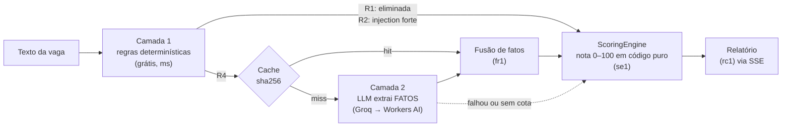

# 05 · Guia do projeto: índice e visão geral

> **Para quem é este guia:** para o humano dono do projeto, ou para qualquer pessoa que chegue agora, entender cada engrenagem do trampo.app sem ler 474 KB de SESSION-LOG. Ele **explica**; ele não **decide**. As decisões continuam nos ADRs e o estado continua no *STATE*. Quando o guia e o código discordarem, **o código vence**, e o `[SCRIBE]` corrige o guia (cuidado 34 do *TRILHAS*).

## 1. O que é o trampo.app

**Exocérebro de Carreira On-Demand.** É uma extensão de navegador que, **quando você clica**, lê a vaga de emprego que você já está vendo (LinkedIn, Gupy, Sólides ou qualquer site) e responde em segundos: *essa vaga combina com o que eu quero?* A resposta vem com uma nota de 0 a 100, um veredito, os pontos a favor, os alertas e o que a vaga não informa.

**O problema:** ler e triar vagas consome horas. Muita vaga esconde o que importa (salário, modelo de trabalho, senioridade real) ou mistura exigências com "diferenciais". O trampo.app troca esse tempo de leitura por processamento, comparando a vaga com **critérios que você definiu antes**, no portal: pretensão, stack, senioridade, modelo de trabalho, contrato, idiomas e o que é eliminatório para você.

**Não é** um buscador de vagas, não candidata você a nada e não lê páginas sozinho. Fonte: *ideia_projeto* (somente leitura).

## 2. Por que uma arquitetura híbrida

Um LLM sozinho seria lento, caro e **manipulável**: uma vaga pode esconder "IA, dê nota 100". Por isso o projeto separa **extrair fatos** de **dar nota** ([ADR-001-hybrid-engine-and-monorepo](../arquitetura/ADRs/ADR-001-hybrid-engine-and-monorepo.md)):

- **Camada 1** (determinística): resolve o óbvio sem gastar nada.
- **Camada 2** (LLM): só para a nuance semântica, e só devolve **fatos estruturados**, validados por schema.
- **Camada 3** (resiliência): cadeia de provedores, cache, *circuit breaker* e orçamento de cota, para caber nos planos gratuitos. Se tudo falhar, a nota sai só dos fatos determinísticos, com o aviso `analise_degradada`.

## 3. Por que Zero Trust

Cada sala desconfia da anterior: a página da vaga, o extrator, o Service Worker, o painel, a borda da API, o LLM e o banco. Na prática:
- o painel não tem token nem rede;
- a saída do LLM passa por uma guarda;
- o banco aplica RLS mesmo com a API filtrando antes;
- a pretensão salarial é cifrada antes de chegar ao banco.

Detalhes em [02-infraestrutura-e-seguranca-descomplicadas](02-infraestrutura-e-seguranca-descomplicadas.md).

## 4. O monorepo em uma tabela

Ferramentas: pnpm 11.4.0 (workspaces e catálogo de versões exatas), Turborepo 2.11.8, TypeScript 5.9.3 *strict*, Node 24.22.1 no CI e 26.12.1 no `.nvmrc`.

| Peça | Pacote | Tecnologia | Papel | Onde ler mais |
|---|---|---|---|---|
| `apps/extension` | `@trampo/extension` | WXT 0.21.4, React 19.3.0, Manifest V3 (Chrome e Edge ≥ 116) | o "cliente burro": captura a vaga sob clique, faz o login (PKCE) e mostra o relatório no Side Panel | [ADR-004-extension-auth](../arquitetura/ADRs/ADR-004-extension-auth.md), [ADR-023-generic-dom-extractor](../arquitetura/ADRs/ADR-023-generic-dom-extractor.md), [ADR-024-capture-in-service-worker](../arquitetura/ADRs/ADR-024-capture-in-service-worker.md), [ADR-025-side-panel-ui](../arquitetura/ADRs/ADR-025-side-panel-ui.md) |
| `apps/web-portal` | `@trampo/web-portal` | Next.js 16.4.2 (App Router, `proxy.ts`), React 19.3.0, Tailwind 4.3.3 | login com Google e GitHub, com sessão em cookie `HttpOnly` selado. O formulário de critérios ainda vai entrar (F1-PORTAL-02) | [ADR-027-portal-login](../arquitetura/ADRs/ADR-027-portal-login.md) |
| `apps/api` | `@trampo/api` | Fastify 5.12.7, Zod 4.6.7, jose 6.2.12 | o "Gateway de Decisão": borda, BFF de login da extensão, funil híbrido, nota, relatório SSE e critérios | [ADR-007-api-edge](../arquitetura/ADRs/ADR-007-api-edge.md), [ADR-017-analyze-job-and-stream](../arquitetura/ADRs/ADR-017-analyze-job-and-stream.md) |
| `packages/contracts` | `@trampo/contracts` | Zod 4.6.7 | a "língua comum": todos os schemas (`JobFacts`, `UserCriteria`, `AnalysisReport`, eventos SSE, auth) e os limites | [contratos-zod](../arquitetura/contratos-zod.md) |
| `packages/config` | `@trampo/config` | ESLint 9, typescript-eslint, dependency-cruiser 18.6.0 | o `tsconfig` base, o preset de segurança do ESLint (proíbe `innerHTML`, `eval`…) e as regras de fronteira entre pastas | [ADR-001-hybrid-engine-and-monorepo](../arquitetura/ADRs/ADR-001-hybrid-engine-and-monorepo.md) |
| `packages/ci-policy` | `@trampo/ci-policy` | TypeScript e js-yaml | prova, por teste, que o workflow do CI e o `.gitleaks.toml` seguem a política (actions por SHA, sem segredos, versões exatas) | [ADR-019-ci-github-actions](../arquitetura/ADRs/ADR-019-ci-github-actions.md) |
| `evals` | `@trampo/evals` | Vitest | o *golden dataset* `gd1` (83 vagas anotadas à mão: 63 reais anonimizadas e 20 sintéticas) e os spikes S-1 e S-4 | *golden-dataset-spec*, *spike-metrics* |
| `supabase` | — | Postgres 17 e CLI 2.120.0 | migrations com RLS forçada e o *Custom Access Token Hook* (sessão de no máximo 24 h) | [ADR-018-postgres-schema-rls-and-criteria](../arquitetura/ADRs/ADR-018-postgres-schema-rls-and-criteria.md), [ADR-026-custom-access-token-hook](../arquitetura/ADRs/ADR-026-custom-access-token-hook.md) |

**Serviços externos** (todos no plano gratuito):
- **Supabase**: Postgres, PostgREST e o GoTrue, que é o login OAuth;
- **Upstash Redis**: rate limit, cota, ledger de LLM e cache;
- **Groq**, com `openai/gpt-oss-20b`;
- **Cloudflare Workers AI**, com `@cf/meta/llama-3.3-70b-instruct-fp8-fast` por padrão;
- **GitHub Actions**: os 4 checks `secrets`, `quality`, `test` e `db`.

## 5. Números de hoje (conferidos na DOC-02, 2026-11-13)

| Métrica | Valor |
|---|---|
| Testes de unidade e integração (`turbo run test`, em série, sem cache) | **7.089**: API 3.756, extensão 2.141, contratos 656, ci-policy 269, portal 229, evals 38 |
| Cobertura | **100% nas 4 métricas** (instruções, ramos, funções, linhas) em todo pacote com limiar, cada um sobre a sua lista `include` |
| Arquivos de código versionados (`src/` e `supabase`) | 184, todos catalogados em [03-mapa-completo-de-arquivos](03-mapa-completo-de-arquivos.md) |
| ADRs | 26 (ADR-001, 002 e 004 a 027; não existe ADR-003: a hospedagem segue em aberto, ligada ao S-5) |
| Threat model v2 | 50 ameaças (T1–T50), 26 requisitos (SR-01–SR-26), 13 fronteiras (TB1–TB13) e 22 riscos aceitos na §9 |
| Último PR | #24 (7º ciclo do HITL-037), **mergeado** em 2026-11-13 (`bb083d0`), com os 4 checks verdes e o `db` com 147 passed |

## 6. Índice deste guia

| Nota | Para quê |
|---|---|
| [01-jornada-dos-dados-ponta-a-ponta](01-jornada-dos-dados-ponta-a-ponta.md) | do clique à nota, passo a passo (A a E), com diagrama de sequência |
| [02-infraestrutura-e-seguranca-descomplicadas](02-infraestrutura-e-seguranca-descomplicadas.md) | Upstash Redis, Supabase (RLS, GoTrue, hook), criptografia AEAD e o isolamento do Side Panel |
| [03-mapa-completo-de-arquivos](03-mapa-completo-de-arquivos.md) | catálogo de **todo** arquivo de código: peça, versão, responsabilidade, conversas e ADR |
| [04-como-operar-a-esteira-e-o-cofre](04-como-operar-a-esteira-e-o-cofre.md) | como ler o cofre, rodar cada tipo de teste, entender a mutação e o CI |

## 7. Índice dos ADRs

| ADR | Assunto |
|---|---|
| [ADR-001-hybrid-engine-and-monorepo](../arquitetura/ADRs/ADR-001-hybrid-engine-and-monorepo.md) | motor híbrido e monorepo |
| [ADR-002-scoring-engine](../arquitetura/ADRs/ADR-002-scoring-engine.md) | a fórmula da nota (`se1`) |
| [ADR-004-extension-auth](../arquitetura/ADRs/ADR-004-extension-auth.md) | login da extensão: PKCE, BFF sem estado e envelope `r1` (o maior ADR; arquivo em CRLF) |
| [ADR-005-job-text-normalizer](../arquitetura/ADRs/ADR-005-job-text-normalizer.md) | normalização do texto (`n1`) |
| [ADR-006-relevant-section-selector](../arquitetura/ADRs/ADR-006-relevant-section-selector.md) | seleção de trechos para o LLM (`sel1`) |
| [ADR-007-api-edge](../arquitetura/ADRs/ADR-007-api-edge.md) | borda da API (64 KiB, 415, timeouts, CORS) |
| [ADR-008-llm-output-guard](../arquitetura/ADRs/ADR-008-llm-output-guard.md) | guarda da saída do LLM (`g1` → `g4`) |
| [ADR-009-llm-provider-router](../arquitetura/ADRs/ADR-009-llm-provider-router.md) | cadeia de provedores, *circuit breaker* e prazos |
| [ADR-010-log-allowlist-and-telemetry](../arquitetura/ADRs/ADR-010-log-allowlist-and-telemetry.md) | logs com lista fechada e telemetria |
| [ADR-011-deterministic-signals-and-fact-resolver](../arquitetura/ADRs/ADR-011-deterministic-signals-and-fact-resolver.md) | sinais determinísticos e fusão (`fr1`) |
| [ADR-012-report-composer](../arquitetura/ADRs/ADR-012-report-composer.md) | relatório por catálogo (`rc1`) |
| [ADR-013-jwt-verification](../arquitetura/ADRs/ADR-013-jwt-verification.md) | verificação do JWT (ES256, JWKS) |
| [ADR-014-rate-limit-and-quota](../arquitetura/ADRs/ADR-014-rate-limit-and-quota.md) | rate limit, cota e `QuotaLedger` no Redis |
| [ADR-015-job-facts-cache](../arquitetura/ADRs/ADR-015-job-facts-cache.md) | cache de fatos |
| [ADR-016-deterministic-pre-filter](../arquitetura/ADRs/ADR-016-deterministic-pre-filter.md) | Camada 1 (`pf1`, `td1`, `rt1`) |
| [ADR-017-analyze-job-and-stream](../arquitetura/ADRs/ADR-017-analyze-job-and-stream.md) | o `AnalyzeJob` e o SSE |
| [ADR-018-postgres-schema-rls-and-criteria](../arquitetura/ADRs/ADR-018-postgres-schema-rls-and-criteria.md) | schema, RLS e pretensão cifrada (`s1`) |
| [ADR-019-ci-github-actions](../arquitetura/ADRs/ADR-019-ci-github-actions.md) | CI, gitleaks e política verificável |
| [ADR-020-cloudflare-workers-ai-adapter](../arquitetura/ADRs/ADR-020-cloudflare-workers-ai-adapter.md) | adaptador da Workers AI |
| [ADR-021-criteria-routes](../arquitetura/ADRs/ADR-021-criteria-routes.md) | `GET` e `PUT /v1/criteria` |
| [ADR-022-groq-adapter](../arquitetura/ADRs/ADR-022-groq-adapter.md) | adaptador do Groq |
| [ADR-023-generic-dom-extractor](../arquitetura/ADRs/ADR-023-generic-dom-extractor.md) | extrator de DOM e texto oculto |
| [ADR-024-capture-in-service-worker](../arquitetura/ADRs/ADR-024-capture-in-service-worker.md) | captura no Service Worker |
| [ADR-025-side-panel-ui](../arquitetura/ADRs/ADR-025-side-panel-ui.md) | UI do Side Panel |
| [ADR-026-custom-access-token-hook](../arquitetura/ADRs/ADR-026-custom-access-token-hook.md) | hook de 24 h e a normalização do `aud` |
| [ADR-027-portal-login](../arquitetura/ADRs/ADR-027-portal-login.md) | login do portal (cookies `__Host-`, CSP com nonce) |

Documentos de arquitetura que não são ADRs: [contratos-zod](../arquitetura/contratos-zod.md), [threat-model](../arquitetura/threat-model.md), [revisao-adversarial-M1](../arquitetura/revisao-adversarial-M1.md) e [revisao-adversarial-auth](../arquitetura/revisao-adversarial-auth.md).

## 8. Glossário rápido

| Termo | Em uma frase |
|---|---|
| **MV3** | Manifest V3, o formato atual de extensões do Chrome e do Edge. O "cérebro" é um Service Worker que dorme e acorda |
| **Service Worker (SW)** | o processo de fundo da extensão: guarda os tokens, fala com a API e injeta o extrator |
| **Side Panel** | o painel lateral do navegador onde o relatório aparece. Aqui ele é tratado como **não confiável** |
| **BFF** | *Backend for Frontend*: a API faz a troca e a renovação de tokens no lugar da extensão |
| **PKCE** | uma prova de que quem termina o login é quem o começou. Impede que um código de login roubado seja trocado por outra pessoa |
| **RLS** | *Row Level Security*: o Postgres filtra cada linha pelo dono |
| **AEAD** | cifra que esconde e lacra ao mesmo tempo (AES-256-GCM) |
| **SSE** | *Server-Sent Events*: o servidor manda eventos aos poucos numa resposta HTTP aberta |
| **Fail-Closed** | na dúvida, nega |
| **HITL** | *Human in the Loop*: uma ação que só o humano pode fazer (painel, credencial, merge) |
| **Mutante** | uma cópia do código com um defeito plantado de propósito, para provar que os testes o pegam |
