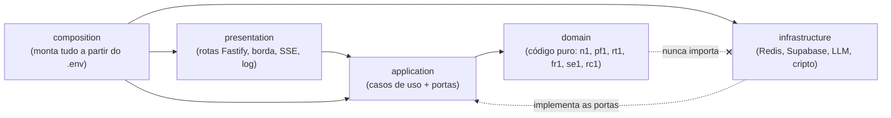

# 03. Mapa completo de arquivos

> **Para que serve:** achar, em segundos, *onde* mora cada peça e *com quem* ela conversa. Cada linha das tabelas é um arquivo real do repositório. O mapa foi gerado na DOC-02 (sessão 27) a partir da leitura de cada arquivo, e conferido por script contra o `git ls-files`: os 184 arquivos versionados de `apps/*/src`, `packages/*/src`, `evals/src` e `supabase` aparecem todos aqui. São 296 linhas de tabela no total.
>
> **Manutenção (cuidado 34 do *TRILHAS*):** a sessão que cria, renomeia, move ou apaga um arquivo de `src/` atualiza a linha dele aqui na Fase 4, junto do *STATE*. A coluna "Peça / versão" segue as constantes de versão do código: se uma constante mudar (por exemplo, `se1` para `se2`), esta nota muda junto.

## Como ler as tabelas

| Coluna | Significado |
|---|---|
| **Arquivo** | o nome do arquivo dentro da pasta do título |
| **Peça / versão** | a classe ou função principal e o identificador de versão que o código declara (`n1`, `sel1`, `pf1`, `td1`, `rt1`, `fr1`, `se1`, `rc1`, `p3`, `g4`, `s1`, `r1`, `aj1`, `li2`…) |
| **O que faz** | a responsabilidade em linguagem simples |
| **Conversa com** | o que entra e o que sai: quem chama e quem é chamado |
| **ADR** | a decisão de arquitetura que explica o porquê |

**As camadas da API** (Clean/Hexagonal Architecture, com a regra de dependência imposta pelo `dependency-cruiser`):

O **domínio** não importa rede, relógio, aleatoriedade, framework nem LLM (SR-13). Quando precisa de algo do mundo, como um hash, pede por uma **porta** (`domain/ports`), e a infraestrutura entrega a implementação.

**Índice:**
1. [1. `packages/contracts`: a língua comum](#1-packagescontracts-a-língua-comum)
2. [2. `packages/config`: regras de lint, TypeScript e fronteiras](#2-packagesconfig-regras-de-lint-typescript-e-fronteiras)
3. [3. `packages/ci-policy`: a política da esteira de CI](#3-packagesci-policy-a-política-da-esteira-de-ci)
4. [4. `apps/api`: a API Fastify (BFF e motor)](#4-appsapi-a-api-fastify-bff-e-motor)
5. [5. `apps/extension`: a extensão MV3 (WXT)](#5-appsextension-a-extensão-mv3-wxt)
6. [6. `apps/web-portal`: o portal Next.js](#6-appsweb-portal-o-portal-nextjs)
7. [7. `evals`: golden dataset e spikes](#7-evals-golden-dataset-e-spikes)
8. [8. `supabase`: banco, RLS e hook](#8-supabase-banco-rls-e-hook)
9. [9. Raiz do repositório e CI](#9-raiz-do-repositório-e-ci)

## 1. `packages/contracts`: a língua comum

### `packages/contracts/src`

Pacote `@trampo/contracts` (versão `1.0.0` no `package.json`, zod `4.6.7` no catálogo do pnpm). Os objetos usam `z.strictObject` (37 ocorrências). Não há nenhuma chamada a `.strict()`.

| Arquivo | Peça / versão | O que faz (em linguagem simples) | Conversa com (entra → sai) | ADR |
|---|---|---|---|---|
| `index.ts` | Barril do pacote | Reexporta todos os módulos do contrato. | Módulos do pacote → extensão, portal, API e evals | [ADR-001-hybrid-engine-and-monorepo](../arquitetura/ADRs/ADR-001-hybrid-engine-and-monorepo.md) |
| `limits.ts` | `JOB_TEXT_MAX_CHARS` (15.000) e demais tetos | Reúne os limites de transporte e de forma: texto da vaga, corpo HTTP, título, salário, critérios e token. Nenhuma regra de nota mora aqui. | Constantes → schemas do contrato e domínio da API (a única importação de valor que o domínio pode fazer) | [ADR-001-hybrid-engine-and-monorepo](../arquitetura/ADRs/ADR-001-hybrid-engine-and-monorepo.md), [ADR-007-api-edge](../arquitetura/ADRs/ADR-007-api-edge.md), [ADR-021-criteria-routes](../arquitetura/ADRs/ADR-021-criteria-routes.md), [ADR-013-jwt-verification](../arquitetura/ADRs/ADR-013-jwt-verification.md), [ADR-004-extension-auth](../arquitetura/ADRs/ADR-004-extension-auth.md) |
| `primitives.ts` | `safeText` / `truncateCodePoints` / `TechTagSchema` / `VersionTagSchema` / `Sha256HexSchema` | Peças básicas. Um texto seguro não aceita invisíveis, `<` `>` nem nada com cara de link. O pacote também traz o corte em code points, o formato de tag de tecnologia e o de versão. | Strings → validadores zod e a função de corte (injetada no domínio) | [ADR-005-job-text-normalizer](../arquitetura/ADRs/ADR-005-job-text-normalizer.md), [ADR-008-llm-output-guard](../arquitetura/ADRs/ADR-008-llm-output-guard.md), [ADR-001-hybrid-engine-and-monorepo](../arquitetura/ADRs/ADR-001-hybrid-engine-and-monorepo.md) |
| `enums.ts` | `SeniorityLevelSchema`, `CurrencySchema`, `PlatformSchema` e outros 9 enums | Listas fechadas de valores: senioridade, modelo de trabalho, contrato, moeda (BRL, USD, EUR, ARS), período, sinais de alerta, benefícios, idiomas, UF, plataforma e provedor de LLM. | Constantes → todos os schemas e cópias no domínio | [ADR-002-scoring-engine](../arquitetura/ADRs/ADR-002-scoring-engine.md), [ADR-023-generic-dom-extractor](../arquitetura/ADRs/ADR-023-generic-dom-extractor.md), [ADR-001-hybrid-engine-and-monorepo](../arquitetura/ADRs/ADR-001-hybrid-engine-and-monorepo.md) |
| `job-facts.ts` | `JobFactsSchema` / `ResolvedJobFactsSchema` / `JobFactsCacheEntrySchema` (`JOB_FACTS_SCHEMA_VERSION` = 1) | Contrato de saída do LLM: só fatos da vaga, sem nota nem veredito, e chave desconhecida é recusada. Também define os fatos depois da fusão e a entrada do cache Redis, revalidada a cada leitura. | Saída do LLM e do cache → API (guarda, cache e fusão) | [ADR-001-hybrid-engine-and-monorepo](../arquitetura/ADRs/ADR-001-hybrid-engine-and-monorepo.md), [ADR-015-job-facts-cache](../arquitetura/ADRs/ADR-015-job-facts-cache.md), [ADR-020-cloudflare-workers-ai-adapter](../arquitetura/ADRs/ADR-020-cloudflare-workers-ai-adapter.md) |
| `user-criteria.ts` | `UserCriteriaSchema` (`USER_CRITERIA_SCHEMA_VERSION` = 1) | Formato dos critérios do usuário: importância de cada dimensão, pretensão salarial, stack (obrigatória, desejável, deal-breakers), idiomas, benefícios e tolerância a sinais de alerta. O JSON tem teto de 12.288 bytes. | Portal → API → Postgres (nunca vai à extensão nem ao LLM) | [ADR-021-criteria-routes](../arquitetura/ADRs/ADR-021-criteria-routes.md), [ADR-018-postgres-schema-rls-and-criteria](../arquitetura/ADRs/ADR-018-postgres-schema-rls-and-criteria.md) |
| `analysis-report.ts` | `AnalysisReportSchema` (`ANALYSIS_REPORT_SCHEMA_VERSION` = 1) | Formato do relatório entregue ao Side Panel: nota de 0 a 100, veredito em 5 faixas, resumo, itens, detalhamento por dimensão, avisos, fatos e versões. Só aceita texto simples. | API (`ReportComposer`) → extensão, que revalida antes de mostrar | [ADR-012-report-composer](../arquitetura/ADRs/ADR-012-report-composer.md), [ADR-002-scoring-engine](../arquitetura/ADRs/ADR-002-scoring-engine.md), [ADR-017-analyze-job-and-stream](../arquitetura/ADRs/ADR-017-analyze-job-and-stream.md) |
| `api.ts` | `AnalyzeJobRequestSchema` (`ANALYZE_REQUEST_SCHEMA_VERSION` = 1) / `JobTextSchema` | Pedido de análise: exige no mínimo 200 caracteres de texto e corta (sem recusar) acima de 15.000 code points. O arquivo também define os erros da API, os eventos de progresso (SSE) e o feedback da nota. | Extensão → `POST /v1/analyze`; API → eventos e erros | [ADR-017-analyze-job-and-stream](../arquitetura/ADRs/ADR-017-analyze-job-and-stream.md), [ADR-001-hybrid-engine-and-monorepo](../arquitetura/ADRs/ADR-001-hybrid-engine-and-monorepo.md), [ADR-018-postgres-schema-rls-and-criteria](../arquitetura/ADRs/ADR-018-postgres-schema-rls-and-criteria.md) |
| `auth.ts` | `AuthExchangeRequestSchema` / `AuthSessionResponseSchema` e afins (`AUTH_SCHEMA_VERSION` = 1) | Contratos do login da extensão: troca do código PKCE, renovação com o refresh selado, logout e a resposta com exatamente 4 campos. | Service Worker da extensão → rotas `/v1/auth/*` da API | [ADR-004-extension-auth](../arquitetura/ADRs/ADR-004-extension-auth.md), [ADR-013-jwt-verification](../arquitetura/ADRs/ADR-013-jwt-verification.md) |

Fora do escopo `src`, o pacote tem 8 arquivos de teste em `packages/contracts/test` (mais um snapshot em `__snapshots__`).

### `packages/contracts`

| Arquivo | Peça / versão | O que faz (em linguagem simples) | Conversa com (entra → sai) | ADR |
|---|---|---|---|---|
| `package.json` | `@trampo/contracts` 1.0.0, Zod 4.6.7 | Contratos Zod compartilhados, publicados de `dist/` com 7 subcaminhos (`limits`, `primitives`, `api`, `analysis-report`, `job-facts`, `user-criteria`, `auth`) além da raiz. Única dependência: zod. | → API, extensão, evals | [ADR-001-hybrid-engine-and-monorepo](../arquitetura/ADRs/ADR-001-hybrid-engine-and-monorepo.md) |

## 2. `packages/config`: regras de lint, TypeScript e fronteiras

### `packages/config`

| Arquivo | Peça / versão | O que faz (em linguagem simples) | Conversa com (entra → sai) | ADR |
|---|---|---|---|---|
| `package.json` | `@trampo/config` 0.0.0 | Publica quatro presets: tsconfig, ESLint de segurança, ESLint de pureza do domínio e dependency-cruiser. | catálogo → todos os apps e pacotes | [ADR-001-hybrid-engine-and-monorepo](../arquitetura/ADRs/ADR-001-hybrid-engine-and-monorepo.md) |
| `tsconfig.base.json` | TypeScript 5.9.3 | Base estrita comum: `strict`, `noUncheckedIndexedAccess`, `exactOptionalPropertyTypes`, alvo ES2024. | → `tsconfig.json` de cada pacote | [ADR-001-hybrid-engine-and-monorepo](../arquitetura/ADRs/ADR-001-hybrid-engine-and-monorepo.md) |
| `dependency-cruiser.cjs` | dependency-cruiser 18.6.0 | Regras de quem pode importar quem: cliente não importa a API, domínio puro, extensão longe da sessão, cliente do portal longe do servidor. | → `.dependency-cruiser.cjs` da raiz e `pnpm lint:deps` | [ADR-001-hybrid-engine-and-monorepo](../arquitetura/ADRs/ADR-001-hybrid-engine-and-monorepo.md), [ADR-027-portal-login](../arquitetura/ADRs/ADR-027-portal-login.md) |
| `eslint/security.js` | typescript-eslint 8.71.2, no-unsanitized 4.1.5, react 7.37.5, regexp 3.3.1 | Proíbe `eval`, `innerHTML` e afins, `dangerouslySetInnerHTML`, regex com risco de ReDoS e `any`. | → `eslint.config` de todos os pacotes | [ADR-001-hybrid-engine-and-monorepo](../arquitetura/ADRs/ADR-001-hybrid-engine-and-monorepo.md) |
| `eslint/domain-purity.js` | typescript-eslint 8.71.2 | Impede o domínio da API de usar rede, relógio, aleatoriedade, `process` ou pacotes externos. | → `eslint.config.js` da API | [ADR-001-hybrid-engine-and-monorepo](../arquitetura/ADRs/ADR-001-hybrid-engine-and-monorepo.md) |

## 3. `packages/ci-policy`: a política da esteira de CI

### `packages/ci-policy`

| Arquivo | Peça / versão | O que faz (em linguagem simples) | Conversa com (entra → sai) | ADR |
|---|---|---|---|---|
| `package.json` | `@trampo/ci-policy` 0.1.0, js-yaml 4.3.2 | Pacote só de teste: a política do CI vira teste que roda no `pnpm test`. | → turbo `test` | [ADR-019-ci-github-actions](../arquitetura/ADRs/ADR-019-ci-github-actions.md) |
| `vitest.config.ts` | Vitest 5.0.5 | Exige 100% nas 4 métricas em `src` (menos `.d.ts`). | `test/**` → cobertura | [ADR-019-ci-github-actions](../arquitetura/ADRs/ADR-019-ci-github-actions.md) |
| `eslint.config.js` | ESLint 9.39.5 | Aplica só o preset de segurança. | `@trampo/config` → lint | [ADR-019-ci-github-actions](../arquitetura/ADRs/ADR-019-ci-github-actions.md) |
| `tsconfig.json` | TypeScript 5.9.3 | Módulos NodeNext, sem emitir arquivos. | `@trampo/config` → `tsc` | [ADR-019-ci-github-actions](../arquitetura/ADRs/ADR-019-ci-github-actions.md) |
| `src/workflow-policy.ts` | TypeScript puro | Lê um workflow e lista as violações: gatilhos, permissões, actions por SHA de lista fechada, sem cache, sem segredo, download só com sha256, CLI do Supabase só local. | YAML lido → lista de violações | [ADR-019-ci-github-actions](../arquitetura/ADRs/ADR-019-ci-github-actions.md) |
| `src/parse-workflow.ts` | js-yaml 4.3.2 | Lê o YAML no esquema 1.2 (`on` fica texto) e recusa chave duplicada. | arquivo `.yml` → objeto | [ADR-019-ci-github-actions](../arquitetura/ADRs/ADR-019-ci-github-actions.md) |
| `src/gitleaks-config.ts` | TypeScript puro | Lê o `.gitleaks.toml` num subconjunto fechado e reproduz o essencial do gitleaks para testar as regras próprias. | `.gitleaks.toml` → regras e verificação | [ADR-019-ci-github-actions](../arquitetura/ADRs/ADR-019-ci-github-actions.md), [ADR-027-portal-login](../arquitetura/ADRs/ADR-027-portal-login.md) |
| `src/types/js-yaml.d.ts` | declaração TS | Tipos mínimos do js-yaml, sem instalar `@types/js-yaml`. | → `parse-workflow.ts` | [ADR-019-ci-github-actions](../arquitetura/ADRs/ADR-019-ci-github-actions.md) |
| `test/workflow-policy.test.ts` | Vitest 5.0.5 | Um caso negativo para cada regra da política. | `workflow-policy.ts` → asserções | [ADR-019-ci-github-actions](../arquitetura/ADRs/ADR-019-ci-github-actions.md) |
| `test/repo-workflows.test.ts` | Vitest 5.0.5 | Aplica a política aos workflows reais e confere o `ci.yml` (4 jobs, versões, hashes), o `config.toml` e o `.gitignore`. | `.github/workflows`, `supabase/config.toml` → asserções | [ADR-019-ci-github-actions](../arquitetura/ADRs/ADR-019-ci-github-actions.md), [ADR-026-custom-access-token-hook](../arquitetura/ADRs/ADR-026-custom-access-token-hook.md) |
| `test/gitleaks-config.test.ts` | Vitest 5.0.5 | Prova o leitor do TOML e as três regras próprias contra exemplos e contra todo arquivo versionado. | `.gitleaks.toml`, `git ls-files` → asserções | [ADR-019-ci-github-actions](../arquitetura/ADRs/ADR-019-ci-github-actions.md), [ADR-027-portal-login](../arquitetura/ADRs/ADR-027-portal-login.md) |

## 4. `apps/api`: a API Fastify (BFF e motor)

### `apps/api (raiz)`

| Arquivo | Peça / versão | O que faz (em linguagem simples) | Conversa com (entra → sai) | ADR |
|---|---|---|---|---|
| `package.json` | `@trampo/api` 0.1.0; Fastify 5.12.7, jose 6.2.12, zod 4.6.7, `@fastify/type-provider-zod` 1.0.1 (via `catalog:`) | Declara o pacote da API (ESM, roda o JS compilado de `dist/`) e os scripts `build`, `typecheck`, `lint`, `test` (Vitest com cobertura) e `test:db` (suíte de banco) e `start`. Só 5 dependências de produção: Fastify, o type-provider Zod, jose, zod e o pacote de contratos do monorepo. | pnpm e catálogo do workspace → `dist/main.js` | [ADR-001-hybrid-engine-and-monorepo](../arquitetura/ADRs/ADR-001-hybrid-engine-and-monorepo.md) |
| `vitest.db.config.ts` | projetos `db` e `db-limite` | Configura a suíte `test:db`, que roda em série contra o Supabase local (Docker) e fica fora do `pnpm test`. Separa a sonda do limite por IP do GoTrue num grupo próprio e exige 100% de cobertura dos arquivos de suporte do banco. | `pnpm test:db` → `test/db/**/*.db.test.ts` | [ADR-018-postgres-schema-rls-and-criteria](../arquitetura/ADRs/ADR-018-postgres-schema-rls-and-criteria.md), [ADR-019-ci-github-actions](../arquitetura/ADRs/ADR-019-ci-github-actions.md) |

### `apps/api/src`

| Arquivo | Peça / versão | O que faz (em linguagem simples) | Conversa com (entra → sai) | ADR |
|---|---|---|---|---|
| `main.ts` | Script de entrada; sem versão | Compõe a API de produção a partir de `process.env`, sobe o servidor e encerra limpo em SIGINT ou SIGTERM. | `process.env` → `composeProductionApp` → `app.listen` | Nenhum ADR citado no arquivo (o comentário cita HITL-028 1A, HITL-032 1A e 2A) |

### `apps/api/src/domain`

| Arquivo | Peça / versão | O que faz (em linguagem simples) | Conversa com (entra → sai) | ADR |
|---|---|---|---|---|
| `index.ts` | Barril público do domínio (sem versão própria) | Reexporta as classes, as constantes de versão e os tipos do domínio. O comentário fixa a regra de pureza: o domínio não usa rede, relógio, aleatoriedade nem zod em tempo de execução. | Arquivos do próprio domínio → camada `application` e `composition` (ex.: `compose-app.ts`) | [ADR-001-hybrid-engine-and-monorepo](../arquitetura/ADRs/ADR-001-hybrid-engine-and-monorepo.md), [ADR-005-job-text-normalizer](../arquitetura/ADRs/ADR-005-job-text-normalizer.md) |

### `apps/api/src/domain/normalization`

| Arquivo | Peça / versão | O que faz (em linguagem simples) | Conversa com (entra → sai) | ADR |
|---|---|---|---|---|
| `job-text-normalizer.ts` | `JobTextNormalizer` (`n1`) | Limpa o texto bruto da vaga: aplica NFKC, remove invisíveis, corta em 15.000 code points, colapsa espaços, mascara PII e links e neutraliza delimitadores. Repete o passo até o texto parar de mudar (no máximo 4 vezes) e calcula o sha256 do resultado. | Texto bruto + `TextHasher` + `truncateCodePoints` injetados → `NormalizedJobText` (texto, hash, versão e sinais para a Camada 1) | [ADR-005-job-text-normalizer](../arquitetura/ADRs/ADR-005-job-text-normalizer.md), [ADR-001-hybrid-engine-and-monorepo](../arquitetura/ADRs/ADR-001-hybrid-engine-and-monorepo.md) |
| `invisible-characters.ts` | `removeInvisibleCharacters` (o comentário diz que a saída mantém o `n1`) | Apaga caracteres invisíveis e de controle (menos a quebra de linha) e conta quantos eram de cada tipo suspeito. Os seletores e o ZWJ que vêm logo depois de um emoji são apagados, mas não entram na contagem por tipo. | Texto → texto limpo + total removido + contagem por classe (tags, largura zero, bidi, seletores de variação) | [ADR-005-job-text-normalizer](../arquitetura/ADRs/ADR-005-job-text-normalizer.md), [ADR-016-deterministic-pre-filter](../arquitetura/ADRs/ADR-016-deterministic-pre-filter.md) |
| `sensitive-data-masks.ts` | `maskSensitiveData` / `MASK_TOKENS` | Troca e-mails, links, CPF/CNPJ e telefones brasileiros por marcadores fixos (`[email]`, `[link]`, `[documento]`, `[telefone]`). Nomes de pessoas não são mascarados. | Texto → texto mascarado + contagem por tipo | [ADR-005-job-text-normalizer](../arquitetura/ADRs/ADR-005-job-text-normalizer.md), [ADR-001-hybrid-engine-and-monorepo](../arquitetura/ADRs/ADR-001-hybrid-engine-and-monorepo.md) |
| `delimiters.ts` | `neutralizeDelimiters` | Troca `<` e `>` por `‹` e `›`, cercas de código por `'''` e marcadores de papel ("system:", "Usuário:") no começo da linha por "system -". Assim o texto da vaga não consegue fechar o envelope do prompt. | Texto → texto neutralizado + contagem | [ADR-005-job-text-normalizer](../arquitetura/ADRs/ADR-005-job-text-normalizer.md), [ADR-001-hybrid-engine-and-monorepo](../arquitetura/ADRs/ADR-001-hybrid-engine-and-monorepo.md) |
| `whitespace.ts` | `canonicalizeLineBreaks` / `collapseWhitespace` | Padroniza as quebras de linha para `\n` e troca TAB por espaço antes da limpeza. Depois colapsa espaços, deixa no máximo 2 quebras seguidas e, no título, junta tudo numa linha só. | Texto → texto com espaços normalizados | [ADR-005-job-text-normalizer](../arquitetura/ADRs/ADR-005-job-text-normalizer.md), [ADR-001-hybrid-engine-and-monorepo](../arquitetura/ADRs/ADR-001-hybrid-engine-and-monorepo.md) |
| `fixed-point.ts` | `iterateToFixedPoint` | Roda um passo de transformação repetidas vezes até a saída não mudar mais, com um teto de passadas. Informa se o texto estabilizou ou não. | Texto + função de passo + teto → valor final, nº de passadas, `stable` e histórico | [ADR-005-job-text-normalizer](../arquitetura/ADRs/ADR-005-job-text-normalizer.md), [ADR-001-hybrid-engine-and-monorepo](../arquitetura/ADRs/ADR-001-hybrid-engine-and-monorepo.md) |

### `apps/api/src/domain/text`

| Arquivo | Peça / versão | O que faz (em linguagem simples) | Conversa com (entra → sai) | ADR |
|---|---|---|---|---|
| `code-points.ts` | `countCodePoints` / `truncateWithinCeiling` / `DependencyContractError` | Conta caracteres em code points (um emoji conta 1) e corta o texto usando a função do contrato. Se a função injetada devolver texto acima do teto, lança um erro e o domínio falha fechado. | Texto + `truncateCodePoints` do contrato → texto cortado ou erro | [ADR-005-job-text-normalizer](../arquitetura/ADRs/ADR-005-job-text-normalizer.md), [ADR-006-relevant-section-selector](../arquitetura/ADRs/ADR-006-relevant-section-selector.md) |

### `apps/api/src/domain/ports`

| Arquivo | Peça / versão | O que faz (em linguagem simples) | Conversa com (entra → sai) | ADR |
|---|---|---|---|---|
| `deterministic-signals.ts` | Porta `DeterministicSignals` | Define o formato dos sinais da Camada 1: modelo de trabalho, contrato, senioridade, salário, menções de stack (cada um com força `explicita` ou `fraca`) e o nível de injection. | `DeterministicPreFilter` (produz) → `FactResolver` e `PreFilterRouter` (consomem) | [ADR-011-deterministic-signals-and-fact-resolver](../arquitetura/ADRs/ADR-011-deterministic-signals-and-fact-resolver.md) |
| `text-hasher.ts` | Porta `TextHasher` | Define o contrato do sha256 em hex minúsculo, para o domínio não importar `node:crypto`. | Implementação em `infrastructure/crypto` → `JobTextNormalizer` | [ADR-005-job-text-normalizer](../arquitetura/ADRs/ADR-005-job-text-normalizer.md) |

### `apps/api/src/domain/selection`

| Arquivo | Peça / versão | O que faz (em linguagem simples) | Conversa com (entra → sai) | ADR |
|---|---|---|---|---|
| `relevant-section-selector.ts` | `RelevantSectionSelector` (`sel1`) | Escolhe, em blocos, o trecho da vaga que vai ao LLM, dentro de um orçamento de 6.000 code points por padrão. Descarta antes os blocos de contato e os de ordens ao modelo e marca os cortes com `[…]`. | `NormalizedJobText` → `SelectedJobText` (texto reduzido, versão, orçamento e contagens de blocos) | [ADR-006-relevant-section-selector](../arquitetura/ADRs/ADR-006-relevant-section-selector.md), [ADR-001-hybrid-engine-and-monorepo](../arquitetura/ADRs/ADR-001-hybrid-engine-and-monorepo.md) |

### `apps/api/src/domain/prefilter`

| Arquivo | Peça / versão | O que faz (em linguagem simples) | Conversa com (entra → sai) | ADR |
|---|---|---|---|---|
| `deterministic-pre-filter.ts` | `DeterministicPreFilter` (`pf1`) | Camada 1. Lê o texto já normalizado e o título e extrai sinais objetivos sem usar IA: modelo de trabalho, contrato, senioridade, salário, stack e risco de injection. Só aceita texto do normalizador `n1` e não depende do usuário. | `NormalizedJobText` + `NormalizedJobTitle` ou `null` → `DeterministicSignals` | [ADR-016-deterministic-pre-filter](../arquitetura/ADRs/ADR-016-deterministic-pre-filter.md), [ADR-011-deterministic-signals-and-fact-resolver](../arquitetura/ADRs/ADR-011-deterministic-signals-and-fact-resolver.md) |
| `pre-filter-router.ts` | `PreFilterRouter` (`rt1`) | Decide o caminho da análise pelas regras R1 a R4: rejeitar sem IA, analisar só com o código, aceitar sem IA (desligado por padrão) ou chamar o LLM. Para julgar, pontua os fatos da Camada 1 com o `ScoringEngine` real. | `DeterministicSignals` + critérios do usuário + modo (`auto` ou `aprofundada`) → `PreFilterDecision` (regra, rota, se chama o LLM, avisos e a nota só determinística) | [ADR-016-deterministic-pre-filter](../arquitetura/ADRs/ADR-016-deterministic-pre-filter.md), [ADR-001-hybrid-engine-and-monorepo](../arquitetura/ADRs/ADR-001-hybrid-engine-and-monorepo.md) |
| `tech-dictionary.ts` | `DICTIONARY_ALIASES` / `DICTIONARY_TERMS` (`td1`) | Lista fechada de tecnologias com apelidos (ex.: "k8s" vira "Kubernetes"). Termos ambíguos como Go, R, C e Spark só contam quando aparecem com uma pista que os confirma. | Constantes → `stack-mentions.ts`, que só emite grafias canônicas | [ADR-016-deterministic-pre-filter](../arquitetura/ADRs/ADR-016-deterministic-pre-filter.md) |
| `stack-mentions.ts` | `detectStack` / `guessLanguage` | Acha as tecnologias do dicionário no texto e decide se cada menção é explícita ou fraca. Fica fraca a menção negada ("não", "sem" etc.), a que está em "diferenciais", a ambígua e a escrita com letras de outro alfabeto. | Texto dobrado + linhas + contexto de cada linha + idioma → lista de `{ term, strength }` | [ADR-016-deterministic-pre-filter](../arquitetura/ADRs/ADR-016-deterministic-pre-filter.md), [ADR-001-hybrid-engine-and-monorepo](../arquitetura/ADRs/ADR-001-hybrid-engine-and-monorepo.md) |
| `salary-signal.ts` | `detectSalary` | Lê valores de salário linha a linha, identifica a moeda (R$, AR$, US$, USD, EUR, € e outras) e o período (hora, mês, ano). "AR$" vira peso argentino e não é lido como real. Linhas de benefício ficam de fora. | Linhas dobradas → `SalarySignal` (explícito só com um candidato, moeda e período) ou `null` | [ADR-016-deterministic-pre-filter](../arquitetura/ADRs/ADR-016-deterministic-pre-filter.md), [ADR-002-scoring-engine](../arquitetura/ADRs/ADR-002-scoring-engine.md) |
| `set-signals.ts` | `detectWorkModels` / `detectContractTypes` / `detectSeniority` | Detecta remoto, híbrido e presencial; CLT, PJ, estágio e outros contratos; e a senioridade. Ignora negações, benefícios como "auxílio home office" e etapas como "entrevista presencial". A senioridade só é explícita quando vem do título. | Texto dobrado + linhas (+ título) → `SetSignal` de cada tipo ou `null` | [ADR-016-deterministic-pre-filter](../arquitetura/ADRs/ADR-016-deterministic-pre-filter.md), [ADR-001-hybrid-engine-and-monorepo](../arquitetura/ADRs/ADR-001-hybrid-engine-and-monorepo.md) |
| `line-context.ts` | `classifyLines` | Rotula cada linha conforme a seção em que está: exigida, desejável (diferencial), empresa, benefício ou desconhecida. Isso define se a tecnologia citada ali é requisito ou não. | Linhas → contexto por linha | [ADR-016-deterministic-pre-filter](../arquitetura/ADRs/ADR-016-deterministic-pre-filter.md), [ADR-001-hybrid-engine-and-monorepo](../arquitetura/ADRs/ADR-001-hybrid-engine-and-monorepo.md) |
| `injection-heuristics.ts` | `assessInjection` | Procura frases dirigidas ao modelo ("se você é uma IA", "ignore as instruções", "dê nota 100"), tokens de chat e excesso de invisíveis, e devolve o risco `baixa`, `media` ou `alta`. Um ataque citado entre aspas como exemplo pesa menos. | Texto dobrado + linhas + sinais do normalizador → nível de injection + motivos (só enums) | [ADR-016-deterministic-pre-filter](../arquitetura/ADRs/ADR-016-deterministic-pre-filter.md), [ADR-001-hybrid-engine-and-monorepo](../arquitetura/ADRs/ADR-001-hybrid-engine-and-monorepo.md) |
| `folding.ts` | `fold` / `findAll` / `splitLines` | Utilitários da Camada 1. Passam o texto para minúsculas sem acento, trocam letras cirílicas e gregas parecidas por latinas e buscam termos respeitando o limite de palavra, sem regex arriscada. | Texto → texto dobrado, posições de ocorrência e linhas | [ADR-016-deterministic-pre-filter](../arquitetura/ADRs/ADR-016-deterministic-pre-filter.md) |

### `apps/api/src/domain/fusion`

| Arquivo | Peça / versão | O que faz (em linguagem simples) | Conversa com (entra → sai) | ADR |
|---|---|---|---|---|
| `fact-resolver.ts` | `FactResolver` (`fr1`) | Junta os fatos do LLM com os sinais explícitos da Camada 1 e registra a origem de cada campo. Quando as duas fontes discordam, o campo fica vazio, marcado como conflito e com aviso. Também calcula a confiança efetiva. | `JobFacts` (ou `null`) + `DeterministicSignals` + `titleHint` + termos marcados pelo usuário → `FactResolution` (fatos resolvidos, proveniência, confiança, avisos e conflitos) | [ADR-011-deterministic-signals-and-fact-resolver](../arquitetura/ADRs/ADR-011-deterministic-signals-and-fact-resolver.md), [ADR-001-hybrid-engine-and-monorepo](../arquitetura/ADRs/ADR-001-hybrid-engine-and-monorepo.md) |

### `apps/api/src/domain/scoring`

| Arquivo | Peça / versão | O que faz (em linguagem simples) | Conversa com (entra → sai) | ADR |
|---|---|---|---|---|
| `scoring-engine.ts` | `ScoringEngine` (`se1`) | Única autoridade da nota. Compara os fatos da vaga com os critérios do usuário em 9 dimensões e devolve uma nota inteira de 0 a 100, a faixa (veredito) e o detalhamento de cada dimensão. | `ScoringInput` (fatos + proveniência + `llmExtracted`) + `UserCriteria` → `ScoreResult` | [ADR-002-scoring-engine](../arquitetura/ADRs/ADR-002-scoring-engine.md), [ADR-001-hybrid-engine-and-monorepo](../arquitetura/ADRs/ADR-001-hybrid-engine-and-monorepo.md) |
| `scoring-policy.ts` | `DEFAULT_SCORING_POLICY` / `SCORING_ENGINE_VERSION` (`se1`) | Guarda todas as constantes do motor: penalidades, faixas, ordem das senioridades, câmbio fixo para BRL (ARS 0,0034) e 220 horas por mês. Também traz a função que recusa uma política incoerente. | Constantes → `ScoringEngine` (validadas no construtor) | [ADR-002-scoring-engine](../arquitetura/ADRs/ADR-002-scoring-engine.md) |

### `apps/api/src/domain/report`

| Arquivo | Peça / versão | O que faz (em linguagem simples) | Conversa com (entra → sai) | ADR |
|---|---|---|---|---|
| `report-composer.ts` | `ReportComposer` (sem versão própria; usa o catálogo `rc1`) | Monta o relatório final com textos prontos: resumo, pontos fortes, alertas, informações faltantes e explicação por dimensão. Não recebe os critérios do usuário, então não tem como repetir dados do perfil. | `ScoreResult` + fatos resolvidos + avisos + envelope (ids, data, caminho) → `AnalysisReport` (validado depois pelo `AnalyzeJob` com zod) | [ADR-012-report-composer](../arquitetura/ADRs/ADR-012-report-composer.md), [ADR-001-hybrid-engine-and-monorepo](../arquitetura/ADRs/ADR-001-hybrid-engine-and-monorepo.md) |
| `report-catalog.ts` | `DEFAULT_REPORT_CATALOG` (`rc1`) | Catálogo das frases em pt-BR e dos rótulos de enum. A validação só aceita uma lista fechada de caracteres (sem `/`, `@`, `[`, `]`, `<` e `>`) e prova que nenhum texto passa dos limites do contrato. | Constantes → `ReportComposer` | [ADR-012-report-composer](../arquitetura/ADRs/ADR-012-report-composer.md) |

### `apps/api/src/application`

| Arquivo | Peça / versão | O que faz (em linguagem simples) | Conversa com (entra → sai) | ADR |
|---|---|---|---|---|
| `index.ts` | Barril de exportação; sem versão própria | É a "vitrine" da camada de aplicação: reexporta casos de uso, políticas, portas e telemetria num lugar só. Por regra, só importa domínio, zod e `@trampo/contracts`. | Os arquivos da pasta → `composition/compose-app.ts`, `composition/production-app.ts` e a presentation | [ADR-001-hybrid-engine-and-monorepo](../arquitetura/ADRs/ADR-001-hybrid-engine-and-monorepo.md) (§7), [ADR-008-llm-output-guard](../arquitetura/ADRs/ADR-008-llm-output-guard.md) (D1) |

### `apps/api/src/application/analysis`

| Arquivo | Peça / versão | O que faz (em linguagem simples) | Conversa com (entra → sai) | ADR |
|---|---|---|---|---|
| `analyze-job.ts` | `AnalyzeJob`; `ANALYZE_JOB_VERSION = "aj1"` | É o maestro do funil: normaliza o texto, roda a triagem determinística, consulta o cache ou o LLM só na regra R4, funde os fatos, calcula a nota e monta o relatório. Valida o próprio relatório com o `AnalysisReportSchema` e grava no cache sem bloquear a resposta. | Pedido + critérios do usuário (da rota) → normalizador, pré-filtro, `PreFilterRouter`, `JobFactsCache`, `LlmProviderRouter`, `FactResolver`, `ScoringEngine`, `ReportComposer`, `Telemetry` → `AnalysisReport` e avisos de etapa (`onStage`) | [ADR-017-analyze-job-and-stream](../arquitetura/ADRs/ADR-017-analyze-job-and-stream.md), [ADR-001-hybrid-engine-and-monorepo](../arquitetura/ADRs/ADR-001-hybrid-engine-and-monorepo.md), [ADR-015-job-facts-cache](../arquitetura/ADRs/ADR-015-job-facts-cache.md), [ADR-016-deterministic-pre-filter](../arquitetura/ADRs/ADR-016-deterministic-pre-filter.md) |

### `apps/api/src/application/auth`

| Arquivo | Peça / versão | O que faz (em linguagem simples) | Conversa com (entra → sai) | ADR |
|---|---|---|---|---|
| `auth-session.ts` | `issueSession`, `callGotrue`, `keysReady`; teto `ACCESS_TOKEN_LIFETIME_MAX_SECONDS = 900` | Peças comuns da troca e da renovação: confere o token novo do GoTrue antes de repassar, impõe a vida máxima de 900 s e sela o refresh num envelope. Qualquer desvio de política vira 503, nunca 401 (exceto `sid` divergente na renovação). | Tokens do GoTrue + origem + relógio → `AccessTokenVerifier` e `RefreshSealer` → `AuthSessionOutcome` (sessão, 401, 503 ou 400) | [ADR-004-extension-auth](../arquitetura/ADRs/ADR-004-extension-auth.md) (D4 a D7) |
| `end-session.ts` | `EndSession`; sem versão | Faz o logout global no GoTrue com o Bearer do usuário, passando pelo bulkhead. Só devolve "encerrada" quando a sessão de fato caiu; o resto é 503. | Bearer já verificado (rota) → `GotrueEgress` → `AuthTokenGateway.logout` → 204 ou 503 | [ADR-004-extension-auth](../arquitetura/ADRs/ADR-004-extension-auth.md) (D4, D8) |
| `exchange-session.ts` | `ExchangeSession`; sem versão | Troca o código PKCE por uma sessão, na ordem do mais barato ao mais caro: formato, chaves do JWKS, orçamento e bulkhead, GoTrue (uma chamada só) e selagem. | Corpo `{authCode, codeVerifier}` + `Origin` → `AccessTokenVerifier.keysReady`, `GotrueEgress`, `AuthTokenGateway.exchangePkce`, `issueSession` → `AuthSessionOutcome` | [ADR-004-extension-auth](../arquitetura/ADRs/ADR-004-extension-auth.md) (D4, D6, D8) |
| `gotrue-egress.ts` | `createGotrueEgress`; política `GOTRUE_EGRESS_POLICY` (janela 300 s, troca 14, total 74, reserva 37, 4 simultâneas, balde 15 a cada 4 s) | Protege o IP único da API no Supabase Auth: conta as chamadas numa janela de 5 min, guarda vagas para a renovação, limita chamadas simultâneas (bulkhead) e segura rajadas com um balde de fichas. | Pedido de troca, renovação ou logout → `Clock` → executa a chamada ou nega com `retryAfterSeconds` | [ADR-004-extension-auth](../arquitetura/ADRs/ADR-004-extension-auth.md) (D8 item 5), [ADR-014-rate-limit-and-quota](../arquitetura/ADRs/ADR-014-rate-limit-and-quota.md) (emenda D10) |
| `refresh-session.ts` | `RefreshSession`; `REFRESH_SESSION_POLICY.retryTimeoutMs = 2_000` | Renova a sessão a partir do envelope selado: abre o envelope, confere idade máxima e inatividade sem rede, chama o GoTrue e, se a resposta pode ter se perdido, tenta uma única vez de novo em até 2 s. | Corpo `{refreshToken}` + `Origin` → `RefreshSealer.open`, `AccessTokenVerifier`, `GotrueEgress`, `AuthTokenGateway.refresh`, `issueSession` → `AuthSessionOutcome` | [ADR-004-extension-auth](../arquitetura/ADRs/ADR-004-extension-auth.md) (D4, D5, D6) |

### `apps/api/src/application/cache`

| Arquivo | Peça / versão | O que faz (em linguagem simples) | Conversa com (entra → sai) | ADR |
|---|---|---|---|---|
| `cache-policy.ts` | `CACHE_POLICY` (TTL 864.000 s = 10 dias, confiança mínima 0,5), `CACHE_KEY_PREFIX = "jobfacts:v1"`, `extractorVersionTag` (`jf-{prompt}-s{schema}-{normalizador}-{seletor}-{guarda}-b{orçamento}`) | Guarda os números do cache (validade, tetos e prazos) e monta a etiqueta de versão do extrator. Qualquer peça que muda o que o LLM recebe ou o que a guarda aceita muda a etiqueta e, portanto, a chave. | Versões do prompt, normalizador, seletor, guarda e orçamento (composição) → etiqueta usada por `JobFactsCache` e `AnalyzeJob` | [ADR-015-job-facts-cache](../arquitetura/ADRs/ADR-015-job-facts-cache.md) (D2, D3, D6) |
| `job-facts-cache.ts` | `JobFactsCache`; chave `jobfacts:v1:{extractorVersion}:{textHash}` | Lê e grava os fatos extraídos de uma vaga, sem nenhum dado do usuário. Só grava saída limpa e confiável (SET NX EX) e, na leitura, revalida tudo; qualquer dúvida vira "miss" e a entrada ruim é apagada. | `textHash` e candidato à escrita (`AnalyzeJob`) → `JobFactsCacheStore` (Redis), `LlmOutputGuard`, `withDeadline` → hit/miss com motivo, ou gravado/recusado | [ADR-015-job-facts-cache](../arquitetura/ADRs/ADR-015-job-facts-cache.md), [ADR-001-hybrid-engine-and-monorepo](../arquitetura/ADRs/ADR-001-hybrid-engine-and-monorepo.md) (§5.4) |

### `apps/api/src/application/criteria`

| Arquivo | Peça / versão | O que faz (em linguagem simples) | Conversa com (entra → sai) | ADR |
|---|---|---|---|---|
| `criteria-guard.ts` | `CriteriaGuard`; `CRITERIA_GUARD_POLICY.timeoutMs = 1_000` | Envolve o repositório de critérios com prazo de 1 s e revalidação estrita. Leitura ou escrita que falha, demora ou sai do contrato vira "indisponível" (503) e nunca libera a análise. | `userId` + access token (+ critérios na escrita) → `CriteriaRepository` (Supabase) → `CriteriaLookup` ou `CriteriaSave` | [ADR-018-postgres-schema-rls-and-criteria](../arquitetura/ADRs/ADR-018-postgres-schema-rls-and-criteria.md) (D6), [ADR-021-criteria-routes](../arquitetura/ADRs/ADR-021-criteria-routes.md) (D5), [ADR-017-analyze-job-and-stream](../arquitetura/ADRs/ADR-017-analyze-job-and-stream.md) (§3.2) |

### `apps/api/src/application/limits`

| Arquivo | Peça / versão | O que faz (em linguagem simples) | Conversa com (entra → sai) | ADR |
|---|---|---|---|---|
| `limit-guards.ts` | `RateLimitGuard`, `DailyQuotaGuard`; prazo `LIMIT_GUARD_POLICY.timeoutMs = 250` | Embrulha o rate limiter e a cota diária: confere a entrada, dá 250 ms à porta e confere a forma da resposta. Exceção, demora ou resposta estranha vira `indisponivel` e nunca libera. | Classe de limite, `userId`, endereço e `requestId` (hook da presentation) → `RateLimiter` e `DailyQuota` (Redis) → decisão ok, limite excedido/esgotada ou indisponível | [ADR-014-rate-limit-and-quota](../arquitetura/ADRs/ADR-014-rate-limit-and-quota.md) (D1) |
| `limit-policy.ts` | `RATE_LIMIT_POLICY`, `DAILY_QUOTA_POLICY` (50/dia), `LEDGER_POLICY` (folga 0,85, global 400/dia, reserva Groq 3.000 tokens) | Tabela de números dos limites: requisições por minuto por usuário e por IP, 50 análises por dia no fuso de Brasília e os tetos de cada provedor de LLM. Calcula a reserva de tokens do Groq e as chamadas diárias da Workers AI a partir de medidas reais. | Medidas do spike (constantes) → `RateLimitGuard`, `DailyQuotaGuard` e adaptadores Redis de limite e ledger | [ADR-014-rate-limit-and-quota](../arquitetura/ADRs/ADR-014-rate-limit-and-quota.md) (D4 a D6), [ADR-022-groq-adapter](../arquitetura/ADRs/ADR-022-groq-adapter.md) (D7.2, D7.3), [ADR-020-cloudflare-workers-ai-adapter](../arquitetura/ADRs/ADR-020-cloudflare-workers-ai-adapter.md) (D9) |
| `windows.ts` | `slidingWindowCount`, `windowPosition`, `quotaDay`, `utcDayAndMinute`, `isEpochMs`; sem versão | Matemática pura das janelas: janela deslizante aproximada, segundos até liberar e o dia civil da cota. O Redis só guarda contadores; a lógica fica aqui, testável. | Instantes em ms → adaptadores Redis de limite e `JobFactsCache` (`isEpochMs`) → índices de janela, contagens e dia | [ADR-014-rate-limit-and-quota](../arquitetura/ADRs/ADR-014-rate-limit-and-quota.md) (D4 a D6) |

### `apps/api/src/application/llm`

| Arquivo | Peça / versão | O que faz (em linguagem simples) | Conversa com (entra → sai) | ADR |
|---|---|---|---|---|
| `circuit-breaker.ts` | `BREAKER_POLICY` (3 falhas seguidas ou 50% de 10, aberto 60 s), `RATE_LIMIT_COOLDOWN` (60 s, entre 1 s e 120 s), `InMemoryProviderStateStore` | "Disjuntor" de cada provedor: depois de falhas demais ele para de chamar por 60 s e depois deixa passar uma única sonda. Também põe o provedor de molho quando ele responde 429. | Estado do provedor + relógio (router) → novo estado (fechado, aberto ou meio-aberto) guardado em memória por processo | [ADR-009-llm-provider-router](../arquitetura/ADRs/ADR-009-llm-provider-router.md) (D5, D6), [ADR-001-hybrid-engine-and-monorepo](../arquitetura/ADRs/ADR-001-hybrid-engine-and-monorepo.md) (§5.5) |
| `extraction-prompt.ts` | `buildExtractionMessages`; `EXTRACTION_PROMPT_VERSION = "p3"` | Monta as duas mensagens enviadas ao LLM: regras fixas de sistema e o texto da vaga dentro do envelope `<vaga id=NONCE>`. Recusa montar se o nonce não tiver 32 hex ou se o texto contiver o marcador ou o próprio nonce. | Texto selecionado + nonce (adaptadores Groq e Workers AI) → mensagens `system` e `user` e o JSON Schema relaxado da resposta | [ADR-020-cloudflare-workers-ai-adapter](../arquitetura/ADRs/ADR-020-cloudflare-workers-ai-adapter.md) (D1, §7, §8), [ADR-001-hybrid-engine-and-monorepo](../arquitetura/ADRs/ADR-001-hybrid-engine-and-monorepo.md) (§5.5) |
| `llm-output-guard.ts` | `LlmOutputGuard`; `LLM_OUTPUT_GUARD_VERSION = "g4"`, teto `LLM_OUTPUT_MAX_BYTES = 8_192` | Trata a resposta do LLM como suspeita: recusa se passar de 8 KiB, se o JSON não abrir ou trouxer `__proto__`/`constructor`, limpa URLs, invisíveis e marcação, corta listas e, por fim, exige o `JobFactsSchema` estrito. Conta tudo o que limpou. | Texto bruto do provedor (router) e entradas do cache → `JobFacts` + contagem do saneamento, ou o motivo da recusa | [ADR-008-llm-output-guard](../arquitetura/ADRs/ADR-008-llm-output-guard.md) (D2 a D6, §5, §6) |
| `llm-provider-router.ts` | `LlmProviderRouter`; `ROUTER_POLICY` (prazo 12 s, Groq 3 s, Workers AI 10 s, máx. 2 chamadas) | Percorre a cadeia de provedores dentro de 12 s, com no máximo 2 chamadas de LLM por análise, um retry só para erro transitório e troca imediata no 429. Reserva cota antes de cada chamada e passa toda resposta pela guarda; nunca lança. | Payload `{text}` + prazo (`AnalyzeJob`) → circuit breaker, `QuotaLedger`, `JobFactsExtractor` de cada provedor, `LlmOutputGuard` → `ExtractionOutcome` (fatos ou motivo da falha + trilha) | [ADR-009-llm-provider-router](../arquitetura/ADRs/ADR-009-llm-provider-router.md), [ADR-022-groq-adapter](../arquitetura/ADRs/ADR-022-groq-adapter.md) (D7.3, D9), [ADR-001-hybrid-engine-and-monorepo](../arquitetura/ADRs/ADR-001-hybrid-engine-and-monorepo.md) (§5.5) |
| `provider-chain.ts` | `parseLlmProviderChain`; `PRODUCTION_PROVIDERS = ["groq", "cloudflare_workers_ai"]` | Lê a variável `LLM_PROVIDER_CHAIN` e só aceita provedores permitidos na fase, sem repetição. Ollama só em dev e evals; se a cadeia não presta, a API nem sobe. | Texto da variável de ambiente (composição) → lista congelada de ids de provedor | [ADR-009-llm-provider-router](../arquitetura/ADRs/ADR-009-llm-provider-router.md) (D7) |

### `apps/api/src/application/ports`

| Arquivo | Peça / versão | O que faz (em linguagem simples) | Conversa com (entra → sai) | ADR |
|---|---|---|---|---|
| `access-token-verifier.ts` | Interface `AccessTokenVerifier`; sem versão | Contrato do verificador do JWT do Supabase: devolve quem é o usuário (`sub`, `session_id`) e a vida do token, ou o motivo da recusa. Também diz se há chave do JWKS pronta. | Token (hooks e casos de uso de auth) → adaptador jose em infrastructure/auth → `Principal` + `TokenLifetime` ou recusa | [ADR-013-jwt-verification](../arquitetura/ADRs/ADR-013-jwt-verification.md) (D1), [ADR-004-extension-auth](../arquitetura/ADRs/ADR-004-extension-auth.md) (D6) |
| `auth-token-gateway.ts` | Interface `AuthTokenGateway`; sem versão | Contrato das chamadas ao GoTrue: troca PKCE, renovação e logout. Toda falha vira `recusado`, `nao_recebido` ou `pode_ter_rotacionado`. | Casos de uso de auth → adaptador HTTP em infrastructure/supabase → `AuthTokenResult` ou `AuthLogoutResult` | [ADR-004-extension-auth](../arquitetura/ADRs/ADR-004-extension-auth.md) (D4, D7) |
| `clock.ts` | Interface `Clock`, função `deadlineAfter`; sem versão | Relógio monotônico injetado, com `nowMs` e `sleep`, e o cálculo do instante-limite da análise. Permite testar prazos sem relógio real. | Router, cache, guardas e auth → `systemClock` em infrastructure/time → tempo e espera | [ADR-009-llm-provider-router](../arquitetura/ADRs/ADR-009-llm-provider-router.md) (D1, D4) |
| `criteria-repository.ts` | Interfaces `CriteriaReader`, `CriteriaWriter`, `CriteriaRepository`; sem versão | Contrato de leitura e gravação dos critérios do usuário, separado em leitura e escrita. Distingue "não configurou" (409) de "indisponível" (503). | `CriteriaGuard` → adaptador Supabase (PostgREST com RLS) → `CriteriaLookup` ou `CriteriaSave` | [ADR-017-analyze-job-and-stream](../arquitetura/ADRs/ADR-017-analyze-job-and-stream.md) (D1), [ADR-018-postgres-schema-rls-and-criteria](../arquitetura/ADRs/ADR-018-postgres-schema-rls-and-criteria.md) (D6), [ADR-021-criteria-routes](../arquitetura/ADRs/ADR-021-criteria-routes.md) (D5) |
| `daily-quota.ts` | Interface `DailyQuota`; sem versão | Contrato da cota diária de análises, idempotente por `requestId` (repetir o mesmo pedido não cobra de novo). | `DailyQuotaGuard` → adaptador Redis → ok, `esgotada` (429) ou `indisponivel` (503) | [ADR-014-rate-limit-and-quota](../arquitetura/ADRs/ADR-014-rate-limit-and-quota.md) (D5) |
| `id-generator.ts` | Interface `IdGenerator`; sem versão | Contrato do gerador de UUID usado no `analysisId`. | `AnalyzeJob` → `cryptoIdGenerator` em infrastructure/ids → UUID | [ADR-017-analyze-job-and-stream](../arquitetura/ADRs/ADR-017-analyze-job-and-stream.md) (D1) |
| `job-facts-cache-store.ts` | Interface `JobFactsCacheStore`; sem versão | Contrato do armazenamento cru do cache: GET, SET NX EX e DEL de strings. A política fica no `JobFactsCache`. | `JobFactsCache` → adaptador Redis em infrastructure/cache → valor, gravado/já existia ou indisponível | [ADR-015-job-facts-cache](../arquitetura/ADRs/ADR-015-job-facts-cache.md) (D1) |
| `job-facts-extractor.ts` | Interface `JobFactsExtractor` (`provider`, `model`, `call`); tipo `LlmJobPayload = { text }` | Contrato de um provedor de LLM: recebe só o texto da vaga e devolve a resposta bruta, sem guarda. Classifica falhas em 429, transitória ou permanente. | `LlmProviderRouter` → adaptadores Groq e Workers AI → resposta bruta + uso de tokens ou falha | [ADR-009-llm-provider-router](../arquitetura/ADRs/ADR-009-llm-provider-router.md) (D1, D2), [ADR-001-hybrid-engine-and-monorepo](../arquitetura/ADRs/ADR-001-hybrid-engine-and-monorepo.md) (§5.5) |
| `provider-state-store.ts` | Interface `ProviderStateStore`, tipo `ProviderState`; sem versão | Contrato do estado de saúde de cada provedor (fase do disjuntor, falhas recentes, sonda, resfriamento). Hoje é síncrono e por processo. | Router → `InMemoryProviderStateStore` → estado do provedor | [ADR-009-llm-provider-router](../arquitetura/ADRs/ADR-009-llm-provider-router.md) (D1, D6) |
| `quota-ledger.ts` | Interface `QuotaLedger`; sem versão | Contrato da contabilidade de cota dos provedores: reservar antes de chamar, registrar o uso real e registrar o 429 compartilhado. Erro ou demora significam negado. | Router → adaptador Redis (`createRedisQuotaLedger`) → `permitido`, `provedor_esgotado` ou `global_esgotado` | [ADR-009-llm-provider-router](../arquitetura/ADRs/ADR-009-llm-provider-router.md) (D6), [ADR-022-groq-adapter](../arquitetura/ADRs/ADR-022-groq-adapter.md) (D7.2, D7.3) |
| `random.ts` | Interface `Random`; sem versão | Aleatoriedade injetada, usada no jitter do retry para os testes serem determinísticos. | Router → `cryptoRandom` em infrastructure/random → número em [0, 1) | [ADR-009-llm-provider-router](../arquitetura/ADRs/ADR-009-llm-provider-router.md) (D1) |
| `rate-limiter.ts` | Interface `RateLimiter`, tipo `RateLimitClass` (`padrao`, `analise`, `criterios`) | Contrato do rate limit por usuário e por endereço do cliente; ambos só entram no Redis via HMAC. | `RateLimitGuard` → adaptador Redis → ok, `limite_excedido` (429) ou `indisponivel` (503) | [ADR-014-rate-limit-and-quota](../arquitetura/ADRs/ADR-014-rate-limit-and-quota.md) (D1, D4) |
| `refresh-sealer.ts` | Interface `RefreshSealer`, tipo `SealedSession` (`rt`, `sid`, `sst`, `iat`) | Contrato da selagem do refresh do Supabase num envelope que só a API abre; o `Origin` da extensão entra no AAD. | `issueSession` e `RefreshSession` → adaptador AEAD em infrastructure/crypto → envelope ou sessão aberta | [ADR-004-extension-auth](../arquitetura/ADRs/ADR-004-extension-auth.md) (D5) |
| `telemetry.ts` | Schemas `LlmExtractionEventSchema`, `AnalysisEventSchema`, `AuthEventSchema`; tetos `TELEMETRY_LATENCY_MAX_MS = 120_000`, `TELEMETRY_STEPS_MAX = 6` | Define os únicos eventos de telemetria aceitos, só com enums e números, sem texto livre, sem id de usuário. Quebra a compilação se os enums divergirem dos tipos reais. | `AnalyzeJob`, rotas de auth e funções de telemetria → `Telemetry.record` (adaptador em memória) | [ADR-010-log-allowlist-and-telemetry](../arquitetura/ADRs/ADR-010-log-allowlist-and-telemetry.md) (D5, D6), [ADR-017-analyze-job-and-stream](../arquitetura/ADRs/ADR-017-analyze-job-and-stream.md) (D5), [ADR-004-extension-auth](../arquitetura/ADRs/ADR-004-extension-auth.md) (D8) |

### `apps/api/src/application/shared`

| Arquivo | Peça / versão | O que faz (em linguagem simples) | Conversa com (entra → sai) | ADR |
|---|---|---|---|---|
| `with-deadline.ts` | `withDeadline`; sem versão | Corrida entre uma operação de rede e um prazo: se a operação falhar ou demorar, sai o valor de reserva; o perdedor é abortado. Nunca rejeita. | Operação + prazo + reserva (cache, guardas de limite, guarda de critérios, renovação) → `Clock` → resultado ou reserva | [ADR-014-rate-limit-and-quota](../arquitetura/ADRs/ADR-014-rate-limit-and-quota.md) (D1), [ADR-015-job-facts-cache](../arquitetura/ADRs/ADR-015-job-facts-cache.md) (D6) |

### `apps/api/src/application/telemetry`

| Arquivo | Peça / versão | O que faz (em linguagem simples) | Conversa com (entra → sai) | ADR |
|---|---|---|---|---|
| `auth-telemetry.ts` | `authEvent`, `authSessionResult`, `endSessionResult`; sem versão | Traduz o resultado de cada caso de uso de auth em um dos rótulos `ok`, `recusado`, `indisponivel` ou `limitado`. Não carrega motivo, token nem usuário. | Resultado da troca, renovação ou logout (rotas) → `AuthEvent` | [ADR-004-extension-auth](../arquitetura/ADRs/ADR-004-extension-auth.md) (D8 item 7), [ADR-010-log-allowlist-and-telemetry](../arquitetura/ADRs/ADR-010-log-allowlist-and-telemetry.md) (D5, D6) |
| `extraction-telemetry.ts` | `llmExtractionEvent`, `telemetryMetricSamples`, `METRIC_CATALOG` | Monta o evento da extração por LLM a partir da trilha do router e traduz eventos em amostras de métrica de rótulos fechados. Do saneamento, só copia três contadores do g3/g4. | `ExtractionOutcome` e eventos (`AnalyzeJob`, auth) → `LlmExtractionEvent` e lista de `MetricSample` | [ADR-010-log-allowlist-and-telemetry](../arquitetura/ADRs/ADR-010-log-allowlist-and-telemetry.md) (D5, D6), [ADR-017-analyze-job-and-stream](../arquitetura/ADRs/ADR-017-analyze-job-and-stream.md) (D5), [ADR-022-groq-adapter](../arquitetura/ADRs/ADR-022-groq-adapter.md) (D10) |

### `apps/api/src/composition`

| Arquivo | Peça / versão | O que faz (em linguagem simples) | Conversa com (entra → sai) | ADR |
|---|---|---|---|---|
| `compose-app.ts` | `composeApp`; `NO_EXTRACTOR_PROMPT_VERSION = "p0"` | Raiz de composição: lê e valida o ambiente, monta cada adaptador uma vez (critérios, limites, auth, telemetria, LLM e cache opcionais) e entrega tudo ao `buildApp`. Ambiente inválido derruba a subida antes de abrir a porta. | Variáveis de ambiente (+ adaptadores de LLM opcionais) → domínio, application, infrastructure e `buildApp` → app Fastify + host + porta | [ADR-017-analyze-job-and-stream](../arquitetura/ADRs/ADR-017-analyze-job-and-stream.md) (D7), [ADR-018-postgres-schema-rls-and-criteria](../arquitetura/ADRs/ADR-018-postgres-schema-rls-and-criteria.md) (D5, D6), [ADR-021-criteria-routes](../arquitetura/ADRs/ADR-021-criteria-routes.md) (§4), [ADR-004-extension-auth](../arquitetura/ADRs/ADR-004-extension-auth.md) (D4 a D8), [ADR-015-job-facts-cache](../arquitetura/ADRs/ADR-015-job-facts-cache.md) (D1), [ADR-014-rate-limit-and-quota](../arquitetura/ADRs/ADR-014-rate-limit-and-quota.md) (D6, D8) |
| `production-app.ts` | `composeProductionApp`, `productionLlmComposition`, `createProductionExtractor`; prompt `EXTRACTION_PROMPT_VERSION` (`p3`) | Monta a cadeia de LLM de produção a partir de `LLM_PROVIDER_CHAIN` (um adaptador por provedor, Groq e/ou Workers AI) e chama o `composeApp`. Sem cadeia válida ou sem credencial, a API não sobe. | Variáveis de ambiente → adaptadores Groq e Workers AI → `composeApp` → app pronto | [ADR-022-groq-adapter](../arquitetura/ADRs/ADR-022-groq-adapter.md) (D8), [ADR-020-cloudflare-workers-ai-adapter](../arquitetura/ADRs/ADR-020-cloudflare-workers-ai-adapter.md) (D8, D10), [ADR-009-llm-provider-router](../arquitetura/ADRs/ADR-009-llm-provider-router.md) (D7) |

### `apps/api/src/infrastructure (raiz)`

| Arquivo | Peça / versão | O que faz (em linguagem simples) | Conversa com (entra → sai) | ADR |
|---|---|---|---|---|
| `index.ts` | barril de exportações | Reexporta os adapters públicos da infraestrutura (verificador JWT, anéis AEAD, cifras, extratores de LLM, repositório de critérios, cliente PostgREST). Não tem lógica própria. | módulos de `infrastructure/*` → `composition` e testes | [ADR-001-hybrid-engine-and-monorepo](../arquitetura/ADRs/ADR-001-hybrid-engine-and-monorepo.md) |

### `apps/api/src/infrastructure/auth`

| Arquivo | Peça / versão | O que faz (em linguagem simples) | Conversa com (entra → sai) | ADR |
|---|---|---|---|---|
| `allowed-amr-env.ts` | `readAllowedAmr`, `DEFAULT_ALLOWED_AMR` = `oauth` | Lê `AUTH_ALLOWED_AMR` e decide quais métodos de login o token pode ter. Por padrão só login social (`oauth`); `password` só é aceito com `NODE_ENV=test`, senão a API não sobe. | variáveis de ambiente → lista de métodos para o verificador JWT | [ADR-004-extension-auth](../arquitetura/ADRs/ADR-004-extension-auth.md), [ADR-013-jwt-verification](../arquitetura/ADRs/ADR-013-jwt-verification.md) |
| `auth-session-env.ts` | `readAuthSessionEnv`, `AUTH_SESSION_LIMITS` | Lê o anel de chaves do selo do refresh e as durações da sessão: idade máxima (padrão 24 h, faixa 1 h a 7 dias) e inatividade (padrão 4 h, mínimo 15 min). Valor fora da forma derruba o boot sem repetir o valor. | `AUTH_REFRESH_SEAL_KEYS`, `AUTH_SESSION_*` → config da sessão do BFF | [ADR-004-extension-auth](../arquitetura/ADRs/ADR-004-extension-auth.md) |
| `jose-access-token-verifier.ts` | `createJoseAccessTokenVerifier`, `JWT_POLICY` (ES256), `JWKS_TIMINGS` | Confere o JWT do Supabase com a chave pública do JWKS: só ES256, `typ` JWT, emissor, `aud` e `role` `authenticated`, idade máxima de 900 s, `is_anonymous` falso e `amr` na lista permitida. JWKS fora do ar vira "chaves indisponíveis" (503), não 401. | header `Authorization` (via hook) + JWKS remoto → `Principal` (`sub`, `session_id`) e `iat`/`exp` | [ADR-013-jwt-verification](../arquitetura/ADRs/ADR-013-jwt-verification.md), [ADR-004-extension-auth](../arquitetura/ADRs/ADR-004-extension-auth.md) |

### `apps/api/src/infrastructure/cache`

| Arquivo | Peça / versão | O que faz (em linguagem simples) | Conversa com (entra → sai) | ADR |
|---|---|---|---|---|
| `redis-job-facts-store.ts` | `createRedisJobFactsStore`, `CACHE_CLIENT_LIMITS` | Guarda e lê no Redis os fatos já extraídos de uma vaga (`GET`, `SET NX EX`, `DEL`), um comando por operação. Usa uma instância própria do cliente Upstash, com teto maior de resposta (128 KiB). | JobFactsCache da aplicação → cliente REST do Upstash | [ADR-015-job-facts-cache](../arquitetura/ADRs/ADR-015-job-facts-cache.md), [ADR-014-rate-limit-and-quota](../arquitetura/ADRs/ADR-014-rate-limit-and-quota.md) |

### `apps/api/src/infrastructure/crypto`

| Arquivo | Peça / versão | O que faz (em linguagem simples) | Conversa com (entra → sai) | ADR |
|---|---|---|---|---|
| `aead-envelope.ts` | `createAeadEnvelope`, `AEAD_POLICY` (AES-256-GCM, IV 12 bytes, tag 16 bytes) | Motor comum de cifra autenticada: gera o envelope `<versão>.<kid>.<iv>.<cifrado>.<tag>` em base64url canônico, com prefixo de AAD por finalidade. Lê o anel de 1 a 4 chaves e recusa anéis que repitam material de chave entre finalidades. | texto claro + contexto (dono ou origem) → envelope; e o caminho inverso | [ADR-004-extension-auth](../arquitetura/ADRs/ADR-004-extension-auth.md), [ADR-018-postgres-schema-rls-and-criteria](../arquitetura/ADRs/ADR-018-postgres-schema-rls-and-criteria.md) |
| `aead-refresh-sealer.ts` | `createAeadRefreshSealer`, envelope `r1` | Sela a sessão da extensão (`rt` refresh token, `sid`, `sst`, `iat`) num envelope que só a API abre, ligado ao `Origin` da extensão pelo AAD. Texto claro acima de 768 bytes não é selado. | casos de uso do BFF → envelope opaco devolvido à extensão | [ADR-004-extension-auth](../arquitetura/ADRs/ADR-004-extension-auth.md) |
| `hmac-key-pseudonymizer.ts` | `createHmacKeyPseudonymizer` (HMAC-SHA256 truncado em 32 hex) | Transforma `sub` e IP em pseudônimos antes de virarem chave do Redis, com um segredo (`RATE_KEY_PEPPER`). Assim nenhum identificador vai em claro para o Redis. | `sub` ou balde de IP → pedaço da chave do rate limit e da cota | [ADR-014-rate-limit-and-quota](../arquitetura/ADRs/ADR-014-rate-limit-and-quota.md) |
| `node-text-hasher.ts` | `nodeTextHasher` (sha256) | Calcula o SHA-256 em hexadecimal do texto da vaga usando o `node:crypto`. É o adapter da porta `TextHasher` do domínio. | normalizador do domínio → hash usado na chave do cache | [ADR-005-job-text-normalizer](../arquitetura/ADRs/ADR-005-job-text-normalizer.md) |
| `salary-cipher.ts` | `createSalaryCipher`, envelope `s1` | Cifra a pretensão salarial do usuário na API antes de gravar no banco, sempre (inclusive quando é `null`). O AAD liga o cifrado ao `userId`, então o cifrado de um usuário não abre na linha de outro. | repositório de critérios → coluna `salary_ciphertext` | [ADR-018-postgres-schema-rls-and-criteria](../arquitetura/ADRs/ADR-018-postgres-schema-rls-and-criteria.md), [ADR-004-extension-auth](../arquitetura/ADRs/ADR-004-extension-auth.md) |

### `apps/api/src/infrastructure/ids`

| Arquivo | Peça / versão | O que faz (em linguagem simples) | Conversa com (entra → sai) | ADR |
|---|---|---|---|---|
| `crypto-id-generator.ts` | `cryptoIdGenerator` (UUID v4) | Gera identificadores UUID v4 com o gerador seguro do `node:crypto`. | porta `IdGenerator` da aplicação → UUID | [ADR-017-analyze-job-and-stream](../arquitetura/ADRs/ADR-017-analyze-job-and-stream.md) |

### `apps/api/src/infrastructure/limits`

| Arquivo | Peça / versão | O que faz (em linguagem simples) | Conversa com (entra → sai) | ADR |
|---|---|---|---|---|
| `limits-env.ts` | `LimitsEnvSchema` | Valida as três variáveis obrigatórias dos limites (`UPSTASH_REDIS_REST_URL`, `UPSTASH_REDIS_REST_TOKEN`, `RATE_KEY_PEPPER`). Sem Redis não há limite, e sem limite a API não sobe. | ambiente → URL, token e pepper para o boot | [ADR-014-rate-limit-and-quota](../arquitetura/ADRs/ADR-014-rate-limit-and-quota.md) |
| `redis-daily-quota.ts` | `createRedisDailyQuota` | Conta as análises do dia (fuso de Brasília) num set por usuário, idempotente por `requestId`: repetir o mesmo pedido não gasta cota. Redis com erro vira "indisponível". | guarda da cota → Redis (`SADD`, `SCARD`, `EXPIRE`) | [ADR-014-rate-limit-and-quota](../arquitetura/ADRs/ADR-014-rate-limit-and-quota.md) |
| `redis-quota-ledger.ts` | `createRedisQuotaLedger` | Contabiliza as chamadas aos LLMs: teto global diário, RPM e RPD por provedor, reserva de tokens no Groq e bloqueio por `Retry-After`. Redis com erro vira `global_esgotado`, que encerra a cadeia de LLM. | router de LLM → Redis (chaves `llm:*`) | [ADR-009-llm-provider-router](../arquitetura/ADRs/ADR-009-llm-provider-router.md), [ADR-014-rate-limit-and-quota](../arquitetura/ADRs/ADR-014-rate-limit-and-quota.md), [ADR-022-groq-adapter](../arquitetura/ADRs/ADR-022-groq-adapter.md) |
| `redis-rate-limiter.ts` | `createRedisRateLimiter` | Rate limit por janela deslizante aproximada, por usuário e por IP ao mesmo tempo, numa transação só. O Redis só guarda contadores; a decisão é feita em TypeScript. | guarda do rate limit → Redis (`INCR`, `PEXPIRE`, `GET`) | [ADR-014-rate-limit-and-quota](../arquitetura/ADRs/ADR-014-rate-limit-and-quota.md) |
| `redis-replies.ts` | `asInteger`, `asStoredCount`, `isOne`, `bestEffort` | Confere o tipo de cada resposta do Redis (inteiro, contador em texto, `1` do `EXPIRE`) e faz compensações em melhor esforço. Qualquer surpresa vira `null`, e o adapter falha fechado. | respostas do cliente Upstash → adapters de limite | [ADR-014-rate-limit-and-quota](../arquitetura/ADRs/ADR-014-rate-limit-and-quota.md) |

### `apps/api/src/infrastructure/llm`

| Arquivo | Peça / versão | O que faz (em linguagem simples) | Conversa com (entra → sai) | ADR |
|---|---|---|---|---|
| `cloudflare-workers-ai-extractor.ts` | `createCloudflareWorkersAiExtractor`, modelo padrão `@cf/meta/llama-3.3-70b-instruct-fp8-fast` | Chama a Workers AI da Cloudflare para extrair os fatos da vaga em JSON (fallback da cadeia de produção). Devolve a resposta bruta; a guarda de saída é do router, e o corpo de erro nunca é lido. | router de LLM → `api.cloudflare.com/client/v4/accounts/<conta>/ai/run/<modelo>` | [ADR-020-cloudflare-workers-ai-adapter](../arquitetura/ADRs/ADR-020-cloudflare-workers-ai-adapter.md), [ADR-009-llm-provider-router](../arquitetura/ADRs/ADR-009-llm-provider-router.md) |
| `groq-extractor.ts` | `createGroqExtractor`, modelo fixo `openai/gpt-oss-20b` | Chama o Groq (primário da cadeia de produção) com JSON Schema, temperatura 0 e `reasoning_effort` baixo. Só `finish_reason: "stop"` com conteúdo é sucesso; o resto é falha permanente. | router de LLM → `https://api.groq.com/openai/v1/chat/completions` | [ADR-022-groq-adapter](../arquitetura/ADRs/ADR-022-groq-adapter.md), [ADR-009-llm-provider-router](../arquitetura/ADRs/ADR-009-llm-provider-router.md) |
| `llm-http.ts` | `failureForStatus`, `parseRetryAfterMs`, `readCapped` | Ferramentas comuns aos dois adapters: lê o corpo com teto em bytes, decodifica UTF-8 estrito e traduz status HTTP em falha (429 vira `limite_de_taxa` com `Retry-After`; 5xx e 408 viram transitória). | respostas HTTP dos provedores → resultado da porta `JobFactsExtractor` | [ADR-022-groq-adapter](../arquitetura/ADRs/ADR-022-groq-adapter.md), [ADR-020-cloudflare-workers-ai-adapter](../arquitetura/ADRs/ADR-020-cloudflare-workers-ai-adapter.md) |

### `apps/api/src/infrastructure/persistence`

| Arquivo | Peça / versão | O que faz (em linguagem simples) | Conversa com (entra → sai) | ADR |
|---|---|---|---|---|
| `supabase-criteria-repository.ts` | `createSupabaseCriteriaRepository` | Lê e grava a linha de critérios do usuário em `user_criteria` com o token dele, abrindo e cifrando a pretensão com o `SalaryCipher`. Falha ao decifrar vira 503, nunca "critérios não configurados", para o usuário não sobrescrever o que tinha. | CriteriaGuard → cliente PostgREST de usuário | [ADR-018-postgres-schema-rls-and-criteria](../arquitetura/ADRs/ADR-018-postgres-schema-rls-and-criteria.md), [ADR-021-criteria-routes](../arquitetura/ADRs/ADR-021-criteria-routes.md) |

### `apps/api/src/infrastructure/random`

| Arquivo | Peça / versão | O que faz (em linguagem simples) | Conversa com (entra → sai) | ADR |
|---|---|---|---|---|
| `crypto-random.ts` | `cryptoRandom` | Sorteia um número entre 0 e 1 com o gerador seguro do Node, usado no atraso aleatório (jitter) da nova tentativa do router. | porta `Random` → router de LLM | [ADR-009-llm-provider-router](../arquitetura/ADRs/ADR-009-llm-provider-router.md) |

### `apps/api/src/infrastructure/redis`

| Arquivo | Peça / versão | O que faz (em linguagem simples) | Conversa com (entra → sai) | ADR |
|---|---|---|---|---|
| `upstash-rest-client.ts` | `createUpstashRestClient`, `UPSTASH_CLIENT_POLICY` (200 ms, 16 comandos, 16 KiB) | Único ponto que fala com o Redis: um `fetch` para `POST /multi-exec` (transação atômica) com o token no header `Authorization`. Qualquer desvio (status, redirecionamento, prazo, corpo grande, JSON ou tipo errado) devolve `null`, e nunca lança. | adapters de limite e de cache → Upstash Redis REST | [ADR-014-rate-limit-and-quota](../arquitetura/ADRs/ADR-014-rate-limit-and-quota.md), [ADR-015-job-facts-cache](../arquitetura/ADRs/ADR-015-job-facts-cache.md) |

### `apps/api/src/infrastructure/supabase`

| Arquivo | Peça / versão | O que faz (em linguagem simples) | Conversa com (entra → sai) | ADR |
|---|---|---|---|---|
| `gotrue-token-client.ts` | `createGotrueTokenClient`, `GOTRUE_CLIENT_POLICY` (5 s, 32 KiB) | Fala com o Supabase Auth (GoTrue) para trocar o código PKCE, renovar a sessão e fazer logout, sem SDK e sem nova tentativa. Usa só a chave publishable e classifica cada falha em `recusado`, `nao_recebido` ou `pode_ter_rotacionado`. | casos de uso do BFF → `/auth/v1/token` e `/auth/v1/logout` | [ADR-004-extension-auth](../arquitetura/ADRs/ADR-004-extension-auth.md), [ADR-018-postgres-schema-rls-and-criteria](../arquitetura/ADRs/ADR-018-postgres-schema-rls-and-criteria.md) |
| `postgrest-user-client.ts` | `createPostgrestUserClient`, `POSTGREST_CLIENT_POLICY` (900 ms, 32 KiB) | Cliente REST do banco que age como o próprio usuário: chave publishable no `apikey` e o JWT do usuário no `Authorization`, para a RLS valer. Recusa chave secret ou legada já no construtor. | repositório de critérios → `/rest/v1/user_criteria` | [ADR-018-postgres-schema-rls-and-criteria](../arquitetura/ADRs/ADR-018-postgres-schema-rls-and-criteria.md), [ADR-021-criteria-routes](../arquitetura/ADRs/ADR-021-criteria-routes.md), [ADR-014-rate-limit-and-quota](../arquitetura/ADRs/ADR-014-rate-limit-and-quota.md) |

### `apps/api/src/infrastructure/telemetry`

| Arquivo | Peça / versão | O que faz (em linguagem simples) | Conversa com (entra → sai) | ADR |
|---|---|---|---|---|
| `in-memory-telemetry.ts` | `InMemoryTelemetry` | Guarda contadores e histogramas em memória, para testes e desenvolvimento. Evento fora do schema é descartado e contado, sem derrubar a análise. | eventos de telemetria da aplicação → séries em memória | [ADR-010-log-allowlist-and-telemetry](../arquitetura/ADRs/ADR-010-log-allowlist-and-telemetry.md) |

### `apps/api/src/infrastructure/time`

| Arquivo | Peça / versão | O que faz (em linguagem simples) | Conversa com (entra → sai) | ADR |
|---|---|---|---|---|
| `system-clock.ts` | `systemClock` | Relógio monotônico real (`performance.now`) e uma espera (`sleep`) que nunca rejeita e para quando o sinal aborta. Usado pelos guardas de limite e pelos prazos da análise. | porta `Clock` → guardas, router e limitador local | [ADR-009-llm-provider-router](../arquitetura/ADRs/ADR-009-llm-provider-router.md), [ADR-014-rate-limit-and-quota](../arquitetura/ADRs/ADR-014-rate-limit-and-quota.md) |

### `apps/api/src/presentation (raiz)`

| Arquivo | Peça / versão | O que faz (em linguagem simples) | Conversa com (entra → sai) | ADR |
|---|---|---|---|---|
| `api-error.ts` | `apiError`, `sendApiError` (catálogo de 10 códigos) | Monta toda resposta de erro no formato público `ApiError`, com status e mensagem em português fixos e sem detalhes internos. Com `retryAfterSeconds`, põe o mesmo valor no corpo e no cabeçalho `Retry-After`. | hooks e rotas → resposta HTTP de erro | [ADR-007-api-edge](../arquitetura/ADRs/ADR-007-api-edge.md), [ADR-014-rate-limit-and-quota](../arquitetura/ADRs/ADR-014-rate-limit-and-quota.md) |
| `build-app.ts` | `buildApp` (Fastify 5.12.7) | Monta o servidor Fastify com a borda na ordem certa: CORS, tipo de mídia, JWT e rate limit, tudo antes de ler o corpo, limite de 64 KiB e prazos explícitos. Registra `/health` sempre e as rotas de análise, critérios e auth só se forem passadas. | `composition` → instância Fastify com hooks e rotas | [ADR-001-hybrid-engine-and-monorepo](../arquitetura/ADRs/ADR-001-hybrid-engine-and-monorepo.md), [ADR-007-api-edge](../arquitetura/ADRs/ADR-007-api-edge.md), [ADR-013-jwt-verification](../arquitetura/ADRs/ADR-013-jwt-verification.md), [ADR-014-rate-limit-and-quota](../arquitetura/ADRs/ADR-014-rate-limit-and-quota.md), [ADR-017-analyze-job-and-stream](../arquitetura/ADRs/ADR-017-analyze-job-and-stream.md), [ADR-021-criteria-routes](../arquitetura/ADRs/ADR-021-criteria-routes.md), [ADR-004-extension-auth](../arquitetura/ADRs/ADR-004-extension-auth.md) |

### `apps/api/src/presentation/edge`

| Arquivo | Peça / versão | O que faz (em linguagem simples) | Conversa com (entra → sai) | ADR |
|---|---|---|---|---|
| `auth-env.ts` | `AuthEnvSchema` | Valida `SUPABASE_URL` e `SUPABASE_JWKS_URL` e exige que o JWKS seja do mesmo projeto. Deriva o emissor esperado (`<SUPABASE_URL>/auth/v1`). | ambiente → emissor e URL do JWKS para o verificador | [ADR-013-jwt-verification](../arquitetura/ADRs/ADR-013-jwt-verification.md) |
| `auth.ts` | `createAuthHook`, `PUBLIC_ROUTES` | Hook que exige `Authorization: Bearer` em toda rota, menos as públicas (`GET /health`, troca e renovação do BFF). Token inválido dá 401; JWKS fora do ar dá 503. | requisição → verificador JWT → `request.principal` | [ADR-013-jwt-verification](../arquitetura/ADRs/ADR-013-jwt-verification.md), [ADR-004-extension-auth](../arquitetura/ADRs/ADR-004-extension-auth.md) |
| `behind-proxy-env.ts` | `readApiBehindProxy` | Lê `API_BEHIND_PROXY` e recusa o boot se ele contradiz o `TRUST_PROXY`. Evita que, atrás de um proxy, todo mundo caia no mesmo balde de IP. | ambiente → decisão usada pelo limitador pré-JWT | [ADR-004-extension-auth](../arquitetura/ADRs/ADR-004-extension-auth.md), [ADR-014-rate-limit-and-quota](../arquitetura/ADRs/ADR-014-rate-limit-and-quota.md) |
| `client-address.ts` | `clientAddressBucket` | Converte o IP do cliente num "balde": IPv4 como está, IPv6 pelo prefixo /64, e o que não é IP num balde único. O balde só vai ao Redis dentro de um HMAC. | `request.ip` → balde para rate limit e limitador local | [ADR-014-rate-limit-and-quota](../arquitetura/ADRs/ADR-014-rate-limit-and-quota.md) |
| `client-error.ts` | `edgeClientErrorHandler` | Responde no formato `ApiError` os erros de socket que acontecem antes de existir requisição (timeout, cabeçalho grande demais, HTTP malformado). | socket do Node → resposta 400, 408 ou 431 e fecha a conexão | [ADR-007-api-edge](../arquitetura/ADRs/ADR-007-api-edge.md) |
| `cors.ts` | `createCorsHook`, `EXTENSION_ROUTES`, `EXTENSION_ONLY_ROUTES` | CORS com lista exata de origens; origem fora da lista leva 403 na borda. A origem da extensão só alcança análise e auth; as rotas de auth são só da extensão, e a origem web leva 403 nelas. | header `Origin` → cabeçalhos CORS ou 403 | [ADR-007-api-edge](../arquitetura/ADRs/ADR-007-api-edge.md), [ADR-021-criteria-routes](../arquitetura/ADRs/ADR-021-criteria-routes.md), [ADR-004-extension-auth](../arquitetura/ADRs/ADR-004-extension-auth.md) |
| `daily-quota.ts` | `createDailyQuotaPreHandler` | preHandler da rota de análise que consome a cota diária pelo `requestId`. Cota esgotada dá 429 com `Retry-After`; Redis fora dá 503. | corpo validado + principal → guarda da cota | [ADR-014-rate-limit-and-quota](../arquitetura/ADRs/ADR-014-rate-limit-and-quota.md) |
| `edge-env.ts` | `EdgeEnvSchema` | Valida `CORS_ALLOWED_ORIGINS` (até 10 origens exatas: `chrome-extension://<id>`, https ou loopback http) e `TRUST_PROXY` (IPs ou CIDRs, nunca `/0`). Vazio fecha tudo. | ambiente → origens permitidas e saltos de proxy | [ADR-007-api-edge](../arquitetura/ADRs/ADR-007-api-edge.md) |
| `media-type.ts` | `mediaTypeHook` | Antes de ler o corpo, exige `application/json` (charset só utf-8) e recusa corpo comprimido. Fora disso, 415. | headers da requisição → passa ou 415 | [ADR-007-api-edge](../arquitetura/ADRs/ADR-007-api-edge.md) |
| `pre-auth-limit.ts` | `createPreAuthLimiter`, `PRE_AUTH_LIMIT_POLICY` (10 trocas e 30 renovações por minuto) | Limitador em memória, por IP pseudonimizado, só nas duas rotas públicas de auth, para tráfego anônimo não gastar comandos do Redis. No máximo 10.000 baldes vivos; os novos dividem um balde de transbordo. | `request.ip` → passa ou 429 com `Retry-After` | [ADR-004-extension-auth](../arquitetura/ADRs/ADR-004-extension-auth.md), [ADR-014-rate-limit-and-quota](../arquitetura/ADRs/ADR-014-rate-limit-and-quota.md) |
| `rate-limit.ts` | `createRateLimitHook` | Hook logo depois do JWT que aplica o rate limit no Redis pela classe da rota (`padrao`, `analise`, `criterios`). Excedido dá 429; Redis fora dá 503. | principal + balde de IP → guarda do rate limit | [ADR-014-rate-limit-and-quota](../arquitetura/ADRs/ADR-014-rate-limit-and-quota.md) |
| `timeouts.ts` | `EDGE_TIMEOUTS` | Fixa os prazos do servidor HTTP: 5 s para os headers, 10 s para receber a requisição, 30 s de ociosidade, 5 s de keep-alive e checagem a cada 1 s. | constantes → opções do Fastify | [ADR-007-api-edge](../arquitetura/ADRs/ADR-007-api-edge.md) |

### `apps/api/src/presentation/logging`

| Arquivo | Peça / versão | O que faz (em linguagem simples) | Conversa com (entra → sai) | ADR |
|---|---|---|---|---|
| `auth-log-sampler.ts` | `createAuthLogSampler` (1 linha por motivo a cada 60 s) | Amostra as linhas de log das rotas de auth: cada motivo escreve no máximo uma linha por minuto, com o número de linhas suprimidas. Evita que um atacante encha o log. | rotas de auth → log com o campo `suprimidas` | [ADR-004-extension-auth](../arquitetura/ADRs/ADR-004-extension-auth.md), [ADR-010-log-allowlist-and-telemetry](../arquitetura/ADRs/ADR-010-log-allowlist-and-telemetry.md) |
| `log-policy.ts` | `createLoggerOptions`, `LOG_ALLOWLIST`, `LOG_MESSAGES` | Impõe a lista fechada de campos e o catálogo de mensagens na escrita final de cada linha do pino. Campo fora da lista some; mensagem fora do catálogo vira `mensagem_fora_do_catalogo`. | logger do Fastify → linha JSON reconstruída no stdout | [ADR-010-log-allowlist-and-telemetry](../arquitetura/ADRs/ADR-010-log-allowlist-and-telemetry.md) |

### `apps/api/src/presentation/routes`

| Arquivo | Peça / versão | O que faz (em linguagem simples) | Conversa com (entra → sai) | ADR |
|---|---|---|---|---|
| `analyze.ts` | `POST /v1/analyze` | Recebe a vaga, carrega os critérios do usuário (antes da cota), consome a cota e devolve a análise em SSE. Depois que o stream abre, qualquer falha vira um único evento `error`. | extensão → AnalyzeJob + repositório de critérios → stream SSE | [ADR-017-analyze-job-and-stream](../arquitetura/ADRs/ADR-017-analyze-job-and-stream.md) |
| `auth.ts` | `POST /v1/auth/exchange`, `/v1/auth/refresh`, `/v1/auth/logout` | BFF sem estado da extensão: troca o código, renova e encerra a sessão, com corpo de até 2.048 bytes e `Cache-Control: no-store`. Traduz o resultado dos casos de uso em 200, 204, 401, 403, 400 ou 503. | extensão → casos de uso do BFF → GoTrue | [ADR-004-extension-auth](../arquitetura/ADRs/ADR-004-extension-auth.md) |
| `criteria.ts` | `GET /v1/criteria`, `PUT /v1/criteria` | Lê e grava os critérios do usuário (corpo do PUT até 16 KiB), com o token já verificado seguindo ao banco. O PUT responde 204 sem corpo; a pretensão em claro só sai pelo GET. | portal → CriteriaGuard → repositório Supabase | [ADR-021-criteria-routes](../arquitetura/ADRs/ADR-021-criteria-routes.md), [ADR-018-postgres-schema-rls-and-criteria](../arquitetura/ADRs/ADR-018-postgres-schema-rls-and-criteria.md) |
| `health.ts` | `GET /health` | Responde `{ "status": "ok" }` sem revelar versão, dependências nem ambiente. É a sonda da hospedagem e não exige token. | hospedagem → 200 | — |

### `apps/api/src/presentation/streaming`

| Arquivo | Peça / versão | O que faz (em linguagem simples) | Conversa com (entra → sai) | ADR |
|---|---|---|---|---|
| `sse-stream.ts` | `SseStream`, `encodeSseEvent` | Escreve os eventos `stage`, `result` e `error` no formato `event: <tipo>` + uma linha `data: <json>`, cada um validado pelo contrato antes de sair. Sem `id:`, sem `retry:` e sem heartbeat: o cliente não reconecta. | rota de análise → corpo `text/event-stream` | [ADR-017-analyze-job-and-stream](../arquitetura/ADRs/ADR-017-analyze-job-and-stream.md) |

### `apps/api/test (domínio)`

Arquivos de apoio (sem testes próprios):

| Arquivo | Peça / versão | O que faz (em linguagem simples) | Conversa com (entra → sai) | ADR |
|---|---|---|---|---|
| `domain/fakes/pre-filter-harness.ts` | `signalsOf` / `foldedLines` (normalizador `n1` + `pf1` reais) | Monta a Camada 1 como o `AnalyzeJob` fará, para que os testes obtenham os sinais a partir de um texto bruto. | Texto bruto (+ título) → `DeterministicSignals`; texto → linhas dobradas | [ADR-016-deterministic-pre-filter](../arquitetura/ADRs/ADR-016-deterministic-pre-filter.md) |
| `domain/fakes/scoring-fixtures.ts` | `facts` / `criteria` / `input` e arbitrários `fast-check` | Fábricas de fatos, critérios e entradas do motor, além de geradores aleatórios para testes de propriedade. Tudo o que sai daqui passa no zod do contrato. | Sobrescritas parciais → `ResolvedJobFacts`, `UserCriteria` e `ScoringInput` válidos | [ADR-002-scoring-engine](../arquitetura/ADRs/ADR-002-scoring-engine.md) |
| `domain/fakes/report-fixtures.ts` | `composeFor` / `scoreResult` / `expectValidReport` | Envelope fixo e atalhos que rodam motor e composer reais ou montam um `ScoreResult` à mão. Também confere o relatório contra o `AnalysisReportSchema`. | `ScoringInput` + critérios → `AnalysisReport` + `ScoreResult` | [ADR-012-report-composer](../arquitetura/ADRs/ADR-012-report-composer.md) |
| `domain/timing.ts` | `bestOfThree` | Mede o tempo de uma função (1 aquecimento + melhor de 3) para os testes de custo linear, sem que uma pausa do sistema derrube o teste. | Função → resultado + menor tempo em ms | não encontrado (o comentário cita só a regra SR-09) |

Quantidade de testes: `apps/api/test/domain` tem 22 arquivos `*.test.ts` (6 deles `*.properties.test.ts`). Não há outra subpasta de testes do domínio; `domain/fakes` só tem os 3 arquivos de apoio acima.

### `apps/api/test (borda, infraestrutura e banco)`

Contagem de testes por pasta (arquivos `*.test.ts`): `test/` (raiz) 28; `test/application` 18; `test/db` 5 (`*.db.test.ts`, só no `test:db`); `test/domain` 22; `test/infrastructure` 23. As subpastas de suporte não têm testes: `test/support` 2 arquivos; `test/db/support` 7; `test/infrastructure/fakes` 5; `test/application/fakes` 7; `test/domain/fakes` 3 (do domínio, fora desta tabela). Soltos: `test/auth-fakes.ts`, `test/limit-fakes.ts`, `test/infrastructure/jwks-fixture.ts` e `test/domain/timing.ts` (do domínio).

| Arquivo | Peça / versão | O que faz (em linguagem simples) | Conversa com (entra → sai) | ADR |
|---|---|---|---|---|
| `test/support/fake-gotrue.ts` | `startFakeGotrue` | Simula o Supabase Auth num socket real em 127.0.0.1, com troca PKCE, renovação que rotaciona, logout e modos lento e corta. Registra cada requisição para provar a lista fechada de cabeçalhos. | testes do BFF → `gotrue-token-client` | [ADR-004-extension-auth](../arquitetura/ADRs/ADR-004-extension-auth.md) |
| `test/support/socket-deadlines.ts` | `HAPPY_PATH_TIMEOUT_MS` = 3.000 | Prazo folgado para os testes de socket real que provam protocolo, não prazo. Os prazos de produção seguem provados nos testes de lento e travado. | constante → testes de socket | — |
| `test/db/support/auth-stack.ts` | `signUpWithPassword`, `rawAuthPost`, `insertPkceFlow` | Cria usuários e sessões no GoTrue local (por senha, só no teste) e grava fluxos PKCE direto no banco local para testar as recusas. | `test:db` → Supabase local | [ADR-004-extension-auth](../arquitetura/ADRs/ADR-004-extension-auth.md) |
| `test/db/support/catalog-sql.ts` | `RLS_CATALOG_SQL`, `PRIVILEGES_SQL`, `EXPECTED_POLICIES` | Guarda as consultas de catálogo do Postgres (RLS ligada e forçada, privilégios de `anon`, `authenticated` e `service_role`, policies, função do hook) e o resultado esperado de cada uma. | testes de banco → psql local | [ADR-018-postgres-schema-rls-and-criteria](../arquitetura/ADRs/ADR-018-postgres-schema-rls-and-criteria.md), [ADR-026-custom-access-token-hook](../arquitetura/ADRs/ADR-026-custom-access-token-hook.md) |
| `test/db/support/heaviest-criteria.ts` | `heaviestCriteria`, semente fixa | Gera o perfil de critérios válido mais pesado (12.288 bytes de JSON em ideogramas sorteados), para provar o limite de 16 KiB no banco mesmo com compressão. | testes de banco e `pnpm test` → `UserCriteria` | [ADR-021-criteria-routes](../arquitetura/ADRs/ADR-021-criteria-routes.md) |
| `test/db/support/local-stack.ts` | `signUp`, `rest`, `upsert`, `psqlJson` | Acesso à pilha local do Supabase: gateway em 127.0.0.1 com a publishable e Postgres pelo psql. Nenhuma chave secret nem `service_role`. | testes de banco → Supabase local | [ADR-018-postgres-schema-rls-and-criteria](../arquitetura/ADRs/ADR-018-postgres-schema-rls-and-criteria.md), [ADR-019-ci-github-actions](../arquitetura/ADRs/ADR-019-ci-github-actions.md) |
| `test/db/support/local-stack-env.ts` | `parseLocalStackEnv` | Guarda do `test:db`: recusa URL que não seja 127.0.0.1, chave que não seja publishable e qualquer credencial do projeto real, antes de conectar. | ambiente do job → `LocalStack` conferido | [ADR-019-ci-github-actions](../arquitetura/ADRs/ADR-019-ci-github-actions.md) |
| `test/db/support/rate-limit-probe.ts` | `flood`, `GOTRUE_TOKEN_BUCKET` | Conta as respostas de uma rajada contra o GoTrue local para descobrir se o limite por IP dele está ativo. É pura e testada no `pnpm test`. | teste `auth-rate-limit.db` → veredito da sonda | [ADR-004-extension-auth](../arquitetura/ADRs/ADR-004-extension-auth.md) |
| `test/db/support/write-signing-key.ts` | script Node (ES256) | Gera uma chave ES256 nova para o GoTrue local antes do `supabase start`, sem sobrescrever e sem imprimir a chave. | job db do CI → `signing_keys.json` | [ADR-004-extension-auth](../arquitetura/ADRs/ADR-004-extension-auth.md), [ADR-019-ci-github-actions](../arquitetura/ADRs/ADR-019-ci-github-actions.md) |
| `test/infrastructure/fakes/fake-groq.ts` | `startFakeGroq` | Simula o Groq em 127.0.0.1 com respostas prontas, status, lento, travado e corte de socket. Nenhum teste gasta cota real. | testes do `groq-extractor` → socket local | [ADR-022-groq-adapter](../arquitetura/ADRs/ADR-022-groq-adapter.md) |
| `test/infrastructure/fakes/fake-postgrest.ts` | `startFakePostgrest` | Simula o PostgREST e imita a RLS (o token define o dono), além de modos de falha e, se pedido, o JWKS no mesmo host. | testes do cliente PostgREST e do boot → socket local | [ADR-018-postgres-schema-rls-and-criteria](../arquitetura/ADRs/ADR-018-postgres-schema-rls-and-criteria.md), [ADR-021-criteria-routes](../arquitetura/ADRs/ADR-021-criteria-routes.md) |
| `test/infrastructure/fakes/fake-upstash.ts` | `startFakeUpstash` | Simula o Upstash `/multi-exec` com modos lento, travado, status de erro, erro num comando, corpo gigante e redirecionamento. | testes de limite e cache → socket local | [ADR-014-rate-limit-and-quota](../arquitetura/ADRs/ADR-014-rate-limit-and-quota.md) |
| `test/infrastructure/fakes/fake-workers-ai.ts` | `startFakeWorkersAi` | Simula a Workers AI em 127.0.0.1 com respostas prontas, bytes crus, lento, travado e corte. | testes do adapter da Cloudflare → socket local | [ADR-020-cloudflare-workers-ai-adapter](../arquitetura/ADRs/ADR-020-cloudflare-workers-ai-adapter.md) |
| `test/infrastructure/fakes/redis-store.ts` | `RedisStore`, `memoryRedis` | Redis em memória que interpreta só os comandos usados pelos adapters, com a semântica real (inclusive `WRONGTYPE`). Também detecta identificador em claro nas chaves. | fake do Upstash e testes → transações simuladas | [ADR-014-rate-limit-and-quota](../arquitetura/ADRs/ADR-014-rate-limit-and-quota.md) |
| `test/infrastructure/jwks-fixture.ts` | `startJwksServer`, `signToken`, `signHs256` | Serve um JWKS falso em 127.0.0.1 e assina tokens como o Supabase, além de montar tokens de ataque (`alg none`, HS256). | testes do verificador → JWKS local | [ADR-013-jwt-verification](../arquitetura/ADRs/ADR-013-jwt-verification.md) |
| `test/auth-fakes.ts` | `fakeVerifier`, `acceptAll`, `TEST_PRINCIPAL` | Verificadores JWT falsos para os testes da apresentação, que exigem um verificador explícito. | testes de rota → `buildApp` | [ADR-013-jwt-verification](../arquitetura/ADRs/ADR-013-jwt-verification.md) |
| `test/limit-fakes.ts` | `fakeRateLimiter`, `fakeDailyQuota`, `openLimits` | Portas de limite falsas (valor, lança, rejeita, trava) embrulhadas nos guardas reais, para os testes da apresentação. | testes de rota → `buildApp` | [ADR-014-rate-limit-and-quota](../arquitetura/ADRs/ADR-014-rate-limit-and-quota.md) |
| `test/application/fakes/analyze-job-harness.ts` | harness do AnalyzeJob | Monta o AnalyzeJob com as peças reais do domínio, o router com extratores roteirizados e o cache sobre store em memória. | testes da análise → AnalyzeJob completo | [ADR-017-analyze-job-and-stream](../arquitetura/ADRs/ADR-017-analyze-job-and-stream.md) |
| `test/application/fakes/auth-session-harness.ts` | harness do BFF | Monta os casos de uso do BFF com GoTrue roteirizado, o RefreshSealer AEAD real e espiões, para provar a ordem dos passos. | testes do BFF → casos de uso | [ADR-004-extension-auth](../arquitetura/ADRs/ADR-004-extension-auth.md) |
| `test/application/fakes/fake-clock.ts` | `FakeClock` | Relógio de eventos discretos: o tempo só anda quando o trabalho pendente para. Determinístico, sem espera real. | testes → porta `Clock` | [ADR-009-llm-provider-router](../arquitetura/ADRs/ADR-009-llm-provider-router.md) |
| `test/application/fakes/fake-criteria-repository.ts` | `FakeCriteriaRepository` | Repositório de critérios em memória que registra consultas, tokens e gravações, para provar a ordem de defesa das rotas. | testes de rota → porta `CriteriaRepository` | [ADR-017-analyze-job-and-stream](../arquitetura/ADRs/ADR-017-analyze-job-and-stream.md), [ADR-021-criteria-routes](../arquitetura/ADRs/ADR-021-criteria-routes.md) |
| `test/application/fakes/fake-quota-ledger.ts` | `FakeQuotaLedger` | Ledger de cota em memória com decisões roteirizadas e modos de falha (lança, rejeita, trava, lixo), para provar que o router falha fechado. | testes do router → porta `QuotaLedger` | [ADR-009-llm-provider-router](../arquitetura/ADRs/ADR-009-llm-provider-router.md) |
| `test/application/fakes/router-harness.ts` | `Harness` | Monta o router de LLM com relógio falso, extratores roteirizados e ledger em memória. | testes do router → `LlmProviderRouter` | [ADR-009-llm-provider-router](../arquitetura/ADRs/ADR-009-llm-provider-router.md) |
| `test/application/fakes/scripted-extractor.ts` | `ScriptedExtractor` | Extrator falso em que cada chamada consome o próximo passo de um roteiro, com latência no relógio falso. | testes do router → porta `JobFactsExtractor` | [ADR-009-llm-provider-router](../arquitetura/ADRs/ADR-009-llm-provider-router.md) |

## 5. `apps/extension`: a extensão MV3 (WXT)

### `apps/extension (raiz do app)`

| Arquivo | Peça / versão | O que faz (em linguagem simples) | Conversa com (entra → sai) | ADR |
|---|---|---|---|---|
| `wxt.config.ts` | `defineConfig(extensionConfig(env))` | Ponto de entrada do build do WXT. Lê e valida as variáveis de build uma vez e entrega a configuração pronta. | `process.env` e `.env` → `loadBuildEnv` → `extensionConfig` → WXT | [ADR-004-extension-auth](../arquitetura/ADRs/ADR-004-extension-auth.md), [ADR-001-hybrid-engine-and-monorepo](../arquitetura/ADRs/ADR-001-hybrid-engine-and-monorepo.md) |
| `extension-config.ts` | `extensionConfig(env)`; manifesto com `minimum_chrome_version: "116"` | Monta o manifesto endurecido: permissões `activeTab`, `identity`, `scripting`, `sidePanel`, `storage`, sem `host_permissions`, `externally_connectable` vazio e CSP de produção com `connect-src` só na origem da API. Também injeta as duas origens no código via `define` e liga o plugin da meta CSP do painel. | `BuildEnv` → manifesto, `import.meta.env.TRAMPO_*`, `panelCspPlugin` | [ADR-004-extension-auth](../arquitetura/ADRs/ADR-004-extension-auth.md), [ADR-001-hybrid-engine-and-monorepo](../arquitetura/ADRs/ADR-001-hybrid-engine-and-monorepo.md) |
| `build-env.ts` | `loadBuildEnv`, `readBuildEnv`, `DOTENV_KEYS` (3 chaves), `DOTENV_MAX_BYTES` 16 KiB | Lê as 3 variáveis do build (`TRAMPO_API_ORIGIN`, `TRAMPO_SUPABASE_ORIGIN`, `TRAMPO_EXTENSION_KEY`) do ambiente ou do `.env` por lista fechada e derruba o build se a forma estiver errada. Também calcula o ID da extensão a partir da chave pública e recusa `TRAMPO_E2E_FAKE_IDENTITY`. | `process.env` e `.env` → `BuildEnv` (origens e chave/ID) | [ADR-004-extension-auth](../arquitetura/ADRs/ADR-004-extension-auth.md), [ADR-001-hybrid-engine-and-monorepo](../arquitetura/ADRs/ADR-001-hybrid-engine-and-monorepo.md) |
| `panel-csp.ts` | `PANEL_CSP`, `panelCspPlugin(mode)` | Define a meta CSP do Side Panel (sem rede, sem formulário, sem troca de base, Trusted Types sem política) e a injeta no topo do `<head>` só no build de produção. | `extension-config.ts` → `sidepanel.html` gerado | [ADR-004-extension-auth](../arquitetura/ADRs/ADR-004-extension-auth.md) |
| `eslint.config.js` | blocos `@trampo/extension/*` (boundaries, worker-modules, panel, extraction etc.) | Regras de lint que fazem a arquitetura valer no código: cada capacidade sensível (`fetch`, `identity`, `executeScript`, `storage.onChanged`, `tabs.create`) só num arquivo, painel sem armazenamento nem navegação, extrator só-leitura e autocontido. | preset `@trampo/config/eslint/security` → todo `src/` e `test/` | [ADR-004-extension-auth](../arquitetura/ADRs/ADR-004-extension-auth.md), [ADR-023-generic-dom-extractor](../arquitetura/ADRs/ADR-023-generic-dom-extractor.md), [ADR-025-side-panel-ui](../arquitetura/ADRs/ADR-025-side-panel-ui.md) |
| `package.json` | `@trampo/extension` 0.1.0; wxt 0.21.4, react 19.3.0, zod 4.6.7, vitest 5.0.5, vite 8.3.4, playwright-core 1.64.1 (versões do catálogo) | Declara dependências e os scripts `dev`, `build`, `typecheck`, `lint`, `test`, `test:e2e` e `test:browser`. As versões vêm do `catalog:` do `pnpm-workspace.yaml`. | pnpm e turbo → scripts do WXT, tsc, eslint e vitest | [ADR-001-hybrid-engine-and-monorepo](../arquitetura/ADRs/ADR-001-hybrid-engine-and-monorepo.md) |
| `turbo.json` | tarefas `build` e `test` | Diz ao Turborepo que o build depende do `.env` e das 4 variáveis `TRAMPO_*`, guarda `.output/**` e que o teste roda depois do build. | turbo da raiz → `wxt build`, `vitest` | [ADR-001-hybrid-engine-and-monorepo](../arquitetura/ADRs/ADR-001-hybrid-engine-and-monorepo.md) |
| `vitest.config.ts` | testes de unidade com `WxtVitest()`, cobertura v8 de 100% | Roda `test/**/*.test.ts` sem navegador, com o navegador falso do WXT e as variáveis de build vazias. Exige 100% de cobertura na lógica do SW, do painel e dos falsos do E2E. | `pnpm test` → `test/*.test.ts` | [ADR-001-hybrid-engine-and-monorepo](../arquitetura/ADRs/ADR-001-hybrid-engine-and-monorepo.md) |
| `vitest.browser.config.ts` | `test:browser` | Roda o extrator num Edge/Chrome real (`test/browser/**/*.browser.test.ts`), um arquivo por vez, sem build da extensão. | `pnpm test:browser` → `test/browser` | [ADR-023-generic-dom-extractor](../arquitetura/ADRs/ADR-023-generic-dom-extractor.md) |
| `vitest.e2e.config.ts` | `test:e2e`, `globalSetup` | Roda o E2E num navegador real com a extensão carregada, um arquivo por vez, com prazos maiores. | `pnpm test:e2e` → `test/e2e/global-setup.ts` → `test/e2e/*.e2e.test.ts` | [ADR-004-extension-auth](../arquitetura/ADRs/ADR-004-extension-auth.md), [ADR-024-capture-in-service-worker](../arquitetura/ADRs/ADR-024-capture-in-service-worker.md), [ADR-025-side-panel-ui](../arquitetura/ADRs/ADR-025-side-panel-ui.md) |
| `.env.example` | 3 nomes: `TRAMPO_API_ORIGIN`, `TRAMPO_SUPABASE_ORIGIN`, `TRAMPO_EXTENSION_KEY` | Modelo do `.env` da extensão, com as três variáveis públicas do build. | desenvolvedor → `build-env.ts` | [ADR-004-extension-auth](../arquitetura/ADRs/ADR-004-extension-auth.md) |

### `apps/extension/src`

| Arquivo | Peça / versão | O que faz (em linguagem simples) | Conversa com (entra → sai) | ADR |
|---|---|---|---|---|
| `build-env.d.ts` | `ImportMetaEnv` (2 campos) | Declara para o TypeScript as duas origens que o build troca no código. | `define` do `extension-config.ts` → `background.ts` | [ADR-004-extension-auth](../arquitetura/ADRs/ADR-004-extension-auth.md) |

### `apps/extension/src/entrypoints`

| Arquivo | Peça / versão | O que faz (em linguagem simples) | Conversa com (entra → sai) | ADR |
|---|---|---|---|---|
| `background.ts` | Service Worker (`defineBackground`) | Liga tudo: no clique do ícone abre o painel e manda capturar a aba; monta consentimento, sessão, análise e captura; aceita só a porta do painel. Força `openPanelOnActionClick: false` para o clique disparar `action.onClicked` e conceder o activeTab. | clique no ícone, `tabs.onRemoved`, `runtime.onConnect` → `capture-service`, `consent-service`, `worker-auth`, `analysis-service`, `worker-port` | [ADR-024-capture-in-service-worker](../arquitetura/ADRs/ADR-024-capture-in-service-worker.md), [ADR-004-extension-auth](../arquitetura/ADRs/ADR-004-extension-auth.md), [ADR-025-side-panel-ui](../arquitetura/ADRs/ADR-025-side-panel-ui.md) |

### `apps/extension/src/entrypoints/sidepanel`

| Arquivo | Peça / versão | O que faz (em linguagem simples) | Conversa com (entra → sai) | ADR |
|---|---|---|---|---|
| `index.html` | página `sidepanel.html` | Casca HTML do painel, com um `#root` e o script do React. No build de produção recebe a meta CSP no topo do `<head>`. | `panel-csp.ts` → `main.tsx` | [ADR-025-side-panel-ui](../arquitetura/ADRs/ADR-025-side-panel-ui.md), [ADR-004-extension-auth](../arquitetura/ADRs/ADR-004-extension-auth.md) |
| `main.tsx` | `createRoot(...).render(<App/>)` | Monta o React dentro do `#root` em modo estrito. | `index.html` → `App.tsx` | [ADR-025-side-panel-ui](../arquitetura/ADRs/ADR-025-side-panel-ui.md) |
| `App.tsx` | `App`, `PasteForm`, `AnalysisArea` | Abre a porta `trampo/sidepanel/v1`, manda o `hello`, revalida toda mensagem e passa ao redutor; mostra captura, formulário de colar texto, sessão e análise. Mensagem fora do contrato derruba a porta. | Service Worker pela porta → `panel-state`, `texts`, `Analysis.tsx`, `Session.tsx` | [ADR-025-side-panel-ui](../arquitetura/ADRs/ADR-025-side-panel-ui.md), [ADR-024-capture-in-service-worker](../arquitetura/ADRs/ADR-024-capture-in-service-worker.md) |
| `Analysis.tsx` | `Consent`, `AnalyzeButton`, `Progress`, `Report`, `ErrorNotice`, `Sending` | Peças visuais da análise: aviso de consentimento, botão, progresso, relatório e erro. Só texto via React, sem link nem `innerHTML`. | estado do `App.tsx` → tela | [ADR-025-side-panel-ui](../arquitetura/ADRs/ADR-025-side-panel-ui.md) |
| `Session.tsx` | `Session` | Área de login: mostra o estado da sessão e só os botões que a lógica oferece ("Entrar com GitHub/Google", "Sair"). Não mostra conta nem provedor depois do login. | `panel-state`, `texts` → cliques `entrar` e `sair` para o `App.tsx` | [ADR-004-extension-auth](../arquitetura/ADRs/ADR-004-extension-auth.md), [ADR-025-side-panel-ui](../arquitetura/ADRs/ADR-025-side-panel-ui.md) |
| `style.css` | CSS do painel com tema claro e escuro | Estilos servidos pela própria extensão (a CSP barra `<style>` inline); texto longo quebra sem rolagem horizontal. | `main.tsx` → tela | [ADR-025-side-panel-ui](../arquitetura/ADRs/ADR-025-side-panel-ui.md) |

### `apps/extension/src/extraction`

| Arquivo | Peça / versão | O que faz (em linguagem simples) | Conversa com (entra → sai) | ADR |
|---|---|---|---|---|
| `job-extractor.ts` | `extractJobText`; versões `ge1` (genérico), `li2` (LinkedIn logado), `li1` (LinkedIn público), `gu1` (Gupy), `so1` (Sólides) | Função autocontida que roda na aba e lê só o texto que o usuário vê, contando cada descarte por motivo (12 motivos, de `naoTexto` a `corDoFundo`). Escolhe a raiz da plataforma ou cai para `main`, `article` ou `body`, e nunca muda a página. | `capture.ts` (via `executeScript`, limites e plataforma) → `{ ok, versao, raiz, texto, truncado, descartes }` | [ADR-023-generic-dom-extractor](../arquitetura/ADRs/ADR-023-generic-dom-extractor.md) |

### `apps/extension/src/capture`

| Arquivo | Peça / versão | O que faz (em linguagem simples) | Conversa com (entra → sai) | ADR |
|---|---|---|---|---|
| `capture.ts` | `extractorRunner`, `platformForUrl`, `captureFromTab`, `capturePasted`; `EXTRACTION_LIMITS` (maxChars 30.000, maxNodes 50.000, minChars 200); `PASTED_EXTRACTOR_VERSION = "colado-1"` | Escolhe a plataforma pelo host da aba, injeta o extrator só no frame principal e no mundo ISOLATED, e valida o retorno com Zod como dado hostil. Também trata o texto colado com a mesma limpeza. | `capture-service` → `browser.scripting.executeScript` → `job-extractor` → `job-text` → `CaptureOutcome` | [ADR-024-capture-in-service-worker](../arquitetura/ADRs/ADR-024-capture-in-service-worker.md), [ADR-023-generic-dom-extractor](../arquitetura/ADRs/ADR-023-generic-dom-extractor.md) |
| `capture-service.ts` | `createCaptureService`; chave `trampo/captura/v1` | Guarda só a última captura em `storage.session` e avisa o painel com uma visão sem o texto (estado, origem, número de caracteres). Apaga a captura quando a aba fecha e cancela a análise quando a captura muda. | `background.ts` → `capture.ts`, `session-store`, `panel-hub` → painel | [ADR-024-capture-in-service-worker](../arquitetura/ADRs/ADR-024-capture-in-service-worker.md) |
| `job-text.ts` | `cleanJobText`, `countCodePoints` | Higieniza o texto: normaliza quebras, tira surrogates órfãos e caracteres de controle e corta em 15.000 code points. | `capture.ts` → texto limpo e flag de truncado | [ADR-024-capture-in-service-worker](../arquitetura/ADRs/ADR-024-capture-in-service-worker.md), [ADR-023-generic-dom-extractor](../arquitetura/ADRs/ADR-023-generic-dom-extractor.md) |

### `apps/extension/src/consent`

| Arquivo | Peça / versão | O que faz (em linguagem simples) | Conversa com (entra → sai) | ADR |
|---|---|---|---|---|
| `consent-service.ts` | `createConsentService`; chave `trampo/consentimento/v1`; versão do aviso `aviso-1` | Guarda o aceite do aviso de envio em `storage.session` e é o portão do envio: sem consentimento vigente, nada vai à API. Retirar o consentimento cancela a análise em curso. | painel (`consentir`, `revogar`) → `session-store` → `analysis-service` (`isGranted`) e painel | [ADR-025-side-panel-ui](../arquitetura/ADRs/ADR-025-side-panel-ui.md) |

### `apps/extension/src/messaging`

| Arquivo | Peça / versão | O que faz (em linguagem simples) | Conversa com (entra → sai) | ADR |
|---|---|---|---|---|
| `protocol.ts` | porta `trampo/sidepanel/v1`, `PROTOCOL_VERSION = 1`, `PanelToWorkerSchema`, `WorkerToPanelSchema`, `SessaoViewSchema` | Contrato privado e estrito (Zod `strictObject`) entre painel e Service Worker: 7 pedidos do painel e 5 tipos de mensagem do SW. A sessão chega ao painel só como booleano e código de erro. | painel e Service Worker → validação nos dois lados | [ADR-024-capture-in-service-worker](../arquitetura/ADRs/ADR-024-capture-in-service-worker.md), [ADR-025-side-panel-ui](../arquitetura/ADRs/ADR-025-side-panel-ui.md), [ADR-004-extension-auth](../arquitetura/ADRs/ADR-004-extension-auth.md) |
| `worker-port.ts` | `checkPanelPort`, `handlePanelConnection` | Lado do SW da porta: aceita só a porta com nome fixo vinda da página `/sidepanel.html` da própria extensão e derruba a porta em qualquer mensagem fora do contrato. | `runtime.onConnect` → callbacks do `background.ts` | [ADR-024-capture-in-service-worker](../arquitetura/ADRs/ADR-024-capture-in-service-worker.md), [ADR-004-extension-auth](../arquitetura/ADRs/ADR-004-extension-auth.md) |
| `panel-hub.ts` | `createPanelHub` | Lista de portas do painel que recebem estado; porta que cai sai da lista sem derrubar as outras. | serviços do SW → portas do painel | [ADR-024-capture-in-service-worker](../arquitetura/ADRs/ADR-024-capture-in-service-worker.md), [ADR-025-side-panel-ui](../arquitetura/ADRs/ADR-025-side-panel-ui.md) |
| `session-channel.ts` | `createSessionChannel` | Leva a visão da sessão às portas sempre saneada por `toSessaoView`, sem enviar leitura velha por cima de uma emissão nova. | `auth-service` (via `worker-auth`) → portas do painel | [ADR-004-extension-auth](../arquitetura/ADRs/ADR-004-extension-auth.md) |
| `session-store.ts` | `sessionStore(key, schema)` | Único acesso a armazenamento da extensão: uma chave em `storage.session`, revalidada com Zod na leitura (valor inválido é apagado). | serviços do SW → `browser.storage.session` | [ADR-004-extension-auth](../arquitetura/ADRs/ADR-004-extension-auth.md), [ADR-024-capture-in-service-worker](../arquitetura/ADRs/ADR-024-capture-in-service-worker.md) |

### `apps/extension/src/auth`

| Arquivo | Peça / versão | O que faz (em linguagem simples) | Conversa com (entra → sai) | ADR |
|---|---|---|---|---|
| `auth-service.ts` | `createAuthService`; `AUTH_SERVICE_POLICY` (login 5 min, renova com 60 s restantes, nova tentativa em 2 s) | Faz login com PKCE, troca o código no BFF, renova o token quando falta pouco e faz logout apagando o local antes da rede. O log só leva motivos de uma lista fechada. | `worker-auth` → `pkce`, `authorize-url`, `auth-code-source`, `redirect`, `api-client`, `session-schema` → `SessaoView` | [ADR-004-extension-auth](../arquitetura/ADRs/ADR-004-extension-auth.md) |
| `pkce.ts` | `createPkcePair` (S256, verifier de 32 bytes), `createState` (16 bytes) | Gera o verifier, o challenge SHA-256 e o `state` do login; sem `crypto.subtle` o login falha fechado e nunca cai para `plain`. | `auth-service` → par PKCE em memória | [ADR-004-extension-auth](../arquitetura/ADRs/ADR-004-extension-auth.md) |
| `authorize-url.ts` | `buildAuthorizeUrl`; caminho `auth`, parâmetro `st` | Monta a URL `/auth/v1/authorize` do Supabase com provedor, `redirect_to`, challenge e método `s256`. | `auth-service` → URL para o `launchWebAuthFlow` | [ADR-004-extension-auth](../arquitetura/ADRs/ADR-004-extension-auth.md) |
| `auth-code-source.ts` | interface `AuthCodeSource`, `obtainRedirectSafely` | Porta abstrata do retorno do login; garante que qualquer falha do adaptador vira `{ ok: false }`, sem ecoar nada. | `auth-service` → adaptador (`web-auth-flow-source`) | [ADR-004-extension-auth](../arquitetura/ADRs/ADR-004-extension-auth.md) |
| `web-auth-flow-source.ts` | `webAuthFlowSource` | Único arquivo com `browser.identity`: pega a Redirect URL `https://<id>.chromiumapp.org/auth` e abre `launchWebAuthFlow` interativo. | `auth-service` → janela de login do navegador → URL de retorno | [ADR-004-extension-auth](../arquitetura/ADRs/ADR-004-extension-auth.md) |
| `redirect.ts` | `parseAuthRedirect` | Lê a URL de retorno como dado hostil: exige `code` e `st` iguais ao esperado, trata `error` como cancelamento e recusa token no fragmento (implicit). | URL de retorno → `ok` com código, `cancelado` ou `recusado` | [ADR-004-extension-auth](../arquitetura/ADRs/ADR-004-extension-auth.md) |
| `session-schema.ts` | chave `trampo/sessao/v1`; `StoredSessionSchema` (`v: 1`, 5 chaves, vida de 1 a 900 s) | Formato da sessão guardada em `storage.session`: access token opaco e refresh selado, nunca o refresh cru do Supabase. | `auth-service` → `session-store` | [ADR-004-extension-auth](../arquitetura/ADRs/ADR-004-extension-auth.md) |
| `worker-auth.ts` | `createWorkerAuth`, `authConfigFrom` | Composição da sessão no SW: sem as duas origens válidas não há config (login vira `auth_sem_configuracao`); cria o `api-client` e liga o canal da sessão. | `background.ts` (origens do build) → `auth-service`, `api-client`, `session-channel` | [ADR-004-extension-auth](../arquitetura/ADRs/ADR-004-extension-auth.md) |

### `apps/extension/src/api`

| Arquivo | Peça / versão | O que faz (em linguagem simples) | Conversa com (entra → sai) | ADR |
|---|---|---|---|---|
| `api-client.ts` | `createApiClient`; `ANALYZE_PATH = "/v1/analyze"`; `API_CLIENT_POLICY` (10 s, sem cookie, sem redirecionamento, sem cache, sem Referer); `ANALYZE_STREAM_POLICY` (10 s, 20 s, 45 s, 64 KiB) | O único `fetch` da extensão: fala só com a origem da API, em 4 rotas de lista fechada, e põe o Bearer só em `/v1/analyze` e no logout. Corta respostas grandes ou lentas. | `auth-service`, `analysis-service` → API (BFF) → status e corpo | [ADR-004-extension-auth](../arquitetura/ADRs/ADR-004-extension-auth.md), [ADR-025-side-panel-ui](../arquitetura/ADRs/ADR-025-side-panel-ui.md), [ADR-017-analyze-job-and-stream](../arquitetura/ADRs/ADR-017-analyze-job-and-stream.md) |
| `sse-reader.ts` | `createSseReader` | Lê o stream SSE do `/v1/analyze` numa forma única (`event:` + `data:`), valida cada evento com Zod e só libera o resultado final se nada vier depois dele. | `analysis-service` (pedaços de texto) → eventos `stage` e terminal | [ADR-025-side-panel-ui](../arquitetura/ADRs/ADR-025-side-panel-ui.md), [ADR-017-analyze-job-and-stream](../arquitetura/ADRs/ADR-017-analyze-job-and-stream.md) |
| `analysis-service.ts` | `createAnalysisService`; 10 motivos de log `analise_*` | Envia a vaga pronta à API só com consentimento e token, renova uma vez no 401 e reenvia com o mesmo `requestId`. Ao painel vão só eventos do contrato público. | painel (`analisar`) → `consent-service`, `capture-service`, `auth-service`, `api-client`, `sse-reader` → painel | [ADR-025-side-panel-ui](../arquitetura/ADRs/ADR-025-side-panel-ui.md), [ADR-004-extension-auth](../arquitetura/ADRs/ADR-004-extension-auth.md) |

### `apps/extension/src/panel`

| Arquivo | Peça / versão | O que faz (em linguagem simples) | Conversa com (entra → sai) | ADR |
|---|---|---|---|---|
| `panel-state.ts` | `reducePanel`, `parseWorkerMessage`, `analysisControl`, `sessionActions`; tetos `ENTRANDO_TETO_MS` 310 s e `ENVIANDO_TETO_MS` 55 s | Lógica pura do painel (sem React e sem navegador): revalida a mensagem do SW e calcula o estado, os botões oferecidos e o "Reconectar". | `App.tsx` → estado do painel | [ADR-025-side-panel-ui](../arquitetura/ADRs/ADR-025-side-panel-ui.md), [ADR-004-extension-auth](../arquitetura/ADRs/ADR-004-extension-auth.md) |
| `texts.ts` | catálogo de textos pt-BR (`ERROR_TEXTS`, `STAGE_LABELS`, `SIGN_IN_LABELS` etc.) | Todos os textos do painel, com um `Record` exaustivo por enum do contrato; o `message` do servidor nunca é exibido. | `panel-state` → `App.tsx`, `Analysis.tsx`, `Session.tsx` | [ADR-025-side-panel-ui](../arquitetura/ADRs/ADR-025-side-panel-ui.md) |

### `Regras de fronteira fora do app (raiz do monorepo e packages/config)`

| Arquivo | Peça / versão | O que faz (em linguagem simples) | Conversa com (entra → sai) | ADR |
|---|---|---|---|---|
| `.dependency-cruiser.cjs` | `extends: "@trampo/config/dependency-cruiser"` | Configuração da raiz que só herda as regras do pacote de config. | `pnpm lint:deps` → `packages/config/dependency-cruiser.cjs` | [ADR-001-hybrid-engine-and-monorepo](../arquitetura/ADRs/ADR-001-hybrid-engine-and-monorepo.md) |
| `packages/config/dependency-cruiser.cjs` | regras `clients-not-to-api`, `extension-no-user-criteria`, `extension-panel-no-auth`, `extension-capture-no-auth`, `extension-auth-only-from-worker`, `extension-contracts-auth-only-auth-and-api` | Proíbe imports que cruzem fronteiras: a extensão não importa a API nem critérios do usuário, o painel e o extrator não alcançam `src/auth`, `src/api`, o `session-store` nem os contratos de auth. | grafo de imports → erro no lint | [ADR-004-extension-auth](../arquitetura/ADRs/ADR-004-extension-auth.md), [ADR-001-hybrid-engine-and-monorepo](../arquitetura/ADRs/ADR-001-hybrid-engine-and-monorepo.md) |
| `packages/config/eslint/security.js` | `security`, `htmlSinkSelectors` | Preset de segurança herdado pela extensão: proíbe `innerHTML`, `outerHTML`, `insertAdjacentHTML`, `srcdoc`, `document.write`, `eval` e liga `react/no-danger` e `no-unsanitized`. | `eslint.config.js` da extensão → todo arquivo | [ADR-001-hybrid-engine-and-monorepo](../arquitetura/ADRs/ADR-001-hybrid-engine-and-monorepo.md) |

### `apps/extension/test (apoio)`

Testes por pasta: `test/` raiz com 30 arquivos `*.test.ts` de unidade (rodam em `pnpm test`); `test/e2e/` com 9 arquivos `*.e2e.test.ts` (analysis, auth, auth-adversarial, auth-lifecycle, auth-negative, capture, csp, messaging, panel); `test/browser/` com 2 arquivos `*.browser.test.ts` (job-extractor e real-fixtures).

| Arquivo | Peça / versão | O que faz (em linguagem simples) | Conversa com (entra → sai) | ADR |
|---|---|---|---|---|
| `tsconfig.json` | estende `../tsconfig.json`, tipos `node` | Configuração TypeScript dos testes e das configs do vitest, checada no `typecheck`. | `tsc -p test/tsconfig.json` | [ADR-001-hybrid-engine-and-monorepo](../arquitetura/ADRs/ADR-001-hybrid-engine-and-monorepo.md) |
| `support/wxt.dotenv.config.ts` | config do WXT só para teste | Mesmo build do `wxt.config.ts`, mas com o `.env` vindo de um arquivo temporário por variável; usado pelo `manifest.test.ts`. | `manifest.test.ts` → `loadBuildEnv` → `extensionConfig` | [ADR-004-extension-auth](../arquitetura/ADRs/ADR-004-extension-auth.md) |
| `fixtures/stream.ts` | `REQUEST_ID` e relatórios de fixture | Eventos de stream e relatórios no formato do contrato público, incluindo formas hostis que o painel precisa recusar inteiras. | testes de unidade e E2E do painel | [ADR-025-side-panel-ui](../arquitetura/ADRs/ADR-025-side-panel-ui.md) |
| `e2e/support/canaries.ts` | canários aleatórios | Gera em tempo de execução os valores falsos de token, envelope e chave que os coletores procuram em três formas (crua, URL-encoded e JSON). | `fake-auth`, `leaks` → provas negativas do E2E | [ADR-004-extension-auth](../arquitetura/ADRs/ADR-004-extension-auth.md) |
| `e2e/support/fake-auth.ts` | estado do IdP falso | Simula o `authorize` do Supabase e as rotas do BFF (troca, renovação, logout e `/v1/analyze` em SSE), conferindo o PKCE S256 de ponta a ponta. | `fake-servers` → testes E2E | [ADR-004-extension-auth](../arquitetura/ADRs/ADR-004-extension-auth.md), [ADR-025-side-panel-ui](../arquitetura/ADRs/ADR-025-side-panel-ui.md) |
| `e2e/support/fake-servers.ts` | handlers HTTP dos falsos | Servidores HTTP sobre o estado do `fake-auth`, registrando origem e presença de `Authorization`/`Cookie` de cada pedido, nunca o valor. | `global-setup.ts` (HTTPS nas portas 47443 e 47444) → navegador | [ADR-004-extension-auth](../arquitetura/ADRs/ADR-004-extension-auth.md) |
| `e2e/support/leaks.ts` | `HEAP_FRAGMENT_CHARS = 16`, `builtManifestViolations` | Lógica pura das provas negativas: o que os coletores procuram (canários no heap, rede, console) e como contam. | `auth-negative.e2e.test.ts`, `global-setup.ts` | [ADR-004-extension-auth](../arquitetura/ADRs/ADR-004-extension-auth.md) |
| `e2e/support/p20.ts` | modo do headless do P20 | Fixa por navegador o modo do login em headless (modo 1, login real no Edge e no Chrome). | testes E2E de login | [ADR-004-extension-auth](../arquitetura/ADRs/ADR-004-extension-auth.md) |
| `e2e/global-setup.ts` | builds "fechado" e "auth", portas 47443 e 47444 | Faz dois builds de produção da extensão, gera chave RSA efêmera e certificado, e sobe o BFF e o Supabase falsos. | `vitest.e2e.config.ts` → `wxt build` → testes E2E | [ADR-004-extension-auth](../arquitetura/ADRs/ADR-004-extension-auth.md) |
| `e2e/browser.ts` | `browserPath` (Edge por padrão ou `TRAMPO_E2E_BROWSER`) | Abre o Edge/Chrome instalado em headless com perfil descartável pelo `playwright-core` e carrega a extensão por CDP `Extensions.loadUnpacked`. | testes E2E → navegador real | [ADR-004-extension-auth](../arquitetura/ADRs/ADR-004-extension-auth.md), [ADR-024-capture-in-service-worker](../arquitetura/ADRs/ADR-024-capture-in-service-worker.md) |
| `e2e/cdp-tap.ts` | coletor CDP de console e rede | Conexão CDP própria que observa SW e páginas desde o nascimento, para as provas negativas. | `browser.ts` → `auth-negative.e2e.test.ts` | [ADR-004-extension-auth](../arquitetura/ADRs/ADR-004-extension-auth.md) |
| `e2e/probes.ts` | espião do painel, heap snapshot, mundos da aba | Coletores de navegador das provas negativas; o que procuram está no `support/leaks.ts`. | `auth-negative.e2e.test.ts` | [ADR-004-extension-auth](../arquitetura/ADRs/ADR-004-extension-auth.md) |
| `e2e/session.ts` | leitores do E2E de login | Funções que leem o estado do painel e dos falsos nos cenários de login. | testes E2E de auth | [ADR-004-extension-auth](../arquitetura/ADRs/ADR-004-extension-auth.md) |
| `browser/bench.ts` | `Bench`, `SOURCE = extractJobText.toString()`, `LIMITS` | Bancada do extrator: carrega o HTML, cria um mundo isolado por CDP e roda a função serializada, com rede bloqueada e cobertura de bloco do V8. | testes `*.browser.test.ts` → navegador real | [ADR-023-generic-dom-extractor](../arquitetura/ADRs/ADR-023-generic-dom-extractor.md) |
| `browser/synthetic-cases.ts` | 26 casos sintéticos | Um caso por técnica de ocultação (display none, details fechado, opacity, fonte minúscula, recorte, fora da tela, cor do fundo, Unicode invisível, Base64, página hostil etc.), cada um com canário oculto e controle visível. | `job-extractor.browser.test.ts` | [ADR-023-generic-dom-extractor](../arquitetura/ADRs/ADR-023-generic-dom-extractor.md) |
| `browser/fixtures/linkedin-01..10.html/.json` e `linkedin-980ed6d9.css` | 7 páginas públicas (`li1`, `.details-pane__content`) e 3 logadas (`li2`, `expandable-text-box`) | Páginas reais anonimizadas do LinkedIn, com metadados de trechos obrigatórios e proibidos; as logadas provam o "ver mais" fechado. | `real-fixtures.browser.test.ts` | [ADR-023-generic-dom-extractor](../arquitetura/ADRs/ADR-023-generic-dom-extractor.md) |
| `browser/fixtures/gupy-01..07.html/.json` e 4 CSS | 7 páginas (`gu1`, raiz `main#main`) | Páginas reais anonimizadas da Gupy. | `real-fixtures.browser.test.ts` | [ADR-023-generic-dom-extractor](../arquitetura/ADRs/ADR-023-generic-dom-extractor.md) |
| `browser/fixtures/solides-01..04.html/.json` e 2 CSS | 4 páginas (`so1`, raiz `#vacancy-box-details`) | Páginas reais anonimizadas da Sólides, em busca de dois painéis. | `real-fixtures.browser.test.ts` | [ADR-023-generic-dom-extractor](../arquitetura/ADRs/ADR-023-generic-dom-extractor.md) |
| `browser/fixtures/geekhunter-01..07.html/.json` e 2 CSS | 7 páginas (`ge1`, raiz `main`) | Páginas reais anonimizadas da GeekHunter, sem extrator próprio: provam o genérico. | `real-fixtures.browser.test.ts` | [ADR-023-generic-dom-extractor](../arquitetura/ADRs/ADR-023-generic-dom-extractor.md) |

## 6. `apps/web-portal`: o portal Next.js

### `apps/web-portal`

| Arquivo | Peça / versão | O que faz (em linguagem simples) | Conversa com (entra → sai) | ADR |
|---|---|---|---|---|
| `package.json` | `@trampo/web-portal` 0.1.0 | Scripts `dev`, `build`, `start`, `lint`, `typecheck` (`next typegen && tsc --noEmit`) e `test` (`vitest run --coverage`). Dependências de execução: jose, next, react, react-dom e zod. | catálogo do pnpm → turbo | [ADR-001-hybrid-engine-and-monorepo](../arquitetura/ADRs/ADR-001-hybrid-engine-and-monorepo.md) |
| `next.config.ts` | Next.js 16.4.2 | Desliga o cabeçalho `X-Powered-By` e a geração de AGENTS.md e aplica os cabeçalhos fixos em todo caminho. Liga o Tailwind no Turbopack. | `headers.ts` → Next.js | [ADR-027-portal-login](../arquitetura/ADRs/ADR-027-portal-login.md) |
| `turbo.json` | turbo 2.11.8 | Faz o `test` do portal depender do próprio `build`, porque a integração sobe o `next start`. | `turbo.json` da raiz → tarefa `test` | [ADR-027-portal-login](../arquitetura/ADRs/ADR-027-portal-login.md) |
| `eslint.config.mjs` | ESLint 9.39.5, eslint-config-next 16.4.2 | Usa os presets do Next e, por último, o preset de segurança do `@trampo/config`. | `@trampo/config/eslint/security` → `pnpm lint` | [ADR-001-hybrid-engine-and-monorepo](../arquitetura/ADRs/ADR-001-hybrid-engine-and-monorepo.md) |
| `vitest.config.mts` | Vitest 5.0.5, coverage-v8 | Roda testes de unidade e integração com as variáveis de ambiente zeradas. Exige 100% nas 4 métricas em `src/server`. | `test/**` → relatório de cobertura | [ADR-027-portal-login](../arquitetura/ADRs/ADR-027-portal-login.md) |
| `tsconfig.json` | TypeScript 5.9.3 | Estende o tsconfig estrito do `@trampo/config` com as opções do Next e o atalho `@/*`. | `@trampo/config/tsconfig.base.json` → `tsc` | [ADR-001-hybrid-engine-and-monorepo](../arquitetura/ADRs/ADR-001-hybrid-engine-and-monorepo.md) |
| `.env.example` | dotenv | Lista os nomes das variáveis: `PORTAL_ORIGIN`, `SUPABASE_URL`, `SUPABASE_PUBLISHABLE_KEY`, `PORTAL_SEAL_KEYS`, `PORTAL_SEAL_ACTIVE_KEY`. | humano → `config.ts` | [ADR-027-portal-login](../arquitetura/ADRs/ADR-027-portal-login.md) |

### `apps/web-portal/src`

| Arquivo | Peça / versão | O que faz (em linguagem simples) | Conversa com (entra → sai) | ADR |
|---|---|---|---|---|
| `proxy.ts` | Next.js 16.4.2 (`proxy`, runtime Node.js) | Roda em todo pedido, sem `matcher`: gera um nonce novo e entrega o trabalho a `edge.ts`. | `NextRequest` → `edge.ts` → `NextResponse` com CSP e `Set-Cookie` | [ADR-027-portal-login](../arquitetura/ADRs/ADR-027-portal-login.md) |

### `apps/web-portal/src/server`

| Arquivo | Peça / versão | O que faz (em linguagem simples) | Conversa com (entra → sai) | ADR |
|---|---|---|---|---|
| `config.ts` | TypeScript puro | Único lugar que lê as variáveis de ambiente do portal, uma vez só, e para tudo se alguma estiver errada. Exige origem exata (https, ou http só em localhost/127.0.0.1) e chave `sb_publishable_`. | `process.env` → `PortalConfig` para `runtime.ts` e `proxy.ts` | [ADR-027-portal-login](../arquitetura/ADRs/ADR-027-portal-login.md) |
| `cookies.ts` | TypeScript puro | Define os dois cookies (`__Host-trampo-sessao` e `__Host-trampo-fluxo`) e monta o `Set-Cookie` com atributos fixos. Cookie repetido no pedido é tratado como ausente. | `session.ts` e `edge.ts` → cabeçalhos `Set-Cookie` e `Cookie` | [ADR-027-portal-login](../arquitetura/ADRs/ADR-027-portal-login.md) |
| `edge.ts` | TypeScript puro | A lógica do proxy sem Next.js: põe a CSP com nonce e, só em GET de página, renova a sessão. Também traduz as decisões de login em resposta 303 ou 403. | `proxy.ts` e rotas de `/auth` → cabeçalhos do pedido e da resposta | [ADR-027-portal-login](../arquitetura/ADRs/ADR-027-portal-login.md) |
| `gotrue.ts` | Zod 4.6.7, `fetch` do Node | Cliente próprio do Supabase Auth (sem SDK) para trocar o código PKCE, renovar e fazer logout. Prazo de 5 s, resposta até 32 KiB, sem seguir redirecionamento. | `session.ts` → GoTrue (`/auth/v1/token` e `/auth/v1/logout`) | [ADR-027-portal-login](../arquitetura/ADRs/ADR-027-portal-login.md) |
| `headers.ts` | TypeScript puro | Monta a Content-Security-Policy com nonce e a lista fixa de cabeçalhos de segurança. | `edge.ts` e `next.config.ts` → cabeçalhos de toda resposta | [ADR-027-portal-login](../arquitetura/ADRs/ADR-027-portal-login.md) |
| `notices.ts` | TypeScript puro | Catálogo fechado dos avisos que aparecem na tela (ex.: "Sua sessão expirou"). Nada vindo da URL vira texto. | `page-state.ts` e `page.tsx` → texto do aviso | [ADR-027-portal-login](../arquitetura/ADRs/ADR-027-portal-login.md) |
| `page-state.ts` | TypeScript puro | Escolhe qual aviso mostrar a partir do `?aviso=` ou do estado que o proxy passou. Também diz para onde mandar quem está sem sessão. | `page.tsx` e `conta/page.tsx` → nome do aviso ou caminho | [ADR-027-portal-login](../arquitetura/ADRs/ADR-027-portal-login.md) |
| `pkce.ts` | `node:crypto` | Gera o verifier PKCE, o `state`, o desafio S256 e o nonce da CSP. Também compara textos em tempo constante. | `session.ts` e `proxy.ts` → valores aleatórios | [ADR-027-portal-login](../arquitetura/ADRs/ADR-027-portal-login.md) |
| `runtime.ts` | TypeScript puro | Monta uma única instância do login por processo juntando configuração, cliente do GoTrue e verificador. | `config.ts`, `gotrue.ts`, `verifier.ts` → `PortalAuth` para rotas, páginas e proxy | [ADR-027-portal-login](../arquitetura/ADRs/ADR-027-portal-login.md) |
| `seal.ts` | `node:crypto` AES-256-GCM | Tranca o conteúdo dos cookies com AES-256-GCM, com dado associado diferente para sessão e fluxo e preso à origem do portal. Aceita de 1 a 4 chaves para rotação. | `session.ts` → envelope `<versão>.<kid>.<iv>.<cifrado>.<tag>` | [ADR-027-portal-login](../arquitetura/ADRs/ADR-027-portal-login.md) |
| `session.ts` | Zod 4.6.7 | Núcleo do login: inicia, completa, renova, lê e encerra a sessão, devolvendo só a intenção HTTP. Sessão morre em 24 h ou após 4 h sem renovação. | rotas, `edge.ts`, páginas → `gotrue.ts`, `verifier.ts`, `seal.ts`, `cookies.ts` | [ADR-027-portal-login](../arquitetura/ADRs/ADR-027-portal-login.md), [ADR-026-custom-access-token-hook](../arquitetura/ADRs/ADR-026-custom-access-token-hook.md) |
| `verifier.ts` | jose 6.2.12, Zod 4.6.7 | Confere o access token do Supabase: ES256, `kid` obrigatório, chaves do JWKS do projeto, idade máxima de 900 s e só login social. Devolve só id do usuário, id da sessão e fim do token. | `session.ts` → JWKS do Supabase | [ADR-027-portal-login](../arquitetura/ADRs/ADR-027-portal-login.md), [ADR-013-jwt-verification](../arquitetura/ADRs/ADR-013-jwt-verification.md) |

### `apps/web-portal/src/app`

| Arquivo | Peça / versão | O que faz (em linguagem simples) | Conversa com (entra → sai) | ADR |
|---|---|---|---|---|
| `layout.tsx` | Next.js 16.4.2, React 19.3.0 | Moldura de todas as páginas, em pt-BR, sem fonte remota e sem script próprio. | `globals.css` → todas as páginas | [ADR-027-portal-login](../arquitetura/ADRs/ADR-027-portal-login.md) |
| `page.tsx` | Next.js 16.4.2 (Server Component) | Página inicial com os botões "Entrar com Google" e "Entrar com GitHub" e o aviso do catálogo. Se já há sessão, mostra o link para a conta. | `runtime.ts`, `page-state.ts`, `notices.ts` → HTML | [ADR-027-portal-login](../arquitetura/ADRs/ADR-027-portal-login.md) |
| `not-found.tsx` | Next.js 16.4.2 | Página 404 forçada a ser dinâmica para receber o nonce da CSP. | `next/server` → HTML | [ADR-027-portal-login](../arquitetura/ADRs/ADR-027-portal-login.md) |
| `globals.css` | Tailwind CSS 4.3.3 | Importa o Tailwind e define as cores de fundo e texto, com tema escuro. | `layout.tsx` → estilos | (nenhum) |
| `favicon.ico` | ícone estático | Ícone da aba do navegador, servido pelo Next.js como arquivo estático; não tem código. | Next.js → navegador | [ADR-027-portal-login](../arquitetura/ADRs/ADR-027-portal-login.md) |

### `apps/web-portal/src/app/auth`

| Arquivo | Peça / versão | O que faz (em linguagem simples) | Conversa com (entra → sai) | ADR |
|---|---|---|---|---|
| `entrar/route.ts` | Next.js 16.4.2 (Route Handler GET) | Recebe `?provedor=google` ou `github` e começa o login, mandando o navegador ao `authorize` do Supabase. | navegador → `startLogin` em `session.ts` → 303 | [ADR-027-portal-login](../arquitetura/ADRs/ADR-027-portal-login.md) |
| `retorno/route.ts` | Next.js 16.4.2 (Route Handler GET) | Recebe `?code=...&st=...` na volta do Supabase, troca o código por tokens no servidor e grava a sessão selada. | Supabase/navegador → `completeLogin` → 303 para `/conta` | [ADR-027-portal-login](../arquitetura/ADRs/ADR-027-portal-login.md) |
| `sair/route.ts` | Next.js 16.4.2 (Route Handler POST) | Encerra a sessão; exige `Origin` exato e `Sec-Fetch-Site: same-origin`, senão 403. Não há GET. | formulário da `/conta` → `logout` → GoTrue → 303 | [ADR-027-portal-login](../arquitetura/ADRs/ADR-027-portal-login.md) |

### `apps/web-portal/src/app/conta`

| Arquivo | Peça / versão | O que faz (em linguagem simples) | Conversa com (entra → sai) | ADR |
|---|---|---|---|---|
| `page.tsx` | Next.js 16.4.2 (Server Component) | Área logada: verifica o token a cada pedido e só mostra "Você está conectado." e o botão Sair. Sem sessão, volta para a inicial. | `readSession` em `session.ts` → HTML ou redirecionamento | [ADR-027-portal-login](../arquitetura/ADRs/ADR-027-portal-login.md) |

### `apps/web-portal/test/unit`

| Arquivo | Peça / versão | O que faz (em linguagem simples) | Conversa com (entra → sai) | ADR |
|---|---|---|---|---|
| `config.test.ts` | Vitest 5.0.5 | Prova que configuração inválida falha fechada e que a mensagem diz só o campo. | `config.ts` → asserções | [ADR-027-portal-login](../arquitetura/ADRs/ADR-027-portal-login.md) |
| `edge.test.ts` | Vitest 5.0.5 | Prova quais pedidos renovam, a CSP no pedido e na resposta e a tradução em 303/403. | `edge.ts`, `runtime.ts` → asserções | [ADR-027-portal-login](../arquitetura/ADRs/ADR-027-portal-login.md) |
| `gotrue.test.ts` | Vitest 5.0.5 | Prova a classificação das respostas do GoTrue (recusado, não recebido, pode ter rotacionado) e o logout local. | `gotrue.ts` + GoTrue simulado → asserções | [ADR-027-portal-login](../arquitetura/ADRs/ADR-027-portal-login.md) |
| `pkce.test.ts` | Vitest 5.0.5 | Prova o tamanho do verifier e do state, o S256 e a comparação em tempo constante. | `pkce.ts` → asserções | [ADR-027-portal-login](../arquitetura/ADRs/ADR-027-portal-login.md) |
| `seal.test.ts` | Vitest 5.0.5 | Prova o anel de chaves e que o selo não abre com outra finalidade, outra origem ou envelope adulterado. | `seal.ts` → asserções | [ADR-027-portal-login](../arquitetura/ADRs/ADR-027-portal-login.md) |
| `session.test.ts` | Vitest 5.0.5 | Prova início e retorno do login, renovação no proxy, leitura da sessão e logout. | `session.ts` com dublês → asserções | [ADR-027-portal-login](../arquitetura/ADRs/ADR-027-portal-login.md) |
| `small-modules.test.ts` | Vitest 5.0.5 | Prova cookies, CSP e cabeçalhos, avisos e escolha do aviso da página. | `cookies.ts`, `headers.ts`, `notices.ts`, `page-state.ts` → asserções | [ADR-027-portal-login](../arquitetura/ADRs/ADR-027-portal-login.md) |
| `verifier.test.ts` | Vitest 5.0.5, jose | Prova a verificação ES256 com JWKS real em socket local, inclusive JWKS fora do ar. | `verifier.ts` → asserções | [ADR-027-portal-login](../arquitetura/ADRs/ADR-027-portal-login.md), [ADR-013-jwt-verification](../arquitetura/ADRs/ADR-013-jwt-verification.md) |

### `apps/web-portal/test/integration`

| Arquivo | Peça / versão | O que faz (em linguagem simples) | Conversa com (entra → sai) | ADR |
|---|---|---|---|---|
| `next-start.test.ts` | Vitest 5.0.5, `next start` | Sobe o portal construído em 127.0.0.1 e prova cabeçalhos em toda resposta, o fluxo completo e que nenhum token aparece no HTML nem na saída do processo. | portal real + `fake-gotrue.ts` → asserções | [ADR-027-portal-login](../arquitetura/ADRs/ADR-027-portal-login.md) |

### `apps/web-portal/test/support`

| Arquivo | Peça / versão | O que faz (em linguagem simples) | Conversa com (entra → sai) | ADR |
|---|---|---|---|---|
| `fake-gotrue.ts` | `node:http`, jose | Supabase Auth de mentira em socket real: authorize, troca PKCE, renovação com reuso de 10 s, logout e JWKS ES256. Simula também a recusa do hook. | testes → respostas HTTP simuladas | [ADR-027-portal-login](../arquitetura/ADRs/ADR-027-portal-login.md), [ADR-026-custom-access-token-hook](../arquitetura/ADRs/ADR-026-custom-access-token-hook.md) |

## 7. `evals`: golden dataset e spikes

### evals

| Arquivo | Peça / versão | O que faz (em linguagem simples) | Conversa com (entra → sai) | ADR |
|---|---|---|---|---|
| `package.json` | `@trampo/evals` 0.1.0 | Scripts `typecheck`, `lint`, `test` e os dois spikes (`spike:s1`, `spike:s4`). Nunca lê `golden/raw`. | `@trampo/contracts` → turbo | [ADR-001-hybrid-engine-and-monorepo](../arquitetura/ADRs/ADR-001-hybrid-engine-and-monorepo.md) |
| `vitest.config.ts` | Vitest 5.0.5 | Exige 100% nas 4 métricas em `src`. | `test/**` → cobertura | [ADR-001-hybrid-engine-and-monorepo](../arquitetura/ADRs/ADR-001-hybrid-engine-and-monorepo.md) |
| `eslint.config.js` | ESLint 9.39.5 | Preset de segurança, ignorando `golden/**` e `coverage/**`. | `@trampo/config` → lint | [ADR-001-hybrid-engine-and-monorepo](../arquitetura/ADRs/ADR-001-hybrid-engine-and-monorepo.md) |
| `tsconfig.json` | TypeScript 5.9.3 | NodeNext, sem emitir; inclui os spikes no typecheck. | `@trampo/config` → `tsc` | [ADR-001-hybrid-engine-and-monorepo](../arquitetura/ADRs/ADR-001-hybrid-engine-and-monorepo.md) |

### `evals/src`

| Arquivo | Peça / versão | O que faz (em linguagem simples) | Conversa com (entra → sai) | ADR |
|---|---|---|---|---|
| `case-schema.ts` | Zod 4.6.7 | Formato de um caso do golden dataset (versão 2): fonte, plataforma, categoria, tags, gabarito esperado e metadado de injection. | `@trampo/contracts` → validador e testes | [ADR-002-scoring-engine](../arquitetura/ADRs/ADR-002-scoring-engine.md), [ADR-011-deterministic-signals-and-fact-resolver](../arquitetura/ADRs/ADR-011-deterministic-signals-and-fact-resolver.md) |
| `load-cases.ts` | `node:fs` | Lê os pares `.case.json` + `.job.txt` de `real/` e `synthetic/` e aponta arquivo sem par. | `golden/cases` → casos carregados | (nenhum; golden-dataset-spec) |
| `text-checks.ts` | TypeScript puro | Procura dado pessoal (e-mail, telefone, CPF, CNPJ, URL), caractere invisível e sobra de cabeçalho; devolve só o tipo, nunca o trecho. | `@trampo/contracts` → achados | (nenhum; golden-dataset-spec) |
| `validate-dataset.ts` | TypeScript puro | Portão do dataset: junta todas as verificações e cobra pelo menos 2 casos por categoria. | `load-cases.ts`, `text-checks.ts` → relatório | (nenhum; golden-dataset-spec) |

### `evals/test`

| Arquivo | Peça / versão | O que faz (em linguagem simples) | Conversa com (entra → sai) | ADR |
|---|---|---|---|---|
| `golden-dataset.test.ts` | Vitest 5.0.5 | Roda o validador no dataset versionado e exige zero achado e pelo menos 63 casos. | `validate-dataset.ts` → asserções | (nenhum; golden-dataset-spec) |
| `validator.test.ts` | Vitest 5.0.5 | Um caso negativo para cada regra do validador, em pastas temporárias. | `src/*` → asserções | (nenhum; golden-dataset-spec) |
| `layer1-acceptance.test.ts` | Vitest 5.0.5 | Aceite da Camada 1 de produção no gd1: compara o `DeterministicPreFilter` real com o protótipo do S-4 e exige métricas iguais ou melhores. | `apps/api/src/domain`, `spikes/s4-layer1` → asserções | [ADR-016-deterministic-pre-filter](../arquitetura/ADRs/ADR-016-deterministic-pre-filter.md) |

### `evals/spikes`

| Arquivo | Peça / versão | O que faz (em linguagem simples) | Conversa com (entra → sai) | ADR |
|---|---|---|---|---|
| `s1-extraction/` (12 arquivos) | Vitest 5.0.5 (config própria) | Spike descartável S-1: mede a extração por LLM (Groq e Cloudflare Workers AI) nos 83 casos do gd1, por modos `S1_MODE`. Fora do `pnpm test`. | `apps/api/.env` (só 4 nomes), provedores → `out/*.jsonl` e `out/s1-metrics.json` | [ADR-020-cloudflare-workers-ai-adapter](../arquitetura/ADRs/ADR-020-cloudflare-workers-ai-adapter.md), [ADR-022-groq-adapter](../arquitetura/ADRs/ADR-022-groq-adapter.md), [ADR-008-llm-output-guard](../arquitetura/ADRs/ADR-008-llm-output-guard.md) |
| `s4-layer1/` (13 arquivos) | Vitest 5.0.5 (config própria) | Spike descartável S-4: protótipo da Camada 1 sem LLM medido nos 83 casos, com prova de tempo linear. A versão de produção está em `apps/api/src/domain`. | `golden/cases` → `out/s4-metrics.json` | [ADR-016-deterministic-pre-filter](../arquitetura/ADRs/ADR-016-deterministic-pre-filter.md), [ADR-011-deterministic-signals-and-fact-resolver](../arquitetura/ADRs/ADR-011-deterministic-signals-and-fact-resolver.md) |

### `evals/golden`

| Arquivo | Peça / versão | O que faz (em linguagem simples) | Conversa com (entra → sai) | ADR |
|---|---|---|---|---|
| `cases/real/` (63 pares) | gd1, `.case.json` + `.job.txt` | Vagas reais anonimizadas: LinkedIn 20, Gupy 19, Solides 9, GeekHunter 8, 99jobs 7. | → `load-cases.ts`, spikes | (nenhum; golden-dataset-spec) |
| `cases/synthetic/` (20 pares) | gd1, `.case.json` + `.job.txt` | Casos sintéticos `syn-01` a `syn-20`: injection, negação, moedas, senioridade, cultura tóxica. | → `load-cases.ts`, spikes | (nenhum; golden-dataset-spec) |
| `raw/` | fora do git | Material bruto por plataforma, ignorado pelo `.gitignore` e nunca lido pelo código. | (nada) | (nenhum) |

## 8. `supabase`: banco, RLS e hook

### supabase

| Arquivo | Peça / versão | O que faz (em linguagem simples) | Conversa com (entra → sai) | ADR |
|---|---|---|---|---|
| `config.toml` | Supabase CLI 2.120.0, Postgres 17 | Pilha local só para teste: JWT de 900 s, assinatura ES256 por chave gerada no job, rotação do refresh com reuso de 10 s e o hook de access token ligado. | → `supabase start` no job `db` | [ADR-018-postgres-schema-rls-and-criteria](../arquitetura/ADRs/ADR-018-postgres-schema-rls-and-criteria.md), [ADR-019-ci-github-actions](../arquitetura/ADRs/ADR-019-ci-github-actions.md), [ADR-026-custom-access-token-hook](../arquitetura/ADRs/ADR-026-custom-access-token-hook.md) |
| `.gitignore` | git | Ignora `.branches`, `.temp` e arquivos de chave do dotenvx. | → git | (nenhum) |
| `migrations/20261022230000_criterios_analises_feedback.sql` | SQL Postgres | Cria `user_criteria`, `analyses` e `analysis_feedback` com RLS ligada e forçada, revoga tudo e dá só o mínimo a `authenticated`. | → banco; usada pela API via PostgREST | [ADR-018-postgres-schema-rls-and-criteria](../arquitetura/ADRs/ADR-018-postgres-schema-rls-and-criteria.md) |
| `migrations/20261112210000_custom_access_token_hook.sql` | SQL plpgsql | Função chamada pelo Supabase Auth a cada emissão de token: recusa sessão com mais de 24 h e corrige o `aud` em lista de um item. | GoTrue → `auth.sessions` → claims ou erro | [ADR-026-custom-access-token-hook](../arquitetura/ADRs/ADR-026-custom-access-token-hook.md) |

## 9. Raiz do repositório e CI

### raiz do repositório

| Arquivo | Peça / versão | O que faz (em linguagem simples) | Conversa com (entra → sai) | ADR |
|---|---|---|---|---|
| `package.json` | pnpm 11.4.0; engines: Node 24.22.1+ na linha 24 ou 26.12.1+ na linha 26 | Scripts `build`, `dev`, `lint`, `typecheck`, `test` (todos via turbo) e `lint:deps` (dependency-cruiser). Fixa o pnpm por hash. | → turbo e depcruise | [ADR-001-hybrid-engine-and-monorepo](../arquitetura/ADRs/ADR-001-hybrid-engine-and-monorepo.md) |
| `pnpm-workspace.yaml` | pnpm 11.4.0 | Lista os pacotes e o catálogo de versões exatas. Liga travas de cadeia de suprimentos: 3 dias de quarentena, sem script de instalação e sem regressão de proveniência. | → todos os `package.json` | [ADR-001-hybrid-engine-and-monorepo](../arquitetura/ADRs/ADR-001-hybrid-engine-and-monorepo.md) |
| `turbo.json` | turbo 2.11.8 | Tarefas `build`, `typecheck`, `lint` e `test` dependem do build das dependências; `envMode` estrito. | → `pnpm build/lint/typecheck/test` | [ADR-001-hybrid-engine-and-monorepo](../arquitetura/ADRs/ADR-001-hybrid-engine-and-monorepo.md) |
| `.nvmrc` | Node 26.12.1 | Versão do Node para a estação local. | → nvm | [ADR-001-hybrid-engine-and-monorepo](../arquitetura/ADRs/ADR-001-hybrid-engine-and-monorepo.md) |
| `.dependency-cruiser.cjs` | dependency-cruiser 18.6.0 | Só estende as regras de `@trampo/config/dependency-cruiser`. | `packages/config` → `pnpm lint:deps` | [ADR-001-hybrid-engine-and-monorepo](../arquitetura/ADRs/ADR-001-hybrid-engine-and-monorepo.md) |
| `.gitleaks.toml` | gitleaks 8.30.1 | Estende as regras padrão, tem uma allowlist global por valor exato e três regras próprias (`trampo-auth-seal-keys`, `trampo-portal-seal-keys`, `trampo-auth-seal-keys-files`). | → job `secrets` e `@trampo/ci-policy` | [ADR-019-ci-github-actions](../arquitetura/ADRs/ADR-019-ci-github-actions.md), [ADR-027-portal-login](../arquitetura/ADRs/ADR-027-portal-login.md) |

### `.github/workflows`

| Arquivo | Peça / versão | O que faz (em linguagem simples) | Conversa com (entra → sai) | ADR |
|---|---|---|---|---|
| `ci.yml` | GitHub Actions, ubuntu-24.04, Node 24.22.1 | Workflow `ci` em push e PR para `master` com 4 jobs: `secrets` (gitleaks), `quality` (build, lint, typecheck, depcruise), `test` (testes em série) e `db` (RLS e hook no Supabase local). | repositório → checks do PR | [ADR-019-ci-github-actions](../arquitetura/ADRs/ADR-019-ci-github-actions.md), [ADR-018-postgres-schema-rls-and-criteria](../arquitetura/ADRs/ADR-018-postgres-schema-rls-and-criteria.md) |
