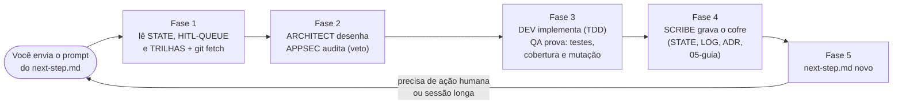

# 04. Como operar a esteira e o cofre

## 1. A esteira em uma figura

O trabalho anda em **sessões**. Cada sessão segue o ciclo de 5 fases do `AGENTS.md` §2, com 6 personas: `[ORCHESTRATOR]`, `[ARCHITECT]`, `[APPSEC]` (com poder de veto), `[DEV]`, `[QA_EVALS]` e `[SCRIBE]`.

**A sua parte, como humano:**
1. Enviar o prompt do `trampo.app/next-step.md` numa sessão nova.
2. Executar os itens da *HITL-QUEUE*, cada um com o seu runbook em `03-infra-runbook/`.
3. Abrir e mergear os PRs (a equipe nunca abre nem mergeia um PR).
4. Responder às decisões que o `[APPSEC]` ou o `[ARCHITECT]` devolvem.

## 2. O papel de cada pasta do cofre (`../base`)

> O cofre **não é versionado em git**. Toda edição começa com um backup no scratchpad da sessão. As notas são LF, com uma exceção: o `ADR-004-extension-auth.md` é CRLF. Por isso as edições por script conferem o fim de linha por bytes. **Nunca** há segredo no cofre.

| Pasta | Conteúdo | Quem escreve |
|---|---|---|
| `00-orquestracao/` | o estado e a governança: *STATE*, *TRILHAS*, *BACKLOG*, *HITL-QUEUE* e *SESSION-LOG* | `[SCRIBE]` e `[ORCHESTRATOR]` |
| `01-requisitos/` | o *ideia_projeto*, o Blueprint v2 do produto. **Somente leitura** (AGENTS §3.1) | ninguém |
| `02-arquitetura/` | os ADRs, o [contratos-zod](../arquitetura/contratos-zod.md) (a §4 se regera por script a partir de `packages/contracts/src`), o [threat-model](../arquitetura/threat-model.md) e as revisões adversariais | `[ARCHITECT]` e `[APPSEC]` |
| `03-infra-runbook/` | o passo a passo das ações humanas: *auth-extensao*, *fixtures-dom*, *llm*, *publicar-branch-pr* e *supabase-hook-real* | `[SCRIBE]` |
| `04-qualidade-evals/` | o *golden-dataset-spec* (`gd1`, 83 casos) e o *spike-metrics* (os números medidos de cada spike) | `[QA_EVALS]` |
| `05-guia-do-projeto/` | **este guia** didático (DOC-02), que se mantém sincronizado com o código pelo cuidado 34 | `[SCRIBE]` |

## 3. Como ler cada arquivo de orquestração

### 3.1 *STATE*: "onde estamos?"

- Tem cerca de 216 KB. O frontmatter guarda a data de `atualizado`. Os campos `fase` e `marco-atual` ficaram na M3, mas o trabalho real está na **Fase 1** (tarefas `F1-*`).
- **Pule** o parágrafo gigante logo abaixo do título: é o histórico comprimido até 2026-10-26.
- Vá ao **último bloco em negrito** antes de `## M1: checkpoints` (procure `**Sessão ` de baixo para cima) e leia o bullet **Próximo**.
- No fim estão os checklists dos marcos (M1, M2, M3 e a Fase 0).

### 3.2 *TRILHAS*: "o que está aberto e que cuidados tomar?"

- A **tabela de trilhas** tem as colunas *Trilha*, *Sessão*, *Gasta cota?* e *Espera*. A regra de ouro: nenhuma trilha gasta cota de LLM nem chama o Supabase real.
- O bloco **O que vem depois** lista as próximas trilhas.
- Os **cuidados permanentes** são uma lista numerada (de 1 a 34). Os gerais vêm primeiro. Do 14 em diante, cada um nasceu de uma sessão e diz que regra seguir e **qual script de mutação rodar de novo** se alguém mexer naquele código. O cuidado 34 manda manter o [03-mapa-completo-de-arquivos](03-mapa-completo-de-arquivos.md) sincronizado.

### 3.3 *BACKLOG*: "quais são as tarefas?"

- Cada tarefa é um título `### <ID>`, no estilo CrewAI: `agent`, `context`, `description`, `expected_output`, `guardrail` (o critério de aceite, ligado a um SR do threat model), `human_input` (o HITL que bloqueia) e **`Status`**. Quando há duas linhas de status, vale a de baixo.
- A legenda: ✅ feito · 🔜 próxima · ⏳ pendente · ⛔ bloqueada por HITL · 🧊 congelada. Na prática também se usa 🟡, para em andamento ou parcial.
- As famílias de ID:

  | Prefixo | Significado |
  |---|---|
  | `M1`–`M3` | marcos |
  | `P0-*` | preparação da Fase 0 |
  | `S-1`–`S-5` | spikes |
  | `F1-<ÉPICO>-NN` | tarefas da Fase 1, com os épicos SEC, DOM, API, LLM, FX, CACHE, DB, EXT, AUTH, PORTAL, EVL, OBS e OPS |
  | `DOC-NN` | documentação |
  | `QA-NN` | qualidade |

### 3.4 *HITL-QUEUE*: "o que só eu posso fazer?"

- Abre com o **índice**, uma tabela com ID, *O quê*, *Bloqueia*, *Prioridade* (🔴 agora, 🟠 antes de X, 🟡 quando puder, 🟢 opcional) e *Status*.
- Cada `## HITL-NNN` traz, nesta ordem: *Bloqueia*, *O que fazer* (aponta o runbook), *Nenhum segredo*, *Decidir* (a opção recomendada vem primeiro), **Como responder** (a frase exata para colar no chat, sem valor sensível) e *Andamento*.
- **Regra de fechamento:** um ciclo de PR (HITL-037) só fecha **pela evidência do GitHub** (`gh pr view <n> --json state,mergeCommit`), nunca pela declaração do prompt. Os dois já divergiram, nos dois sentidos.

### 3.5 *SESSION-LOG*: "o que aconteceu, em detalhe?"

- **Só acréscimo, no fim do arquivo**, em ordem cronológica, apesar de o frontmatter dizer "no topo".
- Uma entrada recente tem os bullets **Sincronização**, **Etapa N** (com o SHA do commit), **Mutação**, **Achado**, **Portão**, **Push**, **Cofre**, **`[APPSEC]`** e **Próximo**.
- Para "por que fizemos X?", procure pelo ID da tarefa ou pelo SHA.

### 3.6 `trampo.app/next-step.md`: "o que eu envio na próxima sessão?"

Tem só três partes: (1) uma linha com a última entrega, (2) as pendências humanas, cada uma apontando para o seu HITL e runbook, e (3) o **próximo prompt**, completo e detalhado.

## 4. Os tipos de teste

Todos os comandos rodam na raiz de `trampo.app`.

| Comando | O que roda | Onde vive | Precisa de | No CI? |
|---|---|---|---|---|
| `pnpm turbo run lint typecheck test --concurrency=1` | ESLint, `tsc` e Vitest com cobertura de todos os pacotes, **em série**. O `test` do portal constrói o Next.js e sobe o `next start` antes | cada `package.json` | nada | sim (jobs `quality` e `test`) |
| `pnpm lint:deps` | o dependency-cruiser: as regras de fronteira entre pastas, como "o domínio não importa infraestrutura" e "o painel não importa `src/auth`" | `package.json` da raiz | nada | sim (`quality`) |
| `pnpm --filter @trampo/api test:db` | os testes contra um **Supabase local de verdade** (Postgres, PostgREST e GoTrue): RLS, privilégios e o hook de 24 h | `apps/api/vitest.db.config.ts` | Docker e `npx supabase@2.120.0 start` | sim (job `db`) |
| `pnpm --filter @trampo/extension test:browser` | o extrator rodando **num navegador real** (Edge por padrão, ou `TRAMPO_E2E_BROWSER`), via `playwright-core` e CDP, contra 26 casos sintéticos de texto oculto e 28 páginas reais anonimizadas | `apps/extension/vitest.browser.config.ts` | Edge ou Chrome instalado | não |
| `pnpm --filter @trampo/extension test:e2e` | a extensão **construída** e carregada no navegador (`Extensions.loadUnpacked` por CDP), com BFF e Supabase falsos em sockets reais: login, captura, envio e painel. A equipe roda **3 rodadas** | `apps/extension/vitest.e2e.config.ts` | Edge ou Chrome instalado | não |
| `pnpm --filter @trampo/evals spike:s1` / `spike:s4` | as medições dos spikes. O S-1 chama provedores de LLM e **gasta cota**: só roda com autorização | `evals/package.json` | variáveis da API (S-1) | não |

**Cobertura:** todo pacote com limiar exige **100%** em instruções, ramos, funções e linhas, cada um sobre a sua lista `include`. No portal, por exemplo, só o `src/server` entra; as rotas e as páginas são cobertas pela integração com o `next start`. O `fast-check` (4.10.2) faz os **testes de propriedade**: em vez de três exemplos escritos à mão, gera milhares de entradas aleatórias para provar regras como "a normalização é idempotente".

## 5. Teste de mutação, explicado

**A pergunta que ele responde:** "se alguém estragar este código, os testes percebem?" Uma cobertura de 100% só prova que cada linha **rodou**, não que alguma asserção **conferiu** o resultado.

**Como funciona:**
1. Um script planta **um defeito pequeno e realista** no código. Isso é um **mutante**. Por exemplo: trocar `<` por `<=`, tirar o `HttpOnly` de um cookie, comparar o `state` só pelo começo, apagar um `revoke`.
2. Roda os testes.
3. Se algum teste falha, o mutante está **morto** (bom: os testes pegaram o defeito). Se todos passam, ele **sobreviveu**, e há um buraco nos testes.
4. O código original volta **pelos bytes guardados**, e o sha256 de cada arquivo é conferido no fim.

**O que acontece com um sobrevivente:** vira um **teste novo** (o caso que faltava) e a rodada se repete, ou é classificado como **equivalente**, com o motivo escrito. Equivalente é um mutante que não muda nada observável. Um exemplo real: o E-03 do portal (tirar a CSP do pedido) é equivalente porque o Next.js 16.4.2 copia para o pedido os cabeçalhos da resposta.

**O portão:** a tarefa só fecha com **0 sobreviventes não equivalentes**. Matar todos os mutantes prova que **cada regra de segurança tem um teste que a defende**: se um dia alguém a remover por engano, o CI fica vermelho.

**Onde ficam os scripts:** os `mut*.py` **não estão no repositório**. Eles ficam no scratchpad de cada sessão (por exemplo `mut_portal01.py`, `mut_db02.py`, `mut04b3.py`) e usam o motor comum `mutlib.py`. O catálogo de cada script está no *SESSION-LOG*, e o *TRILHAS* diz qual rodar de novo para cada arquivo.

**Placares recentes:**

| Script | Resultado |
|---|---|
| `mut_portal01.py` | 61/61 no núcleo e 6/7 na borda (o E-03 é equivalente) |
| `mut_db02.py` | 35/36 (o G-05 é equivalente) |
| `mut04b1.py` | 77/77 |
| `mut_ext07.py` | 38/39 |

**Regras de operação aprendidas com sangue:**
- mutantes de E2E rodam **em primeiro plano**, em **lotes de 3 ou 4**;
- a restauração é por bytes, **nunca** por `git checkout` (com `core.autocrlf=true`, ele regrava o fim de linha);
- a base precisa estar verde antes de mutar;
- no Windows, o `bash` chamado por `subprocess` é o do WSL: use o do Git, pelo caminho completo.

## 6. A esteira do GitHub Actions

O workflow é o `ci` (`.github/workflows/ci.yml`). Ele roda em `push` e `pull_request` para o `master`, com a permissão `contents: read` e nada mais. São **4 jobs** (um teste do `@trampo/ci-policy` trava essa lista):

| Job | O que faz | Por quê |
|---|---|---|
| `secrets` | baixa o **gitleaks 8.30.1**, confere o sha256 e varre **todo o histórico** (`fetch-depth: 0`) com o `.gitleaks.toml` | nenhum segredo entra no git, nem num commit antigo |
| `quality` | `pnpm install --frozen-lockfile`, `turbo run build lint typecheck` e `pnpm lint:deps` | o código compila, segue o lint de segurança e respeita as fronteiras |
| `test` | `turbo run test --concurrency=1` | todos os testes de unidade e integração, com cobertura de 100% |
| `db` | instala a CLI do Supabase 2.120.0 (com o sha256 conferido), gera uma chave ES256 local, sobe a pilha mínima e roda o `test:db` | a RLS, os privilégios e o hook provados contra Postgres e GoTrue de verdade |

**Travas de cadeia de suprimentos:**
- as actions são fixadas por SHA de 40 caracteres (`checkout`, `setup-node`, `pnpm/action-setup` e `supabase/setup-cli`);
- `persist-credentials: false` e nenhum `secrets.*` no workflow;
- no pnpm, `minimumReleaseAge` de 3 dias, `strictDepBuilds`, `blockExoticSubdeps` e `trustPolicy: no-downgrade`.

**Particularidade:** o gitleaks varre o *patch* de cada commit. Por isso, um falso positivo publicado só sai por uma entrada de valor exato na allowlist (ADR-019 D6), nunca por um commit novo. A equipe roda o gitleaks localmente antes de cada push.

**Ciclo de publicação (*HITL-QUEUE §HITL-037*, runbook *publicar-branch-pr*):**
1. Push do `spike/s1-extraction`, sempre depois do `git fetch` e sem *force*. A equipe só faz o push quando o prompt autoriza.
2. **Você** abre o PR para o `master`.
3. Os 4 checks precisam ficar verdes.
4. **Você** mergeia com merge commit, sem apagar o branch.

## 7. Regras de segurança do ambiente (resumo do AGENTS §3)

- O *ideia_projeto* é somente leitura.
- Nenhum segredo no contexto do chat nem no cofre: nunca ler `.env` ou `.env.local` para exibir. Só o `.env.example` tem lugar no repositório.
- Toda entrega técnica termina com o bloco **Análise de Segurança (AppSec)**.
- O fim de linha de cada arquivo é preservado (LF no cofre, CRLF no ADR-004) e conferido por bytes depois de cada edição por script.
